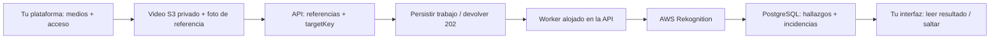

# DeValpo.MediaIntelligence

> Encuentra el momento que importa, sin sacar el catálogo de medios de tu plataforma.

[English](README.md) | **Español**

MediaIntelligence es un **backend cloud-first de búsqueda multimedia** para
integrar descubrimiento de fotos y videos en tu producto. Envía referencias a
archivos privados y un objetivo; recibe resultados estructurados para tu interfaz.

**Ejemplo funcional:** buscar una cara de referencia en un video S3, obtener
sus timestamps y seleccionar una coincidencia para llegar a ese momento.

[](#probar-la-demo-anonimizada)

**[Probar la demo](#probar-la-demo-anonimizada)** · **[Ver el resultado](#qué-devolvió-la-ejecución-real)** · **[Entender la arquitectura](#cloud-first-desde-el-diseño)** · **[Integrar](docs/api.md)**

## Qué Puedes Explorar

- **Un flujo facial en video que funciona:** referencias S3 privadas → trabajo asíncrono → resultados estructurados.
- **Un visor offline:** selecciona un hallazgo guardado y salta al momento, sin credenciales cloud.
- **Un backend por capas:** ASP.NET Core, PostgreSQL y adaptadores AWS/Google con responsabilidades separadas.

Tu aplicación conserva usuarios, permisos y catálogo multimedia. Este repositorio
se concentra en procesar trabajos y devolver hallazgos, no en sustituir tu plataforma.

## Probar La Demo Anonimizada

**Clona el repo y prueba seleccionar → saltar → reproducir. Sin cuenta AWS,
credenciales, API, base de datos ni nuevos procesamientos.** Necesitas Python
3.10+ y un navegador compatible con H.264.

Desde la raíz del repositorio:

```powershell
python scripts/local-viewer/serve.py --video docs/assets/demo/public-demo-media-withheld.mp4 --result docs/assets/demo/public-result.json
```

1. Abre la URL completa que imprime `Visor local:` en la terminal.
2. Selecciona una fila de **Hallazgos** para pausar en su timestamp.
3. Pulsa **Reproducir desde aquí**; usa **Anterior / Siguiente** para recorrer los resultados.
4. Mantén abierta la terminal y detén con **Ctrl+C**. No abras `index.html` directamente.

**Qué es real:** los timestamps y puntuaciones de los 39 registros, extraídos de la respuesta API
exitosa guardada. **Qué se reemplazó:** el video es un sustituto generado,
claramente identificado y con reloj — no es el material analizado ni demuestra
precisión visual de identidad. El JSON público es una versión mínima derivada,
no la exportación API intacta. No contiene nombres originales de archivos,
IDs de trabajos/clientes/caras, fotos de referencia ni rutas cloud. La vista de
arriba es una ilustración. No se incluye ningún fotograma ni audio original.
La demo muestra navegación, no verificación visual de una persona.

### Usar Tus Medios Autorizados

El mismo visor abre medios locales originales y resultados guardados:

```powershell
python scripts/local-viewer/serve.py --videos-dir "<carpeta-local-de-videos>" --result "<resultado-api-guardado.json>" --result "<comparativa-guardada.json>"
```

Repite `--result` para añadir exportaciones. La galería privada de tres videos
conserva 39 registros para la copia H.264 de 1:12, 18 para el video corto H.264
y un resumen separado de cero coincidencias con incidencias para el otro video
corto. Los medios privados no se distribuyen con el repo.

El servidor escucha solo en loopback y lee sin modificar archivos. Si una
búsqueda completada no encuentra coincidencias, devuelve una colección vacía;
las incidencias permanecen visibles y un JSON faltante **no** se presenta como cero hallazgos.
[Formatos y uso del visor](scripts/local-viewer/README.md)

## Qué Devolvió La Ejecución Real

El **2026-11-09** se ejecutó una búsqueda facial autorizada en S3 con una foto de
referencia y un **video H.264 de 72,072 segundos**, usando la API existente.

| Resultado | Valor observado |
| --- | ---: |
| Estado | `Completed` |
| Registros coincidentes | **39** |
| Timestamps distintos | **32** |
| Primera / última coincidencia | **6,506 s / 71,871 s** |
| Umbral de similitud | **80 / 100** |
| Similitud devuelta | **81,23–99,99 / 100** |
| Incidencias reportadas | **0** |

Son registros devueltos, no 39 personas distintas ni identidades verificadas.
Se conservan los timestamps repetidos; la similitud no es un porcentaje de precisión.
La ejecución exitosa usó una copia H.264 después del rechazo del original HEVC
por AWS. Los medios originales y las respuestas brutas permanecen privados.

[La evidencia y su procedencia](docs/examples/video-result-evidence.md) también
conservan el otro resultado AWS y el registro histórico Google. El JSON original
Google sigue sin recuperarse y no forma parte de esta demo reproducible.

## Cloud-First Desde El Diseño

**Envía referencias a objetos, no archivos grandes a través de la API de tu aplicación.**
La plataforma externa administra buckets privados y enlaces de subida/reproducción.
MediaIntelligence recibe `assetSelectorJson` y, para caras de referencia,
`referenceAssetSelectorJson`: campos de bucket/objeto, no URLs públicas ni prefirmadas.



| Capa | Responsabilidad |
| --- | --- |
| `Api` | HTTP, autenticación, estado/resultados y workers |
| `Application` | Casos de uso y orquestación independiente del proveedor |
| `Domain` | Entidades y estado de trabajos |
| `Contracts` | DTO públicos, sin tipos de SDK cloud ni EF |
| `Infrastructure` | Adaptadores AWS/Google, almacenamiento y PostgreSQL |

Esta separación de estilo Clean Architecture ofrece puntos claros para añadir
proveedores y consumidores. Los trabajos persistidos separan la aceptación de
la solicitud de su procesamiento. Las referencias S3/GCS evitan reenviar los
originales en cada petición; se usa staging cuando lo exige el proveedor.

**Extensible no significa autoescalado ya implementado:** los workers hoy se
alojan con la API. Coordinación distribuida, workers separados y autoescalado
son evoluciones operativas, no capacidades demostradas. Hay allowlists de
buckets; no debe asumirse aislamiento completo por cliente/prefijo.
La limpieza de FaceId temporales es independiente del ciclo de vida de los
archivos. La colección del piloto terminó con cero caras almacenadas.

[Arquitectura](docs/architecture.md) · [Referencias cloud](docs/cloud-asset-references-and-staging.md)

## Capacidades Existentes Y Alcance Real

| Capacidad | Integración | Resultado |
| --- | --- | --- |
| Cara de referencia en video — primer piloto | AWS Rekognition | Timestamps coincidentes y similitud |
| Cara de referencia en fotos | Búsqueda por lotes AWS Rekognition | Imágenes agrupadas por `targetKey` |
| Números visibles en videos | Google Video Intelligence | Rangos temporales coincidentes |
| Caras genéricas en videos | Google Video Intelligence | Ocurrencias, no reconocimiento de identidad |
| Números visibles en fotos | Google Vision OCR / AWS Rekognition | Imágenes agrupadas por objetivo |
| Documentos | Google Document AI | Análisis estructurado |

Estas integraciones existen en código; la demo demuestra el **recorrido facial
AWS en video**, no una validación nueva de todos los proveedores. La búsqueda
de fotos por dorsal sigue como próxima experiencia. Las consultas generales
de palabras y códigos alfanuméricos están previstas, no implementadas.
No se afirma un frontend productivo, SLA de precisión ni capacidad de carga medida.

## Cómo Integrarlo

El backend recibe una foto de referencia autorizada y videos compatibles en S3
privado, y devuelve hallazgos para mostrarlos en tu aplicación.

1. Configura credenciales externas, recursos AWS y el bucket S3 permitido.
2. Envía `POST /api/v1/face-search-jobs` con cliente/perfil autorizado,
   selectores cloud y un manifiesto con valores opacos de `targetKey`.
3. Consulta `GET /api/v1/face-search-jobs/{jobId}` y recupera su `/result`.
4. Muestra los timestamps e inspecciona `issues`, no solo el estado del trabajo.

El endpoint de búsqueda no crea el bucket origen ni emite enlaces de subida.
Multipart sigue disponible para desarrollo y compatibilidad.

[Contratos API](docs/api.md) · [Configurar AWS](docs/aws-rekognition-face-search.md) ·
[Levantar el backend](docs/getting-started.md) · [Seguridad](docs/security.md)

## Mapa Del Repositorio

- `src/` — backend por capas; `tests/` — comprobaciones automatizadas.
- `scripts/local-viewer/` — visor offline; `docs/assets/demo/` — solo muestra anonimizada.
- `deploy/` — Compose y configuración de ejemplo; `docs/` — referencias de integración y operación.
- [AGENTS.md](AGENTS.md) y [contexto IA](docs/context/AI_ONBOARDING.md) — instrucciones operativas para colaboradores e IA.

Mantén originales, credenciales y respuestas biométricas brutas fuera de Git.
`outputs/private/` está ignorado para trabajo local, no para distribución.
