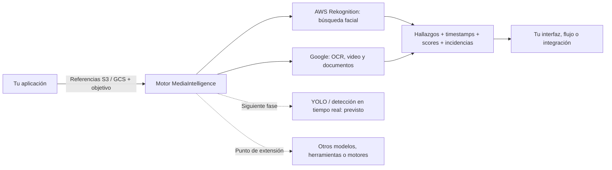
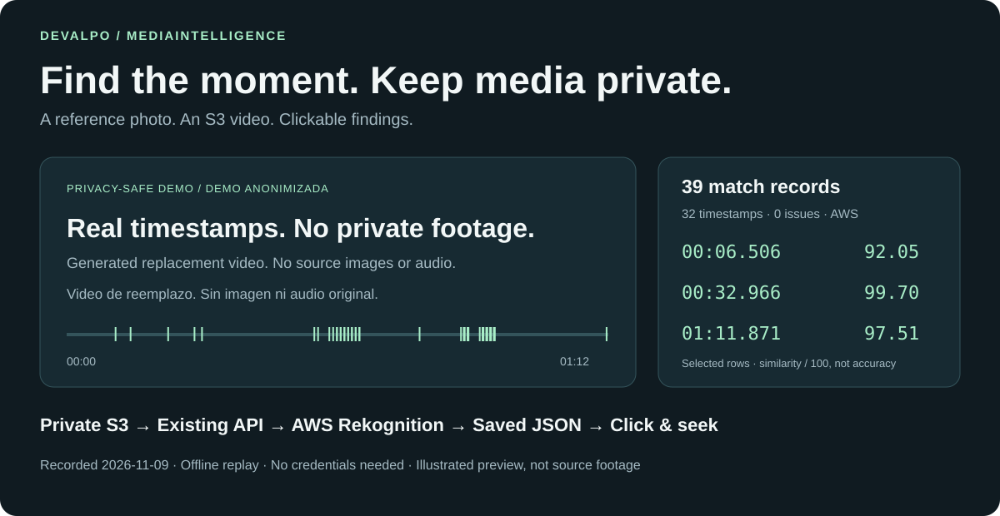
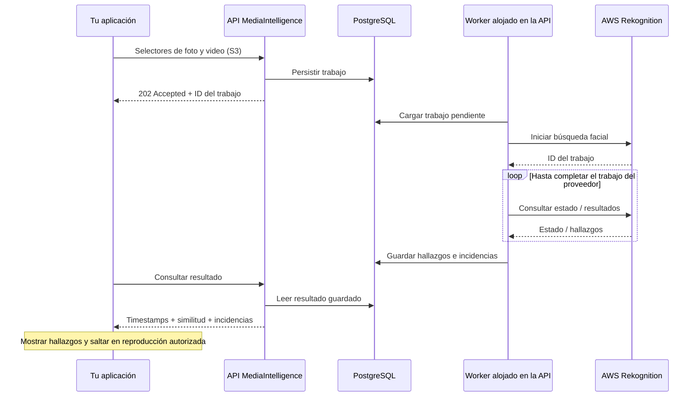

# DeValpo.MediaIntelligence

> **Motor cloud-first de análisis y búsqueda multimedia desarrollado con ASP.NET Core, PostgreSQL y adaptadores AWS/Google.**

[English](README.md) | **Español**

**Fotos, videos y documentos privados → AWS / Google → resultados estructurados para tu aplicación.**
MediaIntelligence es un backend que orquesta análisis documental, búsqueda de
imágenes y búsqueda en videos mediante servicios externos de IA. Las aplicaciones
envían trabajos autenticados con referencias estructuradas a objetos privados
S3/GCS y parámetros del caso de uso; los workers alojados procesan esos trabajos
de forma asíncrona, convierten las respuestas de los proveedores a modelos internos
y persisten estado, hallazgos e incidencias en PostgreSQL.

Cloud-first significa que la entrada habitual de producción son referencias al
almacenamiento, en lugar de volver a subir los mismos medios por la API de la
aplicación en cada solicitud. Se utiliza staging cuando el proveedor lo requiere.
Tu aplicación conserva catálogo y reglas de acceso, y consume los resultados
mediante endpoints HTTP. El visor incluido consume resultados guardados de forma
offline; no es un frontend obligatorio.



**El motor orquesta; los adaptadores resuelven el comportamiento de cada proveedor.**
Las interfaces de Application separan los casos de uso de los SDK en Infrastructure;
los DTO públicos no exponen tipos de los proveedores ni de EF Core. AWS Rekognition
aporta búsqueda por cara de referencia; Google Vision, Video Intelligence y
Document AI cubren OCR, análisis de video y procesamiento documental. No son
capacidades intercambiables de reconocimiento de identidad.

### Extensibilidad Y Siguiente Fase

**El motor no está limitado a AWS ni a Google.** Su arquitectura basada en
adaptadores ofrece puntos de integración para otros modelos, herramientas y
motores de procesamiento, incluidos servicios propios o autoalojados. Cada
integración implementa las interfaces correspondientes y convierte sus resultados
a los modelos de la aplicación; las capacidades nuevas pueden requerir también
casos de uso o contratos nuevos. Es extensibilidad mediante código, no compatibilidad
automática plug-and-play con cualquier motor.

**Siguiente fase: integrar YOLO para detección de objetos, con el procesamiento
en tiempo real como dirección prevista.** Se incorporarán el adaptador y la
orquestación de streaming correspondientes, manteniendo la separación entre
proveedores y lógica de aplicación. Es trabajo previsto, no implementado:
el motor actual procesa trabajos enviados, no transmisiones en vivo.

**[Probar la demo](#probar-la-demo-anonimizada)** · **[Ver el resultado](#qué-devolvió-la-ejecución-real)** · **[Seguir la arquitectura](#cloud-first-desde-el-diseño)** · **[Integrar](docs/api.md)**

## Qué Obtienes

**Ejemplo funcional: foto de referencia + video privado S3 → momentos coincidentes → clic para saltar.**
El piloto AWS guardado devolvió **39 registros en 32 timestamps distintos**, con
**0 incidencias reportadas**, sobre un **video de 72 segundos**.

| Entrada | Salida del motor | Qué puede hacer tu aplicación |
| --- | --- | --- |
| Cara de referencia + video S3 | Timestamps y scores de similitud | Saltar a los momentos coincidentes |
| Número visible + fotos o video | Imágenes o rangos temporales coincidentes | Filtrar una galería o destacar un fragmento |
| Documento + perfil de análisis | Análisis estructurado del documento | Alimentar otro flujo de trabajo |

### Entrada → Salida: Búsqueda Facial En Video

**Entrada:** un video privado, una foto de referencia autorizada y un umbral
de similitud de 80. Los buckets, rutas e identificadores siguientes son ejemplos,
no la solicitud original del piloto ni credenciales publicadas.

`POST /api/v1/face-search-jobs` recibe **multipart/form-data** autenticado.
Para facilitar la lectura, los campos del formulario se muestran juntos como
JSON. Serializa `manifestJson`, `assetSelectorJson` y
`referenceAssetSelectorJson` por separado como cadenas JSON en sus respectivos
campos; **no envíes este objeto completo como un cuerpo application/json**.
El flujo por referencias cloud no necesita adjuntar los archivos multimedia.

```json
{
  "clientKey": "<authorized-client-key>",
  "profileKey": "event-face-search-v1",
  "manifestJson": {
    "minSimilarity": 80,
    "targets": [
      {
        "targetKey": "subject-001",
        "referenceImageKey": "reference-001"
      }
    ]
  },
  "assetSelectorJson": {
    "selectorMode": "ExplicitAssets",
    "storageProvider": "S3",
    "bucketName": "<private-video-bucket>",
    "region": "<aws-region>",
    "assets": [
      {
        "assetKey": "video-001",
        "objectKey": "demo/source-video.mp4",
        "contentType": "video/mp4"
      }
    ]
  },
  "referenceAssetSelectorJson": {
    "selectorMode": "ExplicitAssets",
    "storageProvider": "S3",
    "bucketName": "<private-reference-bucket>",
    "region": "<aws-region>",
    "assets": [
      {
        "assetKey": "reference-001",
        "objectKey": "demo/reference-photo.jpg",
        "contentType": "image/jpeg"
      }
    ]
  }
}
```

**Salida:** al completar el trabajo, consulta
`GET /api/v1/face-search-jobs/{jobId}/result`. Aquí se muestran los **primeros tres
de 39 registros reales** del resultado anonimizado, junto con `status` e `issues`.
Es un resultado abreviado y anonimizado, no la respuesta API completa: se omiten
identificadores de trabajo/cliente, objetivo/referencia y fechas de creación/finalización;
el nombre original del video se sustituye por el nombre usado en la demo.

```json
{
  "status": "Completed",
  "issues": [],
  "faceMatches": [
    {
      "videoFileName": "public-demo-media-withheld.mp4",
      "startTimeSeconds": 6.506,
      "endTimeSeconds": 6.506,
      "similarity": 92.05,
      "sourceProvider": "AwsRekognition"
    },
    {
      "videoFileName": "public-demo-media-withheld.mp4",
      "startTimeSeconds": 8.508,
      "endTimeSeconds": 8.508,
      "similarity": 93.4,
      "sourceProvider": "AwsRekognition"
    },
    {
      "videoFileName": "public-demo-media-withheld.mp4",
      "startTimeSeconds": 13.513,
      "endTimeSeconds": 13.513,
      "similarity": 87.87,
      "sourceProvider": "AwsRekognition"
    }
  ]
}
```

**Cómo leerlo:** la cara de referencia produjo un candidato en el segundo
**6,506**, con un score de similitud de **92,05 / 100**; seleccionar ese hallazgo
permite saltar a ese momento. Inicio y fin iguales representan una ocurrencia
puntual, no la duración de un fragmento. La similitud no es un porcentaje de
precisión medida. Un array `faceMatches` vacío indica ausencia de hallazgos;
revisa siempre `issues` por separado.

[Ver los 39 registros completos en JSON](docs/assets/demo/public-result.json) ·
[Contrato completo de la API](docs/aws-rekognition-face-search.md#contrato-implementado)

[](#probar-la-demo-anonimizada)

**Qué esperar de la demo:** ver 39 registros guardados, seleccionar el primero y
saltar al segundo **6,506**; después reproducir o avanzar al siguiente hallazgo.
El video es un sustituto generado e identificado; los tiempos y scores son reales.
No se publican fotogramas ni audio originales.

## Probar La Demo Anonimizada

**Clona el repo y prueba seleccionar → saltar → reproducir. Sin cuenta AWS,
credenciales, API, base de datos ni nuevos procesamientos.** Necesitas Python
3.10+ y un navegador compatible con H.264.

Desde la raíz del repositorio:

```powershell
python scripts/local-viewer/serve.py --video docs/assets/demo/public-demo-media-withheld.mp4 --result docs/assets/demo/public-result.json
```

1. Abre la URL completa que imprime `Visor local:` en la terminal.
2. Selecciona una fila de **Hallazgos** para pausar en su timestamp.
3. Pulsa **Reproducir desde aquí**; usa **Anterior / Siguiente** para recorrer los resultados.
4. Mantén abierta la terminal y detén con **Ctrl+C**. No abras `index.html` directamente.

**Qué es real:** los timestamps y puntuaciones de los 39 registros, extraídos de la respuesta API
exitosa guardada. **Qué se reemplazó:** el video es un sustituto generado,
claramente identificado y con reloj — no es el material analizado ni demuestra
precisión visual de identidad. El JSON público es una versión mínima derivada,
no la exportación API intacta. No contiene nombres originales de archivos,
IDs de trabajos/clientes/caras, fotos de referencia ni rutas cloud. La vista de
arriba es una ilustración. No se incluye ningún fotograma ni audio original.
La demo muestra navegación, no verificación visual de una persona.

### Usar Tus Medios Autorizados

El mismo visor abre medios locales originales y resultados guardados:

```powershell
python scripts/local-viewer/serve.py --videos-dir "<carpeta-local-de-videos>" --result "<resultado-api-guardado.json>" --result "<comparativa-guardada.json>"
```

Repite `--result` para añadir exportaciones. La galería privada de tres videos
conserva 39 registros para la copia H.264 de 1:12, 18 para el video corto H.264
y un resumen separado de cero coincidencias con incidencias para el otro video
corto. Los medios privados no se distribuyen con el repo.

El servidor escucha solo en loopback y lee sin modificar archivos. Si una
búsqueda completada no encuentra coincidencias, devuelve una colección vacía;
las incidencias permanecen visibles y un JSON faltante **no** se presenta como cero hallazgos.
[Formatos y uso del visor](scripts/local-viewer/README.md)

## Qué Devolvió La Ejecución Real

El **2026-11-09** se ejecutó una búsqueda facial autorizada en S3 con una foto de
referencia y un **video H.264 de 72,072 segundos**, usando la API existente.

| Resultado | Valor observado |
| --- | ---: |
| Estado | `Completed` |
| Registros coincidentes | **39** |
| Timestamps distintos | **32** |
| Primera / última coincidencia | **6,506 s / 71,871 s** |
| Umbral de similitud | **80 / 100** |
| Similitud devuelta | **81,23–99,99 / 100** |
| Incidencias reportadas | **0** |

Son registros devueltos, no 39 personas distintas ni identidades verificadas.
Se conservan los timestamps repetidos; la similitud no es un porcentaje de precisión.
La ejecución exitosa usó una copia H.264 después del rechazo del original HEVC
por AWS. Los medios originales y las respuestas brutas permanecen privados.

[La evidencia y su procedencia](docs/examples/video-result-evidence.md) también
conservan el otro resultado AWS y el registro histórico Google. El JSON original
Google sigue sin recuperarse y no forma parte de esta demo reproducible.

## Cloud-First Desde El Diseño

**Envía referencias a objetos, no archivos grandes a través de la API de tu aplicación.**
La plataforma externa administra buckets privados y enlaces de subida/reproducción.
MediaIntelligence recibe `assetSelectorJson` y, para caras de referencia,
`referenceAssetSelectorJson`: campos de bucket/objeto, no URLs públicas ni prefirmadas.



| Capa | Responsabilidad |
| --- | --- |
| `Api` | HTTP, autenticación, estado/resultados y workers |
| `Application` | Casos de uso y orquestación independiente del proveedor |
| `Domain` | Entidades y estado de trabajos |
| `Contracts` | DTO públicos, sin tipos de SDK cloud ni EF |
| `Infrastructure` | Adaptadores AWS/Google, almacenamiento y PostgreSQL |

Esta separación de estilo Clean Architecture ofrece puntos claros para añadir
proveedores y consumidores. Los trabajos persistidos separan la aceptación de
la solicitud de su procesamiento. Las referencias S3/GCS evitan reenviar los
originales en cada petición; se usa staging cuando lo exige el proveedor.

**Extensible no significa autoescalado ya implementado:** los workers hoy se
alojan con la API. Coordinación distribuida, workers separados y autoescalado
son evoluciones operativas, no capacidades demostradas. Hay allowlists de
buckets; no debe asumirse aislamiento completo por cliente/prefijo.
La limpieza de FaceId temporales es independiente del ciclo de vida de los
archivos. La colección del piloto terminó con cero caras almacenadas.

[Arquitectura](docs/architecture.md) · [Referencias cloud](docs/cloud-asset-references-and-staging.md)

## Capacidades Existentes Y Alcance Real

| Capacidad | Integración | Resultado |
| --- | --- | --- |
| Cara de referencia en video — primer piloto | AWS Rekognition | Timestamps coincidentes y similitud |
| Cara de referencia en fotos | Búsqueda por lotes AWS Rekognition | Imágenes agrupadas por `targetKey` |
| Números visibles en videos | Google Video Intelligence | Rangos temporales coincidentes |
| Caras genéricas en videos | Google Video Intelligence | Ocurrencias, no reconocimiento de identidad |
| Números visibles en fotos | Google Vision OCR / AWS Rekognition | Imágenes agrupadas por objetivo |
| Documentos | Google Document AI | Análisis estructurado |

Estas integraciones existen en código; la demo demuestra el **recorrido facial
AWS en video**, no una validación nueva de todos los proveedores. La búsqueda
de fotos por dorsal queda como una experiencia posterior. Las consultas generales
de palabras y códigos alfanuméricos están previstas, no implementadas.
No se afirma un frontend productivo, SLA de precisión ni capacidad de carga medida.

## Cómo Integrarlo

El backend recibe una foto de referencia autorizada y videos compatibles en S3
privado, y devuelve hallazgos para mostrarlos en tu aplicación.

1. Configura credenciales externas, recursos AWS y el bucket S3 permitido.
2. Envía `POST /api/v1/face-search-jobs` con cliente/perfil autorizado,
   selectores cloud y un manifiesto con valores opacos de `targetKey`.
3. Consulta `GET /api/v1/face-search-jobs/{jobId}` y recupera su `/result`.
4. Muestra los timestamps e inspecciona `issues`, no solo el estado del trabajo.

El endpoint de búsqueda no crea el bucket origen ni emite enlaces de subida.
Multipart sigue disponible para desarrollo y compatibilidad.

[Contratos API](docs/api.md) · [Configurar AWS](docs/aws-rekognition-face-search.md) ·
[Levantar el backend](docs/getting-started.md) · [Seguridad](docs/security.md)

## Mapa Del Repositorio

- `src/` — backend por capas; `tests/` — comprobaciones automatizadas.
- `scripts/local-viewer/` — visor offline; `docs/assets/demo/` — solo muestra anonimizada.
- `deploy/` — Compose y configuración de ejemplo; `docs/` — referencias de integración y operación.
- [AGENTS.md](AGENTS.md) y [contexto IA](docs/context/AI_ONBOARDING.md) — instrucciones operativas para colaboradores e IA.

Mantén originales, credenciales y respuestas biométricas brutas fuera de Git.
`outputs/private/` está ignorado para trabajo local, no para distribución.
