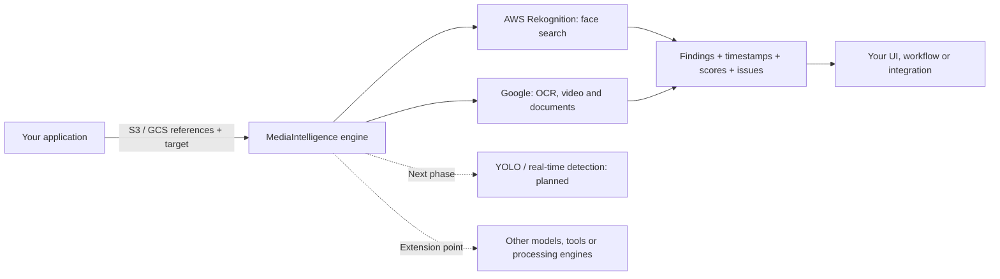
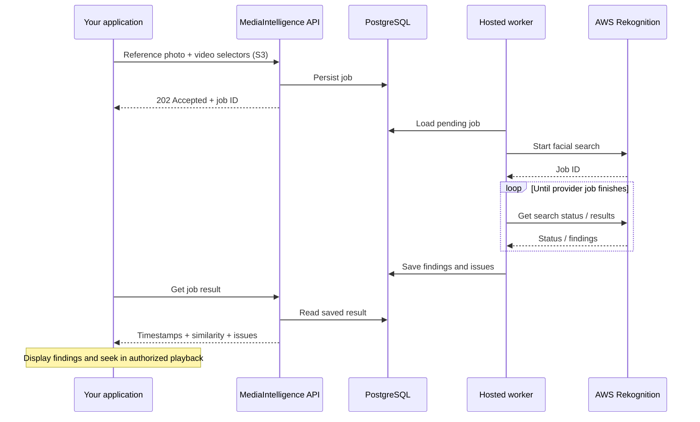

# DeValpo.MediaIntelligence

> **Cloud-first media analysis and search engine built with ASP.NET Core, PostgreSQL and AWS/Google adapters.**

**English** | [Español](README.es.md)

**Private photos, videos and documents → AWS / Google → structured results for your application.**
MediaIntelligence is a backend that orchestrates document analysis, image search
and video search through external AI services. Applications submit authenticated
jobs with structured references to private S3/GCS objects and use-case parameters;
hosted workers process them asynchronously, map provider responses to internal
models and persist job state, findings and processing issues in PostgreSQL.

Cloud-first means storage references are the normal production input, rather
than uploading the same media through the application API for each request.
Provider-specific staging is used when needed. Your application retains its media
catalog and access rules, and consumes results through HTTP endpoints. The bundled
viewer is an offline consumer of saved results, not a required frontend.



**The engine owns orchestration; adapters own provider-specific behavior.**
Application interfaces separate use cases from the SDKs in Infrastructure;
public DTOs do not expose provider SDK or EF Core types. AWS Rekognition supplies
reference-face search, while Google Vision, Video Intelligence and Document AI
cover OCR, video analysis and document processing. These capabilities are not
interchangeable identity-recognition services.

### Extensibility And Next Phase

**The engine is not limited to AWS or Google.** Its adapter-based architecture
provides integration points for additional models, tools and processing engines,
including custom or self-hosted services. Each integration implements the relevant
interfaces and maps its output to the application's models; new capabilities may
also require new use cases or contracts. This is extensibility through code,
not automatic plug-and-play compatibility with every engine.

**Next phase: integrate YOLO for object detection, with real-time processing as
the intended direction.** This work will add the appropriate adapter and streaming
orchestration while preserving the separation between providers and application
logic. It is planned, not implemented: the current engine processes submitted
jobs, not live streams.

**[Try the demo](#try-the-privacy-safe-demo)** · **[See the result](#what-the-real-run-returned)** · **[Follow the architecture](#cloud-first-by-design)** · **[Integrate](docs/api.en.md)**

## What You Get

**Working example: reference photo + private S3 video → matching moments → click to seek.**
The saved AWS pilot returned **39 match records at 32 distinct timestamps**, with
**0 reported issues**, from a **72-second video**.

| Input | Engine output | What your app can do |
| --- | --- | --- |
| Reference face + S3 video | Timestamps and similarity scores | Jump to matching moments |
| Visible-number target + photos or video | Matching images or time ranges | Filter a gallery or highlight a clip |
| Document + analysis profile | Structured document analysis | Feed a downstream workflow |

A concrete finding from the [public, sanitized result](docs/assets/demo/public-result.json):

```json
{
  "videoFileName": "public-demo-media-withheld.mp4",
  "startTimeSeconds": 6.506,
  "endTimeSeconds": 6.506,
  "similarity": 92.05,
  "sourceProvider": "AwsRekognition"
}
```

This is one saved match, not a complete API response. A successful search with no
findings returns an empty collection; errors remain separate. Similarity is a
provider score, not a measured accuracy percentage.

[](#try-the-privacy-safe-demo)

**Expected demo experience:** see 39 saved records, click the first finding and
jump to **6.506 seconds**, then play or move to the next finding. The video is a
labeled generated substitute; the times and scores are real. No original frames
or audio are published.

## Try The Privacy-Safe Demo

**Clone the repo and try click → seek → playback. No AWS account, credentials,
API, database or new processing required.** Requires Python 3.10+ and an H.264-capable browser.

Run from the repository root:

```powershell
python scripts/local-viewer/serve.py --video docs/assets/demo/public-demo-media-withheld.mp4 --result docs/assets/demo/public-result.json
```

1. Open the complete `Visor local:` URL printed in the terminal.
2. Select a row under **Hallazgos** to pause at its timestamp.
3. Choose **Reproducir desde aquí** to play from that point; **Anterior / Siguiente** move between findings.
4. Leave the terminal running; stop it with **Ctrl+C**. Do not open `index.html` directly.

**What is real:** the timestamps and similarity scores for all 39 records, extracted from the
saved successful API response. **What is replaced:** the video is a generated,
explicitly labeled privacy placeholder with a running clock — not the analyzed
footage and not evidence of visual identity accuracy. The public JSON is a
minimal derivative, not an untouched API export. It contains no original filenames,
job/client/face IDs, reference images or cloud paths. The preview above is an illustration.
No original video frames or audio are included. The demo demonstrates navigation,
not visual verification of a person.

### Use Your Own Authorized Media

The same viewer also opens original local media and saved results:

```powershell
python scripts/local-viewer/serve.py --videos-dir "<local-video-folder>" --result "<saved-api-result.json>" --result "<saved-comparison.json>"
```

Repeat `--result` for additional exports. The private three-video gallery retains
39 records for the 1:12 H.264 copy, 18 for the short H.264 video, and a separate
zero-match summary with issues for the other short video. Private assets are not bundled.

The server is loopback-only and read-only. A completed search with no findings
returns an empty collection; processing issues remain visible, and a missing
export is **not** presented as zero matches.
[Viewer formats and usage](scripts/local-viewer/README.md)

## What The Real Run Returned

An authorized S3 facial-search run on **2026-11-09** used a reference photo and
a **72.072-second H.264 video** through the existing API.

| Result | Observed value |
| --- | ---: |
| Job state | `Completed` |
| Match records | **39** |
| Distinct timestamps | **32** |
| First / last finding | **6.506 s / 71.871 s** |
| Similarity threshold | **80 / 100** |
| Returned similarity | **81.23–99.99 / 100** |
| Reported issues | **0** |

These are returned match records, not 39 different people or verified identities.
Repeated timestamps are preserved; similarity is not a measured accuracy percentage.
The successful run used an H.264 copy after AWS rejected the original HEVC
format. The original media and raw responses remain private.

[Evidence and provenance](docs/examples/video-result-evidence.en.md) also documents
the other saved AWS result and the historical Google record. The original Google
JSON remains unavailable and is not part of this playable demo.

## Cloud-First By Design

**Bring object references, not large uploads through your application API.**
The external platform owns private buckets and upload/playback links.
MediaIntelligence accepts `assetSelectorJson` and, for reference-face workflows,
`referenceAssetSelectorJson`: structured bucket/object references, not public or presigned URLs.



| Boundary | Responsibility |
| --- | --- |
| `Api` | HTTP, authentication, status/results and hosted workers |
| `Application` | Use cases and provider-neutral orchestration |
| `Domain` | Core entities and job state |
| `Contracts` | Public DTOs, without provider SDK or EF types |
| `Infrastructure` | AWS/Google adapters, storage and PostgreSQL |

This Clean Architecture-style separation gives new providers and consumers a
clear integration point. Persisted jobs decouple request acceptance from processing.
S3/GCS references avoid forwarding the original bytes in each submission;
provider-specific staging is used when necessary.

**Ready to extend does not mean already autoscaled:** workers currently run with
the API. Distributed coordination, separate workers and autoscaling are future
operating choices, not demonstrated features. Bucket allowlists are implemented;
complete per-client/prefix isolation must not be assumed.
Temporary Rekognition face IDs have a separate cleanup path; file retention
belongs to bucket lifecycle. The pilot collection returned to zero stored faces.

[Architecture](docs/architecture.en.md) · [Cloud references](docs/cloud-asset-references-and-staging.en.md)

## Existing Capabilities, Honest Scope

| Capability | Integration | Output |
| --- | --- | --- |
| Reference face in video — first pilot | AWS Rekognition | Matching timestamps and similarity |
| Reference face in photos | AWS Rekognition image-batch search | Matching images grouped by `targetKey` |
| Visible numbers in videos | Google Video Intelligence | Matching time ranges |
| Generic faces in videos | Google Video Intelligence | Face occurrences, not identity recognition |
| Visible numbers in photos | Google Vision OCR / AWS Rekognition | Matching images grouped by target |
| Documents | Google Document AI | Structured document analysis |

These integrations exist in code; this demo demonstrates the **AWS facial-video
journey**, not a new validation of every provider. Bib-photo retrieval is the
a later product slice. General word and alphanumeric-code queries are planned,
not implemented query types. No production frontend, accuracy SLA or load capacity is claimed.

## How To Integrate

The backend accepts an authorized reference photo and compatible private S3
videos, then returns findings for your application to display.

1. Configure external credentials, AWS resources and the permitted S3 bucket.
2. Submit `POST /api/v1/face-search-jobs` with an authorized client/profile,
   cloud selectors and a manifest using opaque `targetKey` values.
3. Poll `GET /api/v1/face-search-jobs/{jobId}` and retrieve its `/result`.
4. Display returned timestamps and inspect `issues`, not only the job state.

The search endpoint does not create your source bucket or issue upload links.
Multipart remains available for development and compatibility.

[API contracts](docs/api.en.md) · [AWS setup](docs/aws-rekognition-face-search.en.md) ·
[Local backend setup](docs/getting-started.en.md) · [Security](docs/security.en.md)

## Repository Guide

- `src/` — layered backend; `tests/` — automated checks.
- `scripts/local-viewer/` — offline viewer; `docs/assets/demo/` — privacy-safe sample only.
- `deploy/` — Compose and configuration examples; `docs/` — integration and operational references.
- [AGENTS.md](AGENTS.md) and [AI onboarding](docs/context/AI_ONBOARDING.md) — operational context for contributors and AI.

Keep originals, credentials and raw biometric responses outside Git. The ignored
`outputs/private/` workspace is for local-only artifacts, not distribution.
