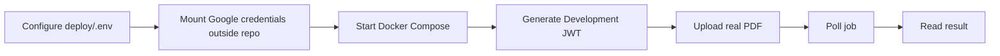

# DeValpo.MediaIntelligence

> Reusable multi-client document and media intelligence engine.

[](https://github.com/lokomurdok89/DeValpo.MediaIntelligence/actions/workflows/ci.yml)
[](https://github.com/lokomurdok89/DeValpo.MediaIntelligence/actions/workflows/docs.yml)

DeValpo.MediaIntelligence exposes a secure API for real document ingestion, Google Document AI analysis, persisted jobs, human review, client webhooks and operational diagnostics.

## Open The Documentation

GitHub Pages is not currently published for this repository because it is private and the active GitHub plan does not support Pages for this repo. Use the GitHub-rendered docs or run the MkDocs preview locally.

| I want to... | Open this |
| --- | --- |
| Start from the documentation home | [docs/index.md](docs/index.md) |
| Run the product locally | [docs/getting-started.md](docs/getting-started.md) |
| Generate Google credentials and tokens | [docs/local-tokens-and-google-secrets.md](docs/local-tokens-and-google-secrets.md) |
| Implement the application end-to-end | [docs/implementation-guide.md](docs/implementation-guide.md) |
| See endpoint flows and sequence diagrams | [docs/api-endpoint-flows.md](docs/api-endpoint-flows.md) |
| Understand the API | [docs/api.md](docs/api.md) |
| Review architecture and components | [docs/architecture.md](docs/architecture.md) |
| Review security, JWT and secrets | [docs/security.md](docs/security.md) |
| Operate Docker, readiness and runbooks | [docs/operations.md](docs/operations.md) |
| Follow QA and product certification | [docs/qa.md](docs/qa.md) |
| See the product roadmap | [docs/roadmap.md](docs/roadmap.md) |

## Local Documentation Preview

Run the real tabbed documentation site locally:

```powershell
pip install -r requirements-docs.txt
python -m mkdocs serve
```

Then open:

```text
http://127.0.0.1:8000/DeValpo.MediaIntelligence/
```

Build validation:

```powershell
python -m mkdocs build --strict
```

## Quick Start

```powershell
dotnet restore DeValpo.MediaIntelligence.sln
dotnet build DeValpo.MediaIntelligence.sln
dotnet test DeValpo.MediaIntelligence.sln
docker compose -f deploy\docker-compose.yml up --build
```

The local API listens on:

```text
http://localhost:8085
```

## Main Real Flow



Google CLI, ADC credential generation and Document AI validation are documented in [docs/local-tokens-and-google-secrets.md](docs/local-tokens-and-google-secrets.md).

## Repository Map

| Path | Purpose |
| --- | --- |
| `src/DeValpo.MediaIntelligence.Api` | ASP.NET Core API, Swagger, auth and health endpoints. |
| `src/DeValpo.MediaIntelligence.Application` | Use cases, orchestration and application abstractions. |
| `src/DeValpo.MediaIntelligence.Infrastructure` | EF Core, PostgreSQL, storage, Google Document AI and workers. |
| `src/DeValpo.MediaIntelligence.Contracts` | Public DTOs and API contracts. |
| `src/DeValpo.MediaIntelligence.Domain` | Domain entities and persistence model. |
| `deploy` | Docker Compose and environment examples. |
| `docs` | MkDocs documentation source. |
| `tests` | Unit and API tests. |

## GitHub Pages

The docs workflow builds the MkDocs site and uploads a `mkdocs-site` artifact. Public Pages deploy is intentionally gated by:

```text
DEPLOY_GITHUB_PAGES=true
```

To make the public Pages URL work, the repository must either be public or use a GitHub plan that supports Pages for private repositories. After that:

1. Go to `Settings -> Pages`.
2. Set source to `GitHub Actions`.
3. Create repository variable `DEPLOY_GITHUB_PAGES=true`.
4. Re-run the `Docs` workflow.

## Safety

Never commit:

- `deploy/.env`
- `secrets/*.json`
- Google credential files
- raw API keys
- JWT signing keys
- webhook signing secrets

Run the secret scan before pushing:

```powershell
powershell -NoProfile -ExecutionPolicy Bypass -File scripts\ci\secret-scan.ps1 -Root .
```
