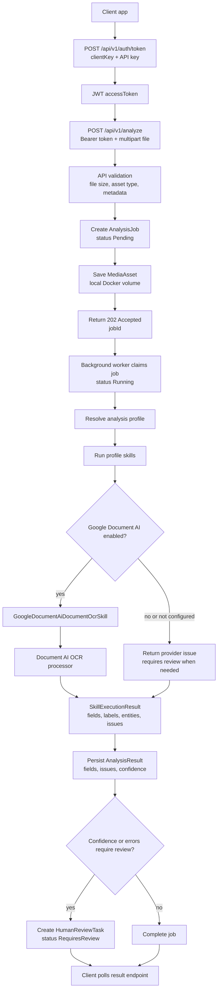
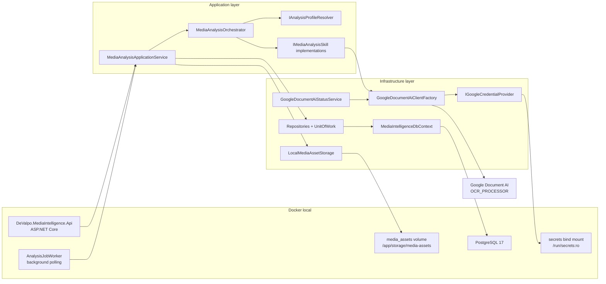
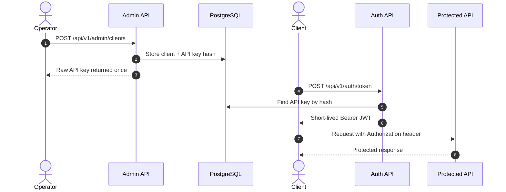
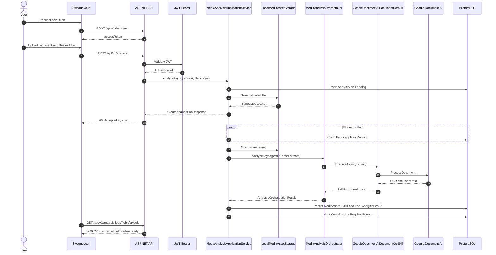
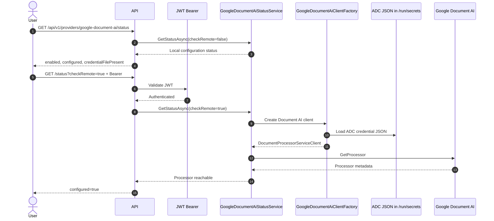
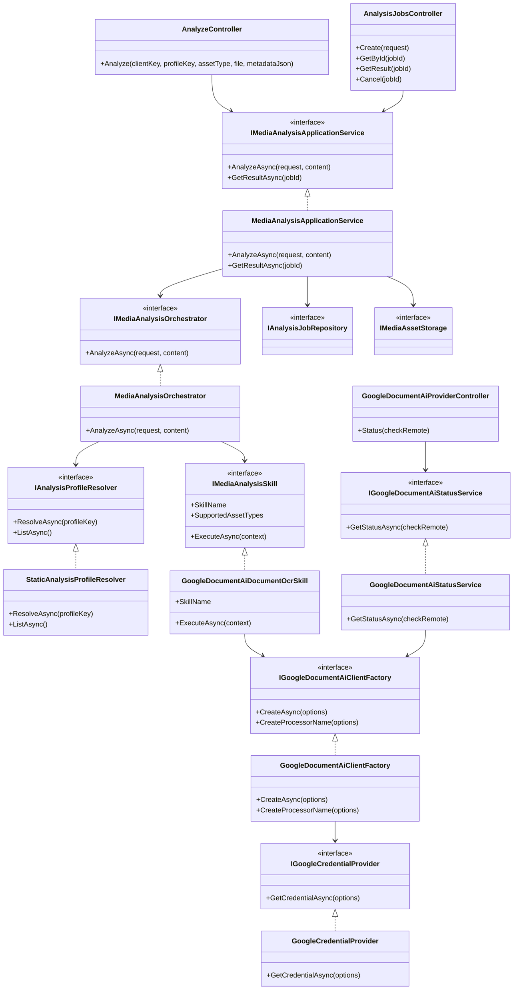
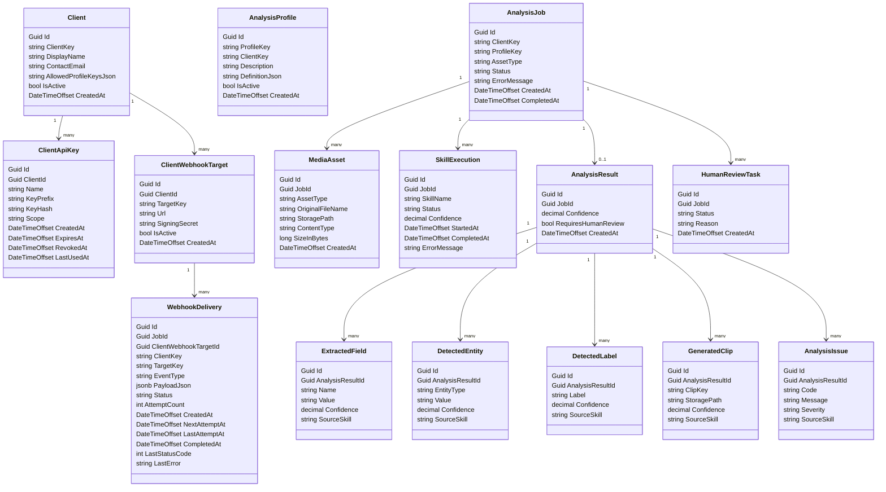
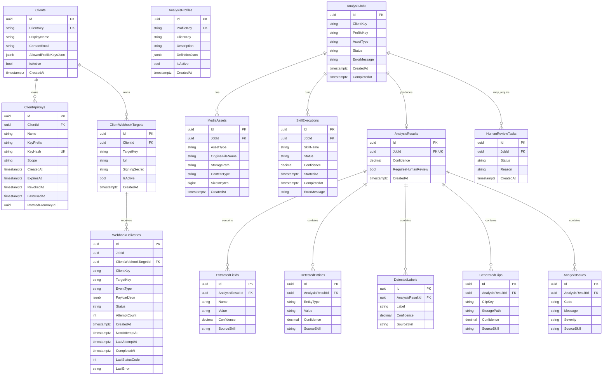

# DeValpo.MediaIntelligence

Reusable multi-client media and document intelligence engine.

This repository is intentionally separate from the Contador repository. It exposes public DTOs through `DeValpo.MediaIntelligence.Contracts` and keeps providers, storage and persistence behind Application abstractions.

## Start Here

GitHub README files do not support real tabs. To keep this readable, the README is the front page and the long endpoint documentation lives in separate pages.

| Icon | Page | What You Use It For |
| --- | --- | --- |
| 🧭 | [Architecture overview](#architecture-overview) | Understand the main components and end-to-end flow. |
| 🚀 | [Run with Docker](#run-with-docker) | Start PostgreSQL and the API with one command. |
| 🔐 | [Local tokens and Google secrets setup](docs/local-tokens-and-google-secrets.md) | Generate local JWT tokens and configure Google credentials safely. |
| 📡 | [API endpoint flows](docs/api-endpoint-flows.md) | See every endpoint grouped with sequence diagrams and usage notes. |
| 🧪 | [Product final phase plan](docs/product-final-phase-plan.md) | Follow the phase-by-phase QA and product completion plan. |
| 📦 | [Release scope v0.1.0-rc.1](docs/release-scope-v0.1.0-rc.1.md) | Know what is included in the current release candidate. |
| 🧰 | [Runbooks](docs/runbooks) | Operate Google, PostgreSQL, storage, security and releases. |

## Endpoint Flow Groups

For the detailed diagrams, open [API endpoint flows](docs/api-endpoint-flows.md). It is grouped like this:

| Group | What Is Inside |
| --- | --- |
| 🟢 Health and readiness | `/health`, `/api/v1/health`, `/ready` |
| 🔐 Authentication | local dev token, client API key to JWT token |
| 🛡️ Client administration | create client, rotate key, revoke key |
| 📚 Catalog | capabilities, profiles and skills |
| 📄 Analysis | upload, create job, poll job, get result, cancel |
| ☁️ Google Document AI | provider status and remote processor check |
| 🧑‍💼 Human review | list, open, start and complete review tasks |
| 🔔 Webhooks | configure targets, inspect deliveries, understand outbound delivery |
| 📊 Operations | metrics and support counters |
| 🛡️ Governance | audit events and retention policy |

## Requirements

- .NET SDK 10.0.x
- Docker Desktop
- PostgreSQL 17 when running outside Docker

## Architecture Overview

The system is a reusable media and document intelligence engine. The API receives assets, validates JWT access issued from client API keys, stores the input file, queues background analysis, persists the normalized result and exposes the job/result through HTTP endpoints.

### End-To-End Flow



### Runtime Components



### API Key And JWT Sequence



### Analyze Sequence



### Google Provider Status Sequence



### Main Class Diagram



### Domain Class Diagram



### Database Diagram



`WebhookDeliveries.JobId` is persisted as an identifier for delivery history filtering. The current EF configuration does not define an `AnalysisJobs` navigation for it yet.

## Run locally

```bash
dotnet restore DeValpo.MediaIntelligence.sln
dotnet tool restore
dotnet build DeValpo.MediaIntelligence.sln
dotnet test DeValpo.MediaIntelligence.sln
dotnet run --project src/DeValpo.MediaIntelligence.Api
```

Swagger is enabled by `Swagger:Enabled` and is available at `/swagger`.

## Run with Docker

Create a local environment file and keep it out of git:

```bash
cp deploy/.env.example deploy/.env
```

Google Document AI supports Application Default Credentials (ADC). For Docker local, create ADC with `gcloud` and copy the generated local credential into the ignored `secrets` folder:

```bash
gcloud auth application-default login
gcloud auth application-default set-quota-project primeval-wind-499515-k6
```

On Windows:

```powershell
Copy-Item "$env:APPDATA\gcloud\application_default_credentials.json" secrets\google-application-default-credentials.json
```

Then set these values in `deploy/.env` when you want to use the real provider in Docker:

```text
GoogleDocumentAi__Enabled=true
GoogleDocumentAi__ProjectId=primeval-wind-499515-k6
GoogleDocumentAi__Location=us
GoogleDocumentAi__ProcessorId=44b3274ce1e84552
GoogleDocumentAi__CredentialsPath=/run/secrets/google-application-default-credentials.json
GoogleDocumentAi__AllowUserCredentials=true
Jwt__SigningKey=replace-with-local-dev-secret-min-32-chars
```

```bash
docker compose -f deploy/docker-compose.yml config
docker compose -f deploy/docker-compose.yml up --build
```

This single Compose file starts both components:

- `postgres`: PostgreSQL database on host port `5435`.
- `media-intelligence-api`: API on host port `8085`.

In Docker, migrations run automatically on API startup because `deploy/.env.example` sets `Database__ApplyMigrationsOnStartup=true`.

The API listens on `http://localhost:8085`, Swagger is available at `http://localhost:8085/swagger`, liveness is exposed at `/health`, and dependency readiness is exposed at `/ready`.

Functional endpoints require JWT Bearer. For real client access, an operator first creates an API client using an admin-scoped token. In Development/Docker local, generate the admin token with:

```bash
curl -X POST http://localhost:8085/api/v1/dev/token \
  -H "Content-Type: application/json" \
  -d "{\"subject\":\"local-admin\",\"clientKey\":\"admin\",\"scope\":\"admin media-intelligence:admin\"}"
```

Create a client and copy the returned `apiKey` immediately. The platform stores only its hash:

```bash
curl -X POST http://localhost:8085/api/v1/admin/clients \
  -H "Authorization: Bearer <adminAccessToken>" \
  -H "Content-Type: application/json" \
  -d "{\"clientKey\":\"my-client\",\"displayName\":\"My Client\",\"contactEmail\":\"ops@example.com\",\"allowedProfileKeys\":[\"generic-document-ocr-v1\"],\"keyName\":\"primary\",\"scope\":\"media-intelligence:client\"}"
```

Exchange that API key for a short-lived JWT:

```bash
curl -X POST http://localhost:8085/api/v1/auth/token \
  -H "Content-Type: application/json" \
  -d "{\"clientKey\":\"my-client\",\"apiKey\":\"<one-time-api-key>\"}"
```

Use the returned `accessToken` in Swagger Authorize or with:

```bash
curl http://localhost:8085/api/v1/capabilities \
  -H "Authorization: Bearer <accessToken>"
```

## Database migrations

Apply migrations from the repository root:

```bash
dotnet tool restore
dotnet dotnet-ef database update --project src/DeValpo.MediaIntelligence.Infrastructure --startup-project src/DeValpo.MediaIntelligence.Api
```

Automatic migration execution is controlled by `Database:ApplyMigrationsOnStartup`. It defaults to `false` in local appsettings and is enabled in Docker through `deploy/.env.example`.

## Google Document AI

For the complete local setup, including Google ADC, Docker secrets and JWT tokens, follow:

- [Local tokens and Google secrets setup](docs/local-tokens-and-google-secrets.md)

Set these values through environment variables or appsettings:

```text
GoogleDocumentAi__Enabled=true
GoogleDocumentAi__ProjectId=your-project
GoogleDocumentAi__Location=us
GoogleDocumentAi__ProcessorId=your-processor
GoogleDocumentAi__CredentialsPath=
```

If `GoogleDocumentAi__CredentialsPath` is empty, the Google SDK uses Application Default Credentials. If you run inside Docker local with a mounted ADC user file, set it to the mounted file under `/run/secrets` and set `GoogleDocumentAi__AllowUserCredentials=true`. Production should use a service account or managed identity path and keep user credentials disabled. Do not commit Google credential JSON files.

Check provider readiness:

```bash
curl http://localhost:8085/api/v1/providers/google-document-ai/status
curl "http://localhost:8085/api/v1/providers/google-document-ai/status?checkRemote=true" \
  -H "Authorization: Bearer <adminOrOperatorAccessToken>"
```

The basic status endpoint checks local configuration and credential file presence. `checkRemote=true` validates the configured processor against Google and requires a Bearer token.

## Analyze an asset

```bash
curl -X POST http://localhost:8085/api/v1/analyze \
  -H "Authorization: Bearer <accessToken>" \
  -F "clientKey=<clientKey>" \
  -F "profileKey=generic-document-ocr-v1" \
  -F "assetType=Document" \
  -F "metadataJson={\"source\":\"manual-test\"}" \
  -F "file=@sample.pdf"
```

The response is `202 Accepted` with a `jobId`. Poll the job until it reaches `Completed` or `RequiresReview`:

```bash
curl http://localhost:8085/api/v1/analysis-jobs/<jobId> \
  -H "Authorization: Bearer <accessToken>"
```

Then retrieve the result:

```bash
curl http://localhost:8085/api/v1/analysis-jobs/<jobId>/result \
  -H "Authorization: Bearer <accessToken>"
```

Upload validation rejects invalid files before they are stored or queued. Supported document/image inputs are PDF, PNG, JPG/JPEG, WEBP and TIFF. Supported video inputs are MP4, MOV and AVI for video profiles. Empty files, oversized files, unsupported extensions, mismatched declared content types, invalid binary signatures and incomplete PDFs return controlled `400` responses with machine-readable error codes.

## Human review

Operator or admin tokens can manage review tasks created when an analysis requires human validation:

```bash
curl http://localhost:8085/api/v1/human-review-tasks?status=Pending \
  -H "Authorization: Bearer <operatorOrAdminAccessToken>"

curl -X POST http://localhost:8085/api/v1/human-review-tasks/<taskId>/start \
  -H "Authorization: Bearer <operatorOrAdminAccessToken>" \
  -H "Content-Type: application/json" \
  -d "{\"comment\":\"Review started\"}"

curl -X POST http://localhost:8085/api/v1/human-review-tasks/<taskId>/complete \
  -H "Authorization: Bearer <operatorOrAdminAccessToken>" \
  -H "Content-Type: application/json" \
  -d "{\"decision\":\"Approve\",\"comment\":\"Accepted\"}"
```

Supported decisions are `Approve`, `Correct` and `Reject`. `Correct` stores the original extracted fields on the review task and writes corrected fields to the result.

## Webhooks

Admin tokens can register webhook targets per client. The signing secret is accepted for outbound HMAC signing and is never returned by the API:

```bash
curl -X POST http://localhost:8085/api/v1/admin/clients/<clientKey>/webhook-targets \
  -H "Authorization: Bearer <adminAccessToken>" \
  -H "Content-Type: application/json" \
  -d "{\"targetKey\":\"primary\",\"url\":\"https://example.com/webhooks/devalpo\",\"signingSecret\":\"replace-with-client-webhook-secret-min-32-chars\",\"isActive\":true}"
```

List targets:

```bash
curl http://localhost:8085/api/v1/admin/clients/<clientKey>/webhook-targets \
  -H "Authorization: Bearer <adminAccessToken>"
```

When an analysis job reaches `Completed`, the worker enqueues one `analysis.completed` delivery per active target. The payload is intentionally minimal and does not include OCR text, raw provider output or signing secrets:

```json
{
  "eventId": "00000000-0000-0000-0000-000000000000",
  "eventType": "analysis.completed",
  "jobId": "00000000-0000-0000-0000-000000000000",
  "clientKey": "generic",
  "profileKey": "generic-document-ocr-v1",
  "jobStatus": "Completed",
  "confidence": 0.89,
  "requiresHumanReview": false,
  "resultUrl": "/api/v1/analysis-jobs/<jobId>/result",
  "occurredAt": "2026-07-06T00:00:00Z"
}
```

Outbound requests include:

```text
X-DeValpo-Event-Id: <webhookDeliveryId>
X-DeValpo-Event-Type: analysis.completed
X-DeValpo-Timestamp: <unixSeconds>
X-DeValpo-Signature: sha256=<hex-hmac>
```

Verify signatures with:

```text
HMACSHA256(signingSecret, X-DeValpo-Timestamp + "." + rawRequestBody)
```

Inspect delivery attempts:

```bash
curl "http://localhost:8085/api/v1/webhook-deliveries?clientKey=<clientKey>&jobId=<jobId>" \
  -H "Authorization: Bearer <accessToken>"
```

Failed deliveries move to `RetryPending` until `WebhookDelivery:MaxAttempts` is reached, then end as `Failed`.

## Operations

Use `/health` for lightweight liveness. It does not check PostgreSQL, storage or Google:

```bash
curl http://localhost:8085/health
```

Use `/ready` for dependency readiness. It checks PostgreSQL, local asset storage and Google Document AI according to `Readiness` configuration:

```bash
curl http://localhost:8085/ready
```

Docker local enables remote Google readiness through:

```text
Readiness__RequireGoogleDocumentAi=true
Readiness__CheckGoogleDocumentAiRemote=true
GoogleDocumentAiStatusCache__RemoteStatusTtlSeconds=60
GoogleDocumentAiStatusCache__RemoteStatusTimeoutSeconds=10
```

Operator/admin tokens can read operational counters:

```bash
curl http://localhost:8085/api/v1/operations/metrics \
  -H "Authorization: Bearer <operatorOrAdminAccessToken>"
```

The metrics response includes counts by job status, human review status and webhook delivery status. It does not include document text, API keys or webhook signing secrets.

## Security, Governance And Retention

Admin tokens can inspect sanitized audit events and configure per-client retention policies. These endpoints require `media-intelligence:admin` scope:

```powershell
curl.exe "http://localhost:8085/api/v1/admin/audit-events?limit=50" `
  -H "Authorization: Bearer <adminAccessToken>"

curl.exe -X PUT "http://localhost:8085/api/v1/admin/clients/<clientKey>/retention-policy" `
  -H "Authorization: Bearer <adminAccessToken>" `
  -H "Content-Type: application/json" `
  -d "{\"enabled\":true,\"retentionDays\":30}"

curl.exe -X POST "http://localhost:8085/api/v1/admin/clients/<clientKey>/retention-policy/execute" `
  -H "Authorization: Bearer <adminAccessToken>"
```

Retention deletes stored media files for terminal jobs older than the configured policy and marks each asset row with `DeletedAt`. Audit metadata is intentionally sanitized: it must not include API keys, webhook signing secrets, JWT signing keys, Google credentials, OCR text or document content.

Operational runbooks:

- [Google Document AI runbook](docs/runbooks/google-document-ai.md)
- [PostgreSQL runbook](docs/runbooks/postgres.md)
- [Release and migration runbook](docs/runbooks/release-and-migrations.md)
- [Security, governance and retention runbook](docs/runbooks/security-governance-retention.md)
- [Storage runbook](docs/runbooks/storage.md)

## Add a skill

1. Implement `IMediaAnalysisSkill`.
2. Register it in `Infrastructure/DependencyInjection.cs`.
3. Add its name to a profile definition.
4. Add focused tests for the skill or orchestrator behavior.

## Add a profile

Profiles are resolved through `IAnalysisProfileResolver`. The initial implementation is static and can be replaced by a database-backed resolver without changing controllers or skills.

## CI/CD status

GitHub Actions validates restore, build, tests, Docker build and Docker Compose config. There is no automatic deployment in this phase.

## Productization and QA

The remaining work to move from MVP to product is tracked in:

- [API endpoint flows](docs/api-endpoint-flows.md)
- [Productization plan](docs/productization-plan.md)
- [Product final phase plan](docs/product-final-phase-plan.md)
- [Release scope v0.1.0-rc.1](docs/release-scope-v0.1.0-rc.1.md)
- [Client onboarding guide](docs/client-onboarding-guide.md)

The repository also includes a reusable QA skill for future product-readiness audits:

- [DeValpo MediaIntelligence QA skill](docs/devalpo-mediaintelligence-qa/SKILL.md)

The QA review for this change is recorded in:

- [QA review](docs/qa-review.md)
- [Phase 0 base hygiene QA](docs/qa-phase-0-base-hygiene.md)
- [Phase 1 foundation hardening QA](docs/qa-phase-1-foundation-hardening.md)
- [Phase 2 customer access and security QA](docs/qa-phase-2-customer-access-security.md)
- [Phase 3 tenant isolation QA](docs/qa-phase-3-tenant-isolation.md)
- [Phase 4 async jobs and worker QA](docs/qa-phase-4-async-jobs-worker.md)
- [Phase 5 file ingestion validation QA](docs/qa-phase-5-file-ingestion-validation.md)
- [Phase 6 human review workflow QA](docs/qa-phase-6-human-review-workflow.md)
- [Phase 7 webhook delivery QA](docs/qa-phase-7-webhook-delivery.md)
- [Phase 8 observability and readiness QA](docs/qa-phase-8-observability-readiness.md)
- [Phase 9 security, governance and retention QA](docs/qa-phase-9-security-governance-retention.md)
- [Phase 10 CI/CD, staging and release QA](docs/qa-phase-10-cicd-staging-release.md)
- [Phase 11 product certification QA](docs/qa-phase-11-product-certification.md)
