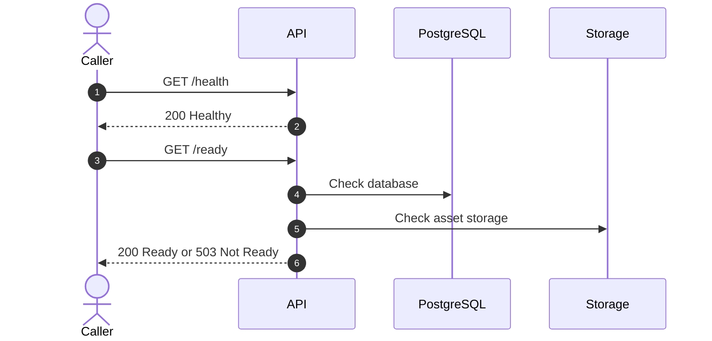
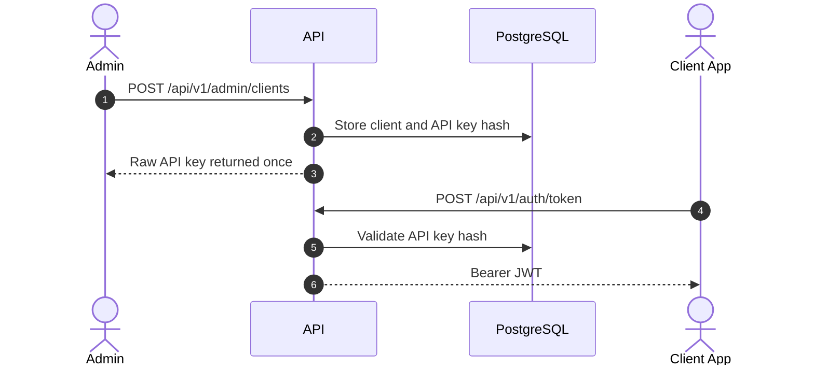
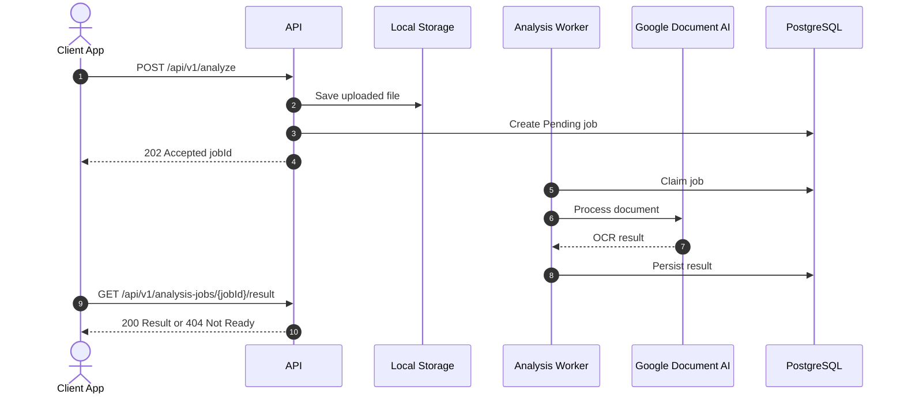
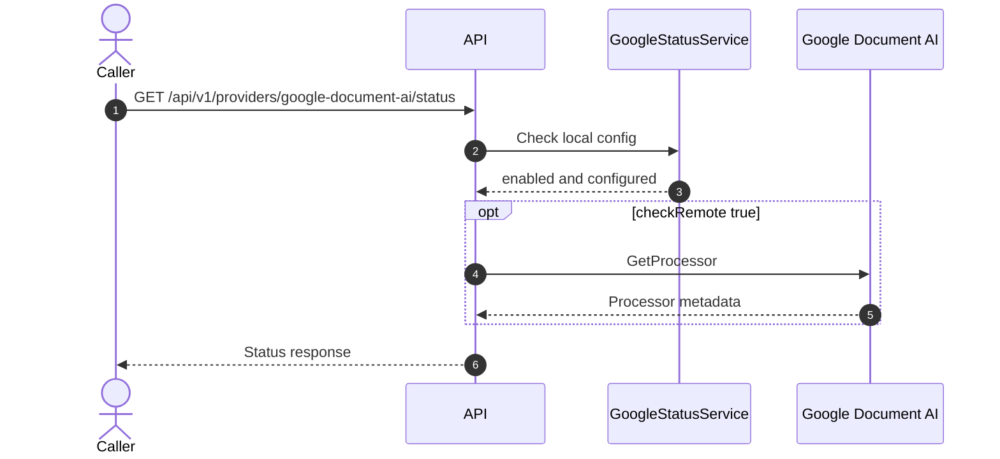
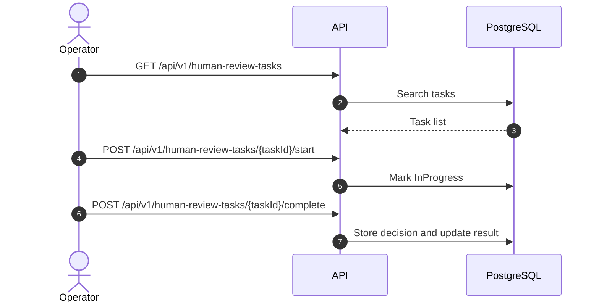
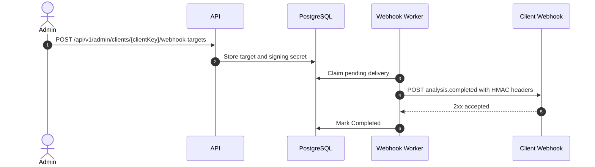
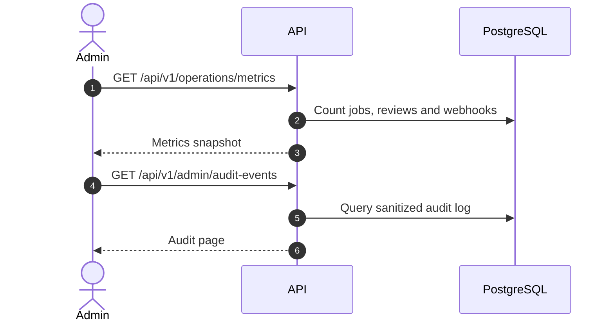
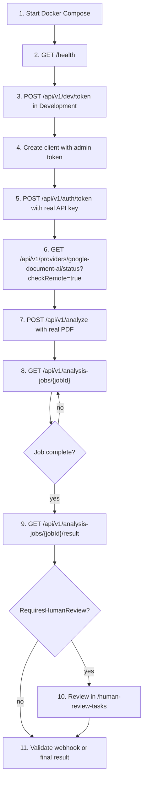

# API Endpoint Flows

This page is the simple endpoint view. The documentation site provides real navigation tabs, and this page adds role tabs plus endpoint-level sequence diagrams.

## How To Read This Page

| Icon | Meaning | User |
| --- | --- | --- |
| 🟢 | Public | Monitoring, Docker, browser |
| 🔐 | Authenticated client | Integrations uploading and reading analysis results |
| 🛡️ | Administration | Operators with `media-intelligence:admin` scope |
| 🧑‍💼 | Human operation | Users reviewing uncertain results |
| 🔔 | Webhooks | External systems receiving events |
| 📊 | Operations | Monitoring and support |

Simple rule:

1. Check `/health`.
2. Generate or exchange a token.
3. Call protected endpoints with `Authorization: Bearer <token>`.
4. For real documents, use `POST /api/v1/analyze`.
5. For results, query `/api/v1/analysis-jobs/{jobId}` and then `/result`.

=== "Client"

    Main path:

    1. `POST /api/v1/auth/token`
    2. `POST /api/v1/analyze`
    3. `GET /api/v1/analysis-jobs/{jobId}`
    4. `GET /api/v1/analysis-jobs/{jobId}/result`

=== "Admin"

    Main path:

    1. `POST /api/v1/admin/clients`
    2. Rotate or revoke API keys when needed.
    3. Configure webhook targets.
    4. Review audit and retention.

=== "Operator"

    Main path:

    1. `GET /ready`
    2. `GET /api/v1/operations/metrics`
    3. `GET /api/v1/human-review-tasks`
    4. Resolve review tasks.

=== "QA"

    Main path:

    1. Validate `401` without token.
    2. Validate `200` with the right token.
    3. Upload a real document.
    4. Validate result, review and webhook if applicable.

## Quick Map

| Group | Endpoints | Security |
| --- | --- | --- |
| 🟢 Health | `GET /health`, `GET /api/v1/health`, `GET /ready` | Public |
| 🔐 Auth | `POST /api/v1/dev/token`, `POST /api/v1/auth/token` | Dev public, real auth uses API key |
| 🛡️ Clients | `POST /api/v1/admin/clients`, rotate/revoke API key | Admin |
| 📚 Catalog | `GET /api/v1/capabilities`, `GET /api/v1/profiles`, `GET /api/v1/skills` | Bearer |
| 📄 Analysis | `POST /api/v1/analyze`, `POST /api/v1/analysis-jobs`, job/result/cancel | Bearer |
| ☁️ Provider | `GET /api/v1/providers/google-document-ai/status` | Basic public, remote Bearer |
| 🧑‍💼 Review | `GET/POST /api/v1/human-review-tasks` | Operator/Admin |
| 🔔 Webhooks | targets and deliveries | Admin/Client |
| 📊 Operations | `GET /api/v1/operations/metrics` | Operator/Admin |
| 🛡️ Governance | audit events and retention policy | Admin |

## 🟢 Health And Readiness

## 🔐 Authentication And Client Access

## 📄 Analysis Jobs And Results

## ☁️ Google Document AI Status

## 🧑‍💼 Human Review

## 🔔 Webhooks

## 📊 Operations And Governance

## Real Test Flow

## Quick Error Checklist

| Symptom | Common Cause | What To Check |
| --- | --- | --- |
| `401` | Missing Bearer token | `Authorization: Bearer <token>` header |
| `403` | Wrong scope or client | `client_key`, `scope`, `allowedProfileKeys` |
| `400` upload | Invalid file | Extension, binary signature, complete PDF, size |
| Google `configured=false` | Incomplete configuration | ProjectId, Location, ProcessorId, CredentialsPath |
| Invalid Google credential | Bad ADC or JSON | Mounted file under `/run/secrets` and local `AllowUserCredentials` |
| Job does not finish | Worker or provider error | API container logs and job table |
| Webhook fails | URL or signature | `/api/v1/webhook-deliveries` history |
