# API Endpoint Flows

Esta pagina es la vista simple de endpoints. En GitHub no existen pestanas reales dentro del README, por eso el README apunta aqui y esta pagina usa bloques desplegables por grupo.

## Como Leer Esta Pagina

| Icono | Significado | Quien lo usa |
| --- | --- | --- |
| 🟢 | Publico | Monitoreo, Docker, navegador |
| 🔐 | Cliente autenticado | Integraciones que suben y consultan analisis |
| 🛡️ | Administracion | Operadores con scope `media-intelligence:admin` |
| 🧑‍💼 | Operacion humana | Usuarios que revisan resultados |
| 🔔 | Webhooks | Sistemas externos que reciben eventos |
| 📊 | Operaciones | Monitoreo y soporte |

Regla simple:

1. Primero verifica `/health`.
2. Luego genera un token.
3. Despues llama endpoints protegidos con `Authorization: Bearer <token>`.
4. Para documentos reales, usa `POST /api/v1/analyze`.
5. Para resultados, consulta `/api/v1/analysis-jobs/{jobId}` y luego `/result`.

=== "Cliente"

    Ruta principal:

    1. `POST /api/v1/auth/token`
    2. `POST /api/v1/analyze`
    3. `GET /api/v1/analysis-jobs/{jobId}`
    4. `GET /api/v1/analysis-jobs/{jobId}/result`

=== "Admin"

    Ruta principal:

    1. `POST /api/v1/admin/clients`
    2. Rotar o revocar API keys cuando corresponda.
    3. Configurar webhook targets.
    4. Revisar auditoria y retencion.

=== "Operador"

    Ruta principal:

    1. `GET /ready`
    2. `GET /api/v1/operations/metrics`
    3. `GET /api/v1/human-review-tasks`
    4. Resolver tareas de revision.

=== "QA"

    Ruta principal:

    1. Validar `401` sin token.
    2. Validar `200` con token correcto.
    3. Subir documento real.
    4. Validar resultado, review y webhook si aplica.

## Mapa Rapido

| Grupo | Endpoints | Seguridad |
| --- | --- | --- |
| 🟢 Salud | `GET /health`, `GET /api/v1/health`, `GET /ready` | Publico |
| 🔐 Auth | `POST /api/v1/dev/token`, `POST /api/v1/auth/token` | Dev publico, auth real publico con API key |
| 🛡️ Clientes | `POST /api/v1/admin/clients`, rotate/revoke API key | Admin |
| 📚 Catalogo | `GET /api/v1/capabilities`, `GET /api/v1/profiles`, `GET /api/v1/skills` | Bearer |
| 📄 Analisis | `POST /api/v1/analyze`, `POST /api/v1/analysis-jobs`, job/result/cancel | Bearer |
| ☁️ Proveedor | `GET /api/v1/providers/google-document-ai/status` | Basico publico, remoto Bearer |
| 🧑‍💼 Revision | `GET/POST /api/v1/human-review-tasks` | Operator/Admin |
| 🔔 Webhooks | targets y deliveries | Admin/Client |
| 📊 Operacion | `GET /api/v1/operations/metrics` | Operator/Admin |
| 🛡️ Gobierno | audit events y retention policy | Admin |

## 🟢 Salud Y Readiness

<details>
<summary>🟢 GET /health</summary>

**Para que sirve:** confirma que el proceso API esta vivo. No valida base de datos ni Google.

**Respuesta esperada:** `Healthy`.

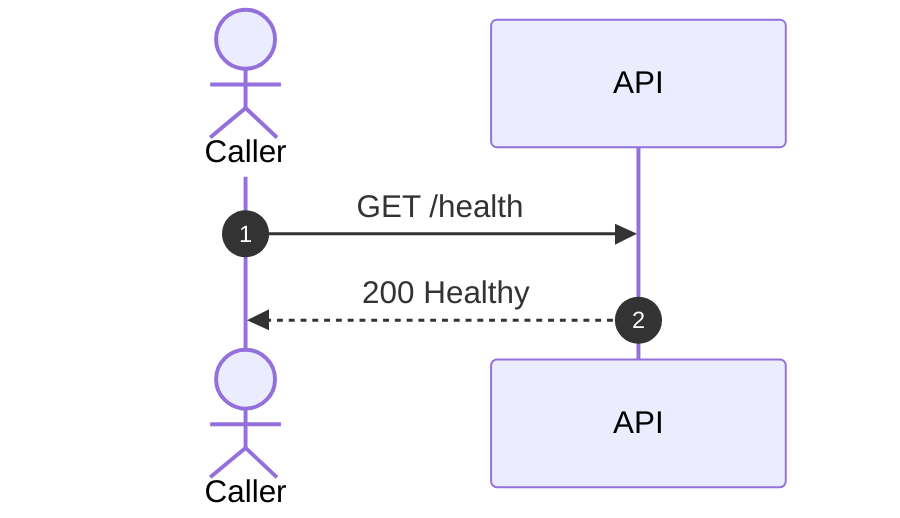

</details>

<details>
<summary>🟢 GET /api/v1/health</summary>

**Para que sirve:** entrega salud basica desde controlador versionado.

**Respuesta esperada:** estado HTTP `200`.

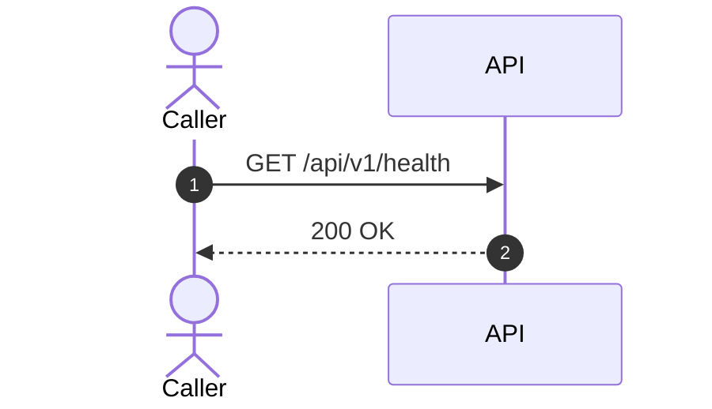

</details>

<details>
<summary>🟢 GET /ready</summary>

**Para que sirve:** valida dependencias configuradas para readiness: PostgreSQL, storage local y opcionalmente Google Document AI.

**Respuesta esperada:** `200` cuando las dependencias requeridas estan listas.

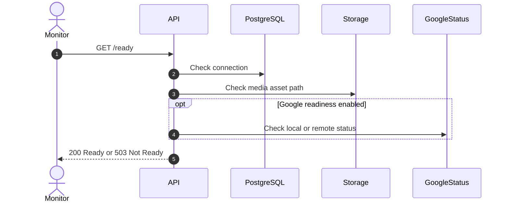

</details>

## 🔐 Autenticacion Y Acceso Cliente

<details>
<summary>🔐 POST /api/v1/dev/token</summary>

**Para que sirve:** genera un JWT local solo en ambiente `Development`. Es para pruebas locales con Docker o Swagger.

**No usar en produccion.**

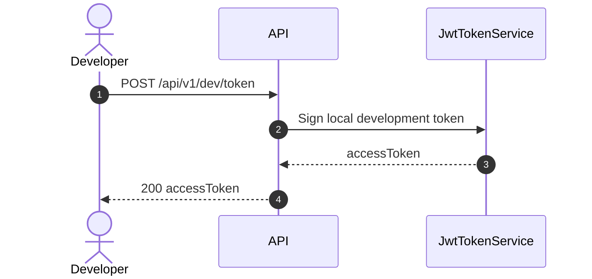

</details>

<details>
<summary>🛡️ POST /api/v1/admin/clients</summary>

**Para que sirve:** crea un cliente de integracion y devuelve una API key una sola vez.

**Importante:** la API key cruda no se guarda. La plataforma guarda solo el hash.

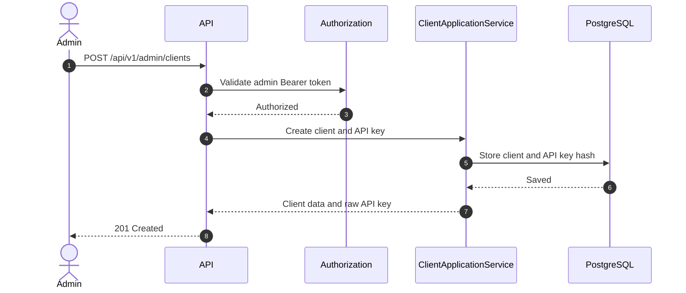

</details>

<details>
<summary>🔐 POST /api/v1/auth/token</summary>

**Para que sirve:** cambia `clientKey + apiKey` por un JWT corto para llamar endpoints protegidos.

**Entrada minima:** `clientKey`, `apiKey`.

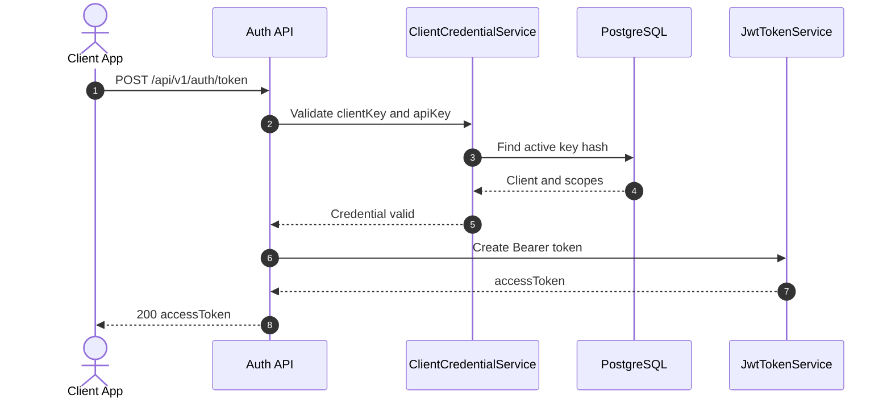

</details>

<details>
<summary>🛡️ POST /api/v1/admin/clients/{clientKey}/api-keys/{apiKeyId}/rotate</summary>

**Para que sirve:** reemplaza una API key existente por una nueva.

**Uso normal:** cuando una key se vencio, se sospecha exposicion o se rota por politica.

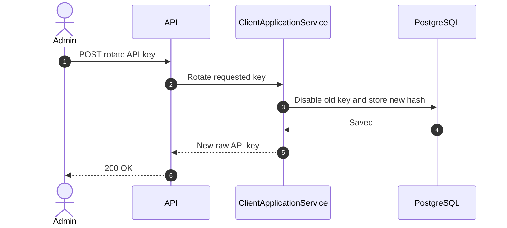

</details>

<details>
<summary>🛡️ POST /api/v1/admin/clients/{clientKey}/api-keys/{apiKeyId}/revoke</summary>

**Para que sirve:** desactiva una API key para que ya no pueda emitir JWT.

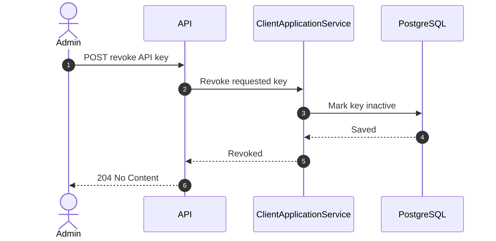

</details>

## 📚 Catalogo De Capacidades

<details>
<summary>📚 GET /api/v1/capabilities</summary>

**Para que sirve:** lista capacidades disponibles para clientes e integraciones.

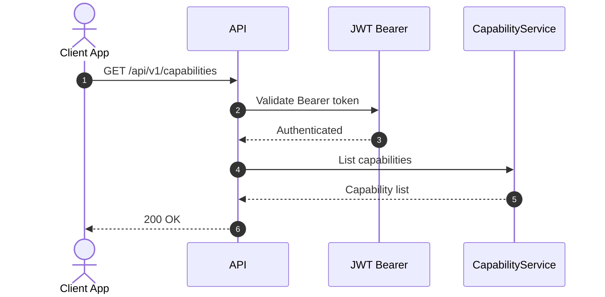

</details>

<details>
<summary>📚 GET /api/v1/profiles</summary>

**Para que sirve:** lista perfiles de analisis, por ejemplo OCR documental generico.

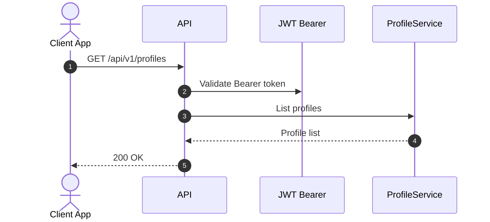

</details>

<details>
<summary>📚 GET /api/v1/skills</summary>

**Para que sirve:** lista skills tecnicos registrados en la plataforma.

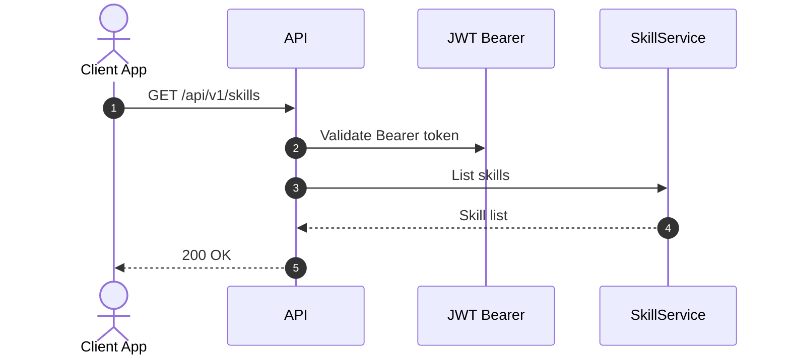

</details>

## 📄 Analisis De Documentos Y Jobs

<details>
<summary>📄 POST /api/v1/analyze</summary>

**Para que sirve:** sube un archivo real, valida acceso, guarda el archivo y crea un job para procesamiento en background.

**Entrada:** multipart form con `clientKey`, `profileKey`, `assetType`, `file` y opcionalmente `metadataJson`.

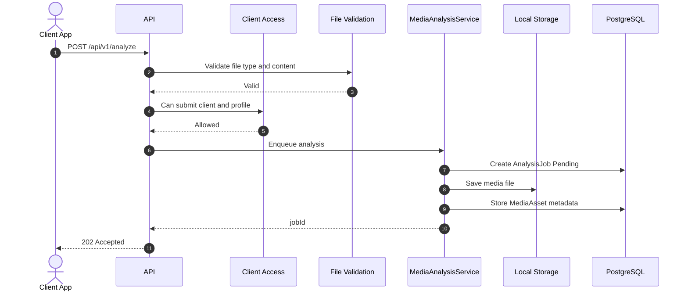

</details>

<details>
<summary>📄 POST /api/v1/analysis-jobs</summary>

**Para que sirve:** crea un job pendiente sin subir archivo. Es util para reservar o rastrear trabajo antes de adjuntar media.

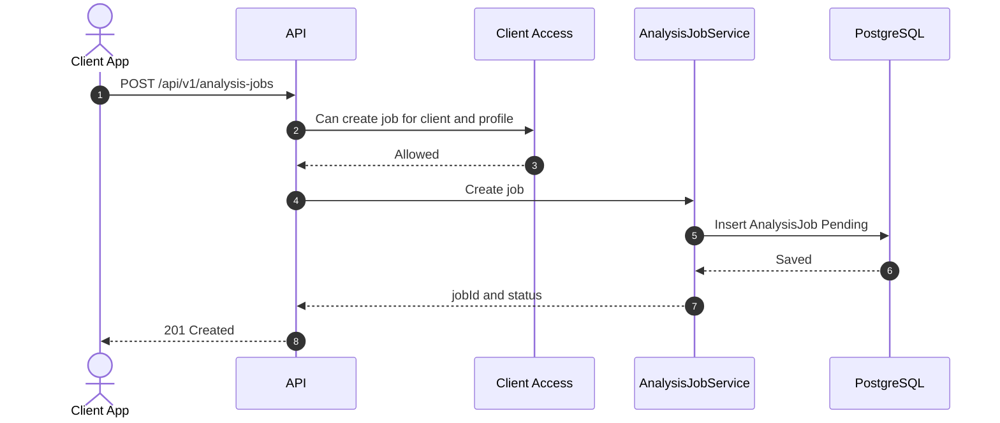

</details>

<details>
<summary>📄 GET /api/v1/analysis-jobs/{jobId}</summary>

**Para que sirve:** consulta estado del job: `Pending`, `Running`, `Completed`, `RequiresReview`, `Failed` o `Cancelled`.

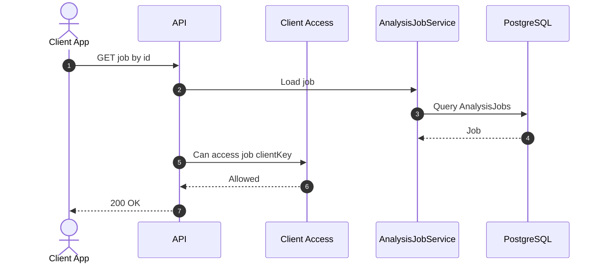

</details>

<details>
<summary>📄 GET /api/v1/analysis-jobs/{jobId}/result</summary>

**Para que sirve:** obtiene el resultado persistido del analisis cuando ya existe.

**Nota:** si el job aun no termina o no pertenece al cliente, responde `404`.

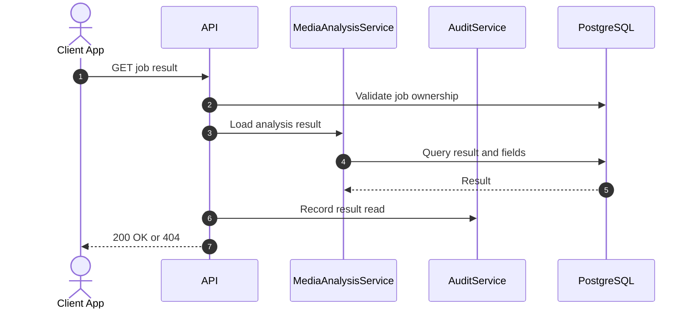

</details>

<details>
<summary>📄 POST /api/v1/analysis-jobs/{jobId}/cancel</summary>

**Para que sirve:** cancela un job no terminal.

**No cancela:** jobs completados, fallidos o ya cancelados.

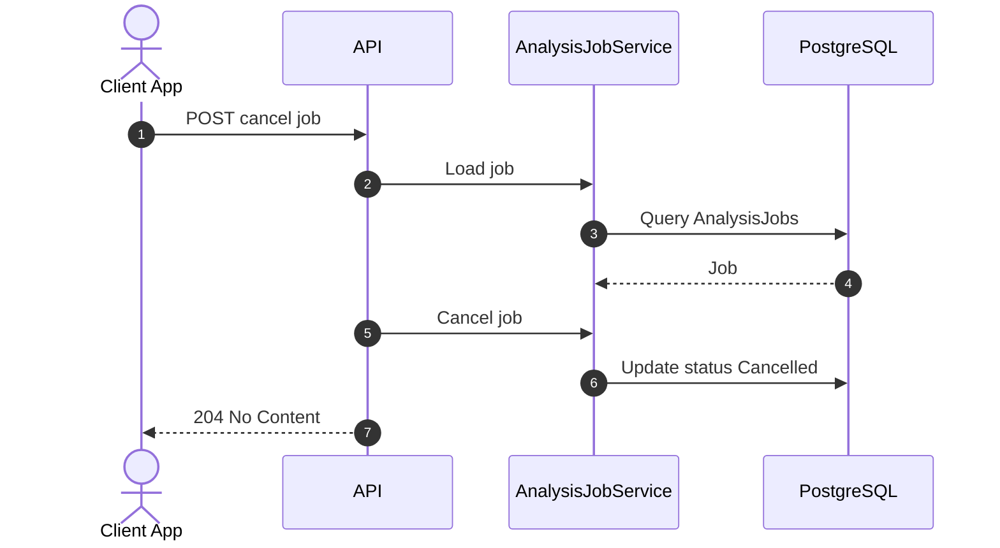

</details>

<details>
<summary>⚙️ Background worker de analisis</summary>

**Para que sirve:** no es endpoint HTTP, pero explica que pasa despues de `POST /api/v1/analyze`.

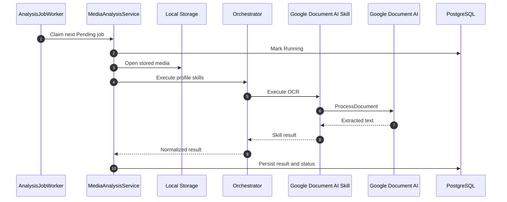

</details>

## ☁️ Google Document AI

<details>
<summary>☁️ GET /api/v1/providers/google-document-ai/status</summary>

**Para que sirve:** valida configuracion local de Google Document AI.

**Modo basico:** sin `checkRemote`, revisa configuracion y existencia del archivo de credenciales.

**Modo remoto:** con `?checkRemote=true`, llama Google para validar el processor y requiere Bearer token.

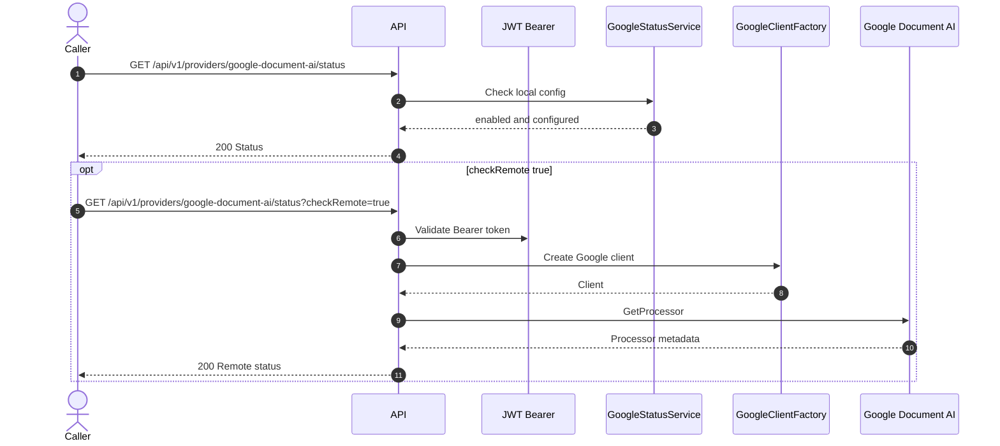

</details>

## 🧑‍💼 Human Review

<details>
<summary>🧑‍💼 GET /api/v1/human-review-tasks</summary>

**Para que sirve:** lista tareas pendientes, en progreso o completadas de revision humana.

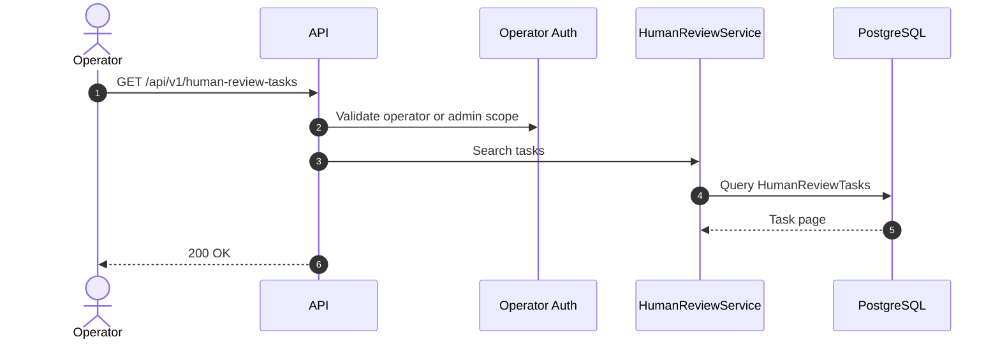

</details>

<details>
<summary>🧑‍💼 GET /api/v1/human-review-tasks/{taskId}</summary>

**Para que sirve:** abre el detalle de una tarea de revision.

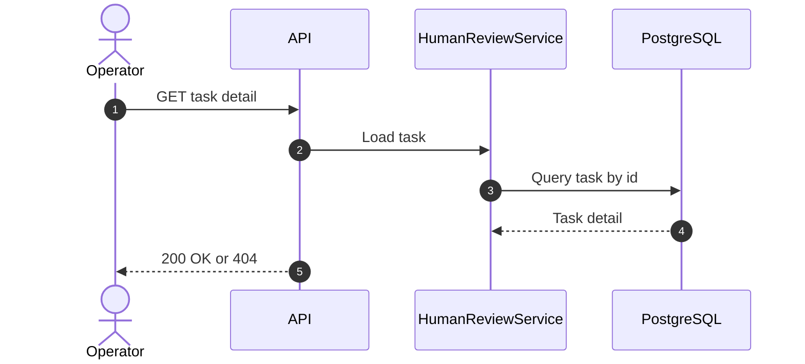

</details>

<details>
<summary>🧑‍💼 POST /api/v1/human-review-tasks/{taskId}/start</summary>

**Para que sirve:** marca una tarea como tomada por un operador.

```mermaid
sequenceDiagram
    autonumber
    actor Operator as Operator
    participant API as API
    participant App as HumanReviewService
    participant DB as PostgreSQL
    Operator->>API: POST start task
    API->>App: Start review
    App->>DB: Update status InProgress
    DB-->>App: Saved
    API-->>Operator: 200 OK
```

</details>

<details>
<summary>🧑‍💼 POST /api/v1/human-review-tasks/{taskId}/complete</summary>

**Para que sirve:** cierra la revision con decision `Approve`, `Correct` o `Reject`.

```mermaid
sequenceDiagram
    autonumber
    actor Operator as Operator
    participant API as API
    participant App as HumanReviewService
    participant DB as PostgreSQL
    Operator->>API: POST complete task
    API->>App: Complete with decision
    alt Correct
        App->>DB: Store corrected fields
    else Approve or Reject
        App->>DB: Store decision
    end
    App->>DB: Update task and job state
    API-->>Operator: 200 OK
```

</details>

## 🔔 Webhooks

<details>
<summary>🔔 POST /api/v1/admin/clients/{clientKey}/webhook-targets</summary>

**Para que sirve:** registra una URL externa para recibir eventos del cliente.

**Seguridad:** guarda un signing secret para firmar eventos salientes.

```mermaid
sequenceDiagram
    autonumber
    actor Admin as Admin
    participant API as API
    participant App as WebhookTargetService
    participant DB as PostgreSQL
    Admin->>API: POST webhook target
    API->>App: Validate target
    App->>DB: Store target and signing secret
    DB-->>App: Saved
    API-->>Admin: 201 Created
```

</details>

<details>
<summary>🔔 GET /api/v1/admin/clients/{clientKey}/webhook-targets</summary>

**Para que sirve:** lista targets de webhook configurados para un cliente.

```mermaid
sequenceDiagram
    autonumber
    actor Admin as Admin
    participant API as API
    participant App as WebhookTargetService
    participant DB as PostgreSQL
    Admin->>API: GET webhook targets
    API->>App: List targets
    App->>DB: Query active and inactive targets
    DB-->>App: Targets
    API-->>Admin: 200 OK
```

</details>

<details>
<summary>🔔 GET /api/v1/webhook-deliveries</summary>

**Para que sirve:** consulta historial de entregas de webhooks y reintentos.

```mermaid
sequenceDiagram
    autonumber
    actor Client as Client App
    participant API as API
    participant App as WebhookDeliveryService
    participant DB as PostgreSQL
    Client->>API: GET /api/v1/webhook-deliveries
    API->>App: Search deliveries
    App->>DB: Query delivery history
    DB-->>App: Delivery page
    API-->>Client: 200 OK
```

</details>

<details>
<summary>⚙️ Entrega saliente analysis.completed</summary>

**Para que sirve:** muestra como la plataforma llama el sistema externo cuando termina un analisis.

```mermaid
sequenceDiagram
    autonumber
    participant Worker as WebhookWorker
    participant DB as PostgreSQL
    participant Hmac as HMAC Signer
    participant Receiver as Client Webhook
    Worker->>DB: Claim RetryPending delivery
    DB-->>Worker: Delivery payload and target
    Worker->>Hmac: Sign timestamp and JSON body
    Hmac-->>Worker: sha256 signature
    Worker->>Receiver: POST analysis.completed
    Receiver-->>Worker: 2xx accepted
    Worker->>DB: Mark Completed
```

</details>

## 📊 Operaciones

<details>
<summary>📊 GET /api/v1/operations/metrics</summary>

**Para que sirve:** entrega contadores operativos sin exponer texto OCR, secretos ni documentos.

```mermaid
sequenceDiagram
    autonumber
    actor Operator as Operator
    participant API as API
    participant App as OperationsService
    participant DB as PostgreSQL
    Operator->>API: GET /api/v1/operations/metrics
    API->>App: Build metrics snapshot
    App->>DB: Count jobs, reviews and webhooks
    DB-->>App: Aggregates
    API-->>Operator: 200 OK
```

</details>

## 🛡️ Gobierno, Auditoria Y Retencion

<details>
<summary>🛡️ GET /api/v1/admin/audit-events</summary>

**Para que sirve:** lista eventos auditables sanitizados.

**No debe incluir:** API keys, JWT signing keys, credenciales Google, OCR completo ni contenido de documentos.

```mermaid
sequenceDiagram
    autonumber
    actor Admin as Admin
    participant API as API
    participant App as AuditService
    participant DB as PostgreSQL
    Admin->>API: GET /api/v1/admin/audit-events
    API->>App: Search audit events
    App->>DB: Query sanitized audit log
    DB-->>App: Audit events
    API-->>Admin: 200 OK
```

</details>

<details>
<summary>🛡️ GET /api/v1/admin/clients/{clientKey}/retention-policy</summary>

**Para que sirve:** consulta la politica de retencion configurada para un cliente.

```mermaid
sequenceDiagram
    autonumber
    actor Admin as Admin
    participant API as API
    participant App as RetentionService
    participant DB as PostgreSQL
    Admin->>API: GET retention policy
    API->>App: Load client policy
    App->>DB: Query retention policy
    DB-->>App: Policy
    API-->>Admin: 200 OK
```

</details>

<details>
<summary>🛡️ PUT /api/v1/admin/clients/{clientKey}/retention-policy</summary>

**Para que sirve:** habilita o cambia cuantos dias se conservan archivos y datos retenibles.

```mermaid
sequenceDiagram
    autonumber
    actor Admin as Admin
    participant API as API
    participant App as RetentionService
    participant DB as PostgreSQL
    Admin->>API: PUT retention policy
    API->>App: Validate and save policy
    App->>DB: Upsert client retention policy
    DB-->>App: Saved
    API-->>Admin: 200 OK
```

</details>

<details>
<summary>🛡️ POST /api/v1/admin/clients/{clientKey}/retention-policy/execute</summary>

**Para que sirve:** ejecuta limpieza de archivos para jobs terminales que superan la politica.

```mermaid
sequenceDiagram
    autonumber
    actor Admin as Admin
    participant API as API
    participant App as RetentionService
    participant Storage as Local Storage
    participant DB as PostgreSQL
    Admin->>API: POST execute retention
    API->>App: Execute retention policy
    App->>DB: Find expired terminal jobs
    App->>Storage: Delete retained media files
    App->>DB: Mark assets DeletedAt
    API-->>Admin: 200 OK
```

</details>

## Flujo Completo Recomendado Para Probar Real

```mermaid
flowchart TD
    A["1. Levantar Docker Compose"] --> B["2. GET /health"]
    B --> C["3. POST /api/v1/dev/token en Development"]
    C --> D["4. Crear cliente con admin token"]
    D --> E["5. POST /api/v1/auth/token con API key real"]
    E --> F["6. GET /api/v1/providers/google-document-ai/status?checkRemote=true"]
    F --> G["7. POST /api/v1/analyze con PDF real"]
    G --> H["8. GET /api/v1/analysis-jobs/{jobId}"]
    H --> I{"Job completo?"}
    I -- "no" --> H
    I -- "si" --> J["9. GET /api/v1/analysis-jobs/{jobId}/result"]
    J --> K{"RequiresHumanReview?"}
    K -- "si" --> L["10. Revisar en /human-review-tasks"]
    K -- "no" --> M["11. Validar webhook o resultado final"]
    L --> M
```

## Checklist De Error Rapido

| Sintoma | Causa comun | Que revisar |
| --- | --- | --- |
| `401` | Falta Bearer token | Header `Authorization: Bearer <token>` |
| `403` | Token sin scope o cliente incorrecto | `client_key`, `scope`, `allowedProfileKeys` |
| `400` en upload | Archivo invalido | Extension, firma binaria, PDF completo, tamano |
| Google `configured=false` | Configuracion incompleta | ProjectId, Location, ProcessorId, CredentialsPath |
| Google credencial invalida | ADC o JSON incorrecto | Archivo montado en `/run/secrets` y `AllowUserCredentials` local |
| Job no termina | Worker o provider con error | Logs del contenedor API y tabla de jobs |
| Webhook falla | URL o firma | Historial en `/api/v1/webhook-deliveries` |
