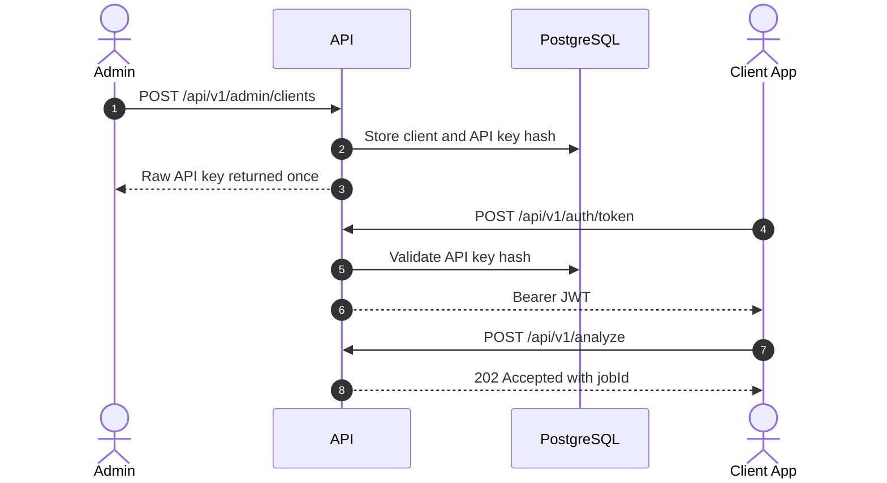

# API

The API exposes JWT-protected flows for clients, administrators, operators and external systems.

## Access Flow

## Main Endpoints

| Role | Endpoints | Purpose |
| --- | --- | --- |
| Client | `/api/v1/auth/token`, `/api/v1/analyze`, `/api/v1/analysis-jobs/*` | Issue JWTs, upload documents and read results. |
| Admin | `/api/v1/admin/clients/*`, `/api/v1/admin/audit-events`, retention policy | Create clients, API keys, audit and retention. |
| Operator | `/api/v1/human-review-tasks`, `/api/v1/operations/metrics` | Human review and operational diagnostics. |
| External system | Client webhook receiver | Receive `analysis.completed`. |

## Detailed Documentation

- [Endpoint flows](api-endpoint-flows.md): endpoint sequence diagrams.
- [Profiles](profiles.md): available analysis profiles.
- [Skills](skills.md): executable analysis units.
- [Client onboarding](client-onboarding-guide.md): controlled client setup.

## Simple Rules

- Every functional endpoint requires `Authorization: Bearer <token>`.
- `/health` is public.
- `/ready` validates dependencies.
- `/api/v1/dev/token` exists only in `Development`.
- Raw API keys are returned once; only their hash is stored afterwards.
