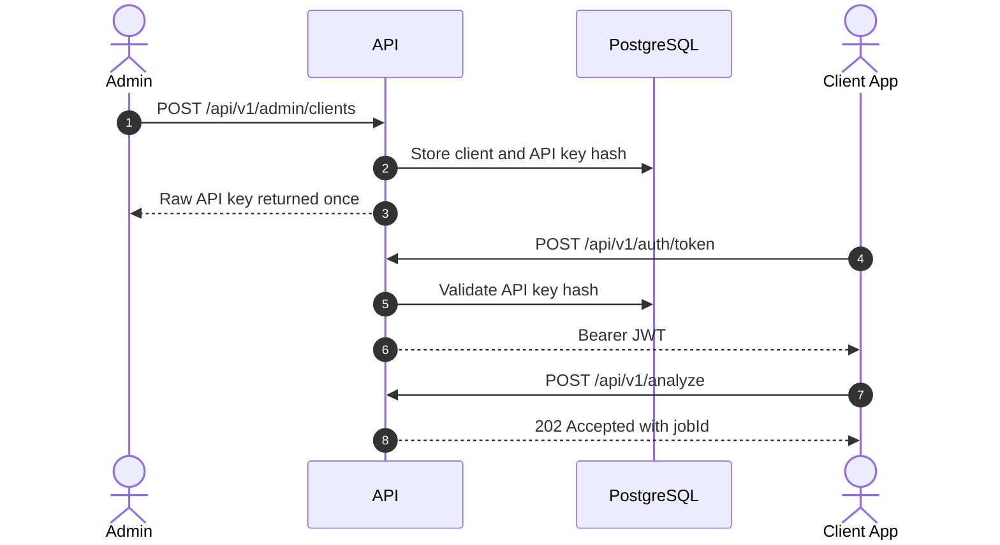

# API

The API exposes JWT-protected flows for clients, administrators, operators and external systems.

## Access Flow



## Main Endpoints

| Role | Endpoints | Purpose |
| --- | --- | --- |
| Client | `/api/v1/auth/token`, `/api/v1/analyze`, `/api/v1/analysis-jobs/*`, `/api/v1/video-search-jobs/*`, `/api/v1/face-search-jobs/*`, `/api/v1/image-batch-search-jobs/*` | Issue JWTs, upload documents, videos, images, reference assets and read results. |
| Admin | `/api/v1/admin/clients/*`, `/api/v1/admin/audit-events`, retention policy | Create clients, API keys, audit and retention. |
| Operator | `/api/v1/human-review-tasks`, `/api/v1/operations/metrics` | Human review and operational diagnostics. |
| External system | Client webhook receiver | Receive `analysis.completed`. |

## Detailed Documentation

- [Endpoint flows](reference/api-endpoint-flows.md): endpoint sequence diagrams.
- [Profiles](profiles.md): available analysis profiles.
- [Skills](skills.md): executable analysis units.
- [Client onboarding](client-onboarding-guide.md): controlled client setup.

## AWS Rekognition Face Search

Endpoints:

```text
POST /api/v1/face-search-jobs
GET  /api/v1/face-search-jobs/{jobId}
GET  /api/v1/face-search-jobs/{jobId}/result
GET  /api/v1/providers/aws-rekognition/status
```

`POST /api/v1/face-search-jobs` uses `multipart/form-data`. `consentReferenceId` is an optional external reference and does not block processing when omitted:

```text
clientKey=<client-key>
profileKey=event-face-search-v1
consentReferenceId=<external-consent-reference>
manifestJson={"targets":[{"targetKey":"participant-001","referenceImageKey":"reference-1"}],"minSimilarity":90}
videos=@<video.mp4>
referenceImages=@<face.jpg>
```

`referenceImages` are numbered in upload order: `reference-1`, `reference-2`, etc. Results return `FaceReference` matches with timestamps, similarity and `sourceProvider=AwsRekognition`; they do not expose `FaceId`, S3 paths or credentials.

For production references, the same endpoint can receive cloud selectors:

```text
assetSelectorJson={"selectorMode":"AllPrefix","storageProvider":"S3","bucketName":"event-bucket","prefix":"events/race/videos/","region":"us-east-1"}
referenceAssetSelectorJson={"selectorMode":"ExplicitAssets","storageProvider":"S3","bucketName":"event-bucket","assets":[{"assetKey":"reference-1","objectKey":"events/race/selfies/person-1.jpg","contentType":"image/jpeg"}]}
```

## Image Batch Search

Endpoints:

```text
POST /api/v1/image-batch-search-jobs
GET  /api/v1/image-batch-search-jobs/{jobId}
GET  /api/v1/image-batch-search-jobs/{jobId}/result
```

Image batch search returns image matches grouped by `targetKey`. AWS supports face references and visible numbers. Google Vision supports visible numbers/OCR and returns a controlled `Unsupported` issue for face identity search.

It accepts multipart uploads for compatibility and `assetSelectorJson` / `referenceAssetSelectorJson` for S3/GCS references. See [Cloud references and staging](cloud-asset-references-and-staging.en.md).

## Simple Rules

- Every functional endpoint requires `Authorization: Bearer <token>`.
- `/health` is public.
- `/ready` validates dependencies.
- `/api/v1/dev/token` exists only in `Development`.
- Raw API keys are returned once; only their hash is stored afterwards.

## Document Jobs, Review And Callbacks

[Client onboarding](client-onboarding-guide.md) contains the create-client,
one-time API key, JWT exchange and document upload examples. Document jobs use
`POST /api/v1/analyze` (file plus profile) or `POST /api/v1/analysis-jobs`
(job metadata without a file); read `/api/v1/analysis-jobs/{jobId}` and `/result`.
`POST /api/v1/analysis-jobs/{jobId}/cancel` cancels a nonterminal document job.
This lifecycle is not a claim that every search module exposes identical states.

| Document state | Meaning |
| --- | --- |
| `Pending` / `Running` | Awaiting work / processing |
| `Completed` | Result available; inspect `issues` as well |
| `RequiresReview` | Human review required |
| `Failed` / `Cancelled` | Terminal failure / cancellation |

Document result fields include `confidence`, `requiresHumanReview`,
`extractedFields`, `detectedEntities`, `detectedLabels`, `generatedClips` and
`issues`. An empty `generatedClips` collection does not imply physical clips exist.
`metadataJson` on upload accepts flat string metadata; keep sensitive data out.

An operator/admin lists `/api/v1/human-review-tasks?status=Pending`, reads
`/{taskId}`, then POSTs to `/{taskId}/start` and `/{taskId}/complete`.
The completion body uses `decision` (`Approve`, `Correct` or `Reject`) and a
`comment`; correction details follow the endpoint contract. See
[endpoint flows](reference/api-endpoint-flows.md) for review and administration.

Optional `analysis.completed` deliveries are signed with HMAC-SHA256 over the
UTF-8 string `timestamp + "." + rawPayload`. Receiver headers:

```text
X-DeValpo-Event-Id: <delivery-id>
X-DeValpo-Event-Type: analysis.completed
X-DeValpo-Timestamp: <unix-seconds>
X-DeValpo-Signature: sha256=<hex-hmac>
```

The payload contains `eventType`, `jobId`, `clientKey`, `profileKey`, `jobStatus`,
`confidence`, `requiresHumanReview` and a relative `resultUrl`, not full OCR,
raw provider data or credentials. Configure targets under
`/api/v1/admin/clients/{clientKey}/webhook-targets`; inspect
`/api/v1/webhook-deliveries` for delivery status. Do not assume this document
callback contract covers every search workflow.

Admin key rotation/revocation use POST
`/api/v1/admin/clients/{clientKey}/api-keys/{apiKeyId}/rotate` and `/revoke`.
Audit and retention routes are documented in the endpoint flows and onboarding
guide; do not include raw API keys, face identifiers or OCR in shared logs.
