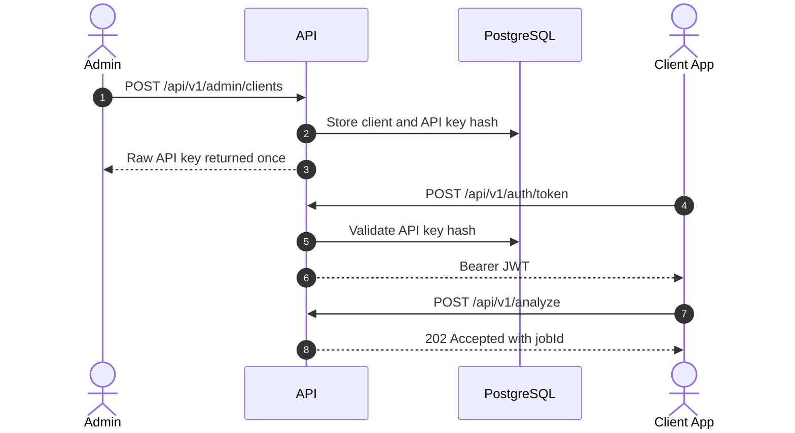

# API

La API expone flujos protegidos por JWT para clientes, administradores, operadores y sistemas externos.

## Flujo De Acceso



## Endpoints Principales

| Rol | Endpoints | Uso |
| --- | --- | --- |
| Cliente | `/api/v1/auth/token`, `/api/v1/analyze`, `/api/v1/analysis-jobs/*`, `/api/v1/video-search-jobs/*`, `/api/v1/face-search-jobs/*`, `/api/v1/image-batch-search-jobs/*` | Emitir JWT, subir documentos, videos, lotes de imagenes, imagenes de referencia y leer resultados. |
| Admin | `/api/v1/admin/clients/*`, `/api/v1/admin/audit-events`, retention policy | Crear clientes, API keys, auditoria y retencion. |
| Operador | `/api/v1/human-review-tasks`, `/api/v1/operations/metrics` | Revision humana y diagnostico operativo. |
| Sistema externo | Webhook receiver del cliente | Recibir `analysis.completed`. |

## Documentacion Detallada

- [Flujos de endpoints](reference/api-endpoint-flows.md): secuencia por endpoint.
- [Perfiles](profiles.md): perfiles de analisis disponibles.
- [Skills](skills.md): unidades ejecutables de analisis.
- [Onboarding de cliente](client-onboarding-guide.md): alta controlada de clientes.
- [Image batch search](image-batch-search.md): busqueda por numero visible o referencia facial en lotes de imagenes.

## AWS Rekognition Face Search

Endpoints:

```text
POST /api/v1/face-search-jobs
GET  /api/v1/face-search-jobs/{jobId}
GET  /api/v1/face-search-jobs/{jobId}/result
GET  /api/v1/providers/aws-rekognition/status
```

`POST /api/v1/face-search-jobs` usa `multipart/form-data`:

```text
clientKey=<client-key>
profileKey=event-face-search-v1
consentReferenceId=<external-consent-reference-optional>
manifestJson={"targets":[{"targetKey":"participant-001","referenceImageKey":"reference-1"}],"minSimilarity":90}
videos=@<video.mp4>
referenceImages=@<face.jpg>
```

Las `referenceImages` se numeran en el orden de subida: `reference-1`, `reference-2`, etc. El resultado devuelve `FaceReference` matches con timestamps, similitud y `sourceProvider=AwsRekognition`; no devuelve `FaceId`, rutas S3 ni credenciales.

Para produccion se pueden reemplazar `videos` y/o `referenceImages` por referencias cloud:

```text
assetSelectorJson={"selectorMode":"AllPrefix","storageProvider":"S3","bucketName":"event-bucket","prefix":"events/race/videos/","region":"us-east-1"}
referenceAssetSelectorJson={"selectorMode":"ExplicitAssets","storageProvider":"S3","bucketName":"event-bucket","assets":[{"assetKey":"reference-1","objectKey":"events/race/selfies/person-1.jpg","contentType":"image/jpeg"}]}
```

## Image Batch Search

Endpoints:

```text
POST /api/v1/image-batch-search-jobs
GET  /api/v1/image-batch-search-jobs/{jobId}
GET  /api/v1/image-batch-search-jobs/{jobId}/result
GET  /api/v1/providers/google-vision/status
```

`POST /api/v1/image-batch-search-jobs` usa `multipart/form-data`:

```text
clientKey=<client-key>
profileKey=image-batch-search-v1
manifestJson={"targets":[{"targetKey":"bib-123","queryType":"VisibleNumber","visibleNumber":"123"},{"targetKey":"participant-001","queryType":"FaceReference","referenceImageKey":"reference-1"}]}
images=@<photo-1.jpg>
images=@<photo-2.jpg>
referenceImages=@<face.jpg>
```

El resultado se agrupa por `targetKey` y devuelve imagenes encontradas. AWS Rekognition soporta `VisibleNumber` y `FaceReference`; Google Vision soporta `VisibleNumber` y devuelve issue `Unsupported` para `FaceReference`.

Tambien acepta `assetSelectorJson` para imagenes fuente y `referenceAssetSelectorJson` para referencias faciales ya subidas a S3/GCS. Ver [Referencias cloud y staging](cloud-asset-references-and-staging.md).

## Reglas Simples

- Todo endpoint funcional requiere `Authorization: Bearer <token>`.
- `/health` es publico.
- `/ready` valida dependencias.
- El endpoint `/api/v1/dev/token` existe solo en `Development`.
- Las API keys crudas se devuelven una vez y luego solo queda el hash.
