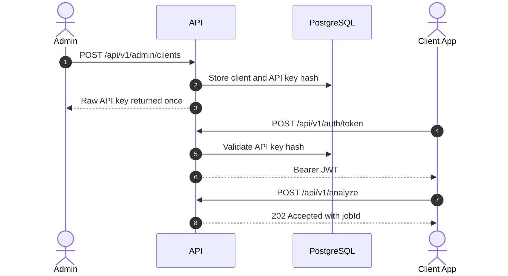

# API

La API expone flujos protegidos por JWT para clientes, administradores, operadores y sistemas externos.

## Flujo De Acceso

## Endpoints Principales

| Rol | Endpoints | Uso |
| --- | --- | --- |
| Cliente | `/api/v1/auth/token`, `/api/v1/analyze`, `/api/v1/analysis-jobs/*` | Emitir JWT, subir documentos y leer resultados. |
| Admin | `/api/v1/admin/clients/*`, `/api/v1/admin/audit-events`, retention policy | Crear clientes, API keys, auditoria y retencion. |
| Operador | `/api/v1/human-review-tasks`, `/api/v1/operations/metrics` | Revision humana y diagnostico operativo. |
| Sistema externo | Webhook receiver del cliente | Recibir `analysis.completed`. |

## Documentacion Detallada

- [Flujos de endpoints](api-endpoint-flows.md): secuencia por endpoint.
- [Perfiles](profiles.md): perfiles de analisis disponibles.
- [Skills](skills.md): unidades ejecutables de analisis.
- [Onboarding de cliente](client-onboarding-guide.md): alta controlada de clientes.

## Reglas Simples

- Todo endpoint funcional requiere `Authorization: Bearer <token>`.
- `/health` es publico.
- `/ready` valida dependencias.
- El endpoint `/api/v1/dev/token` existe solo en `Development`.
- Las API keys crudas se devuelven una vez y luego solo queda el hash.
