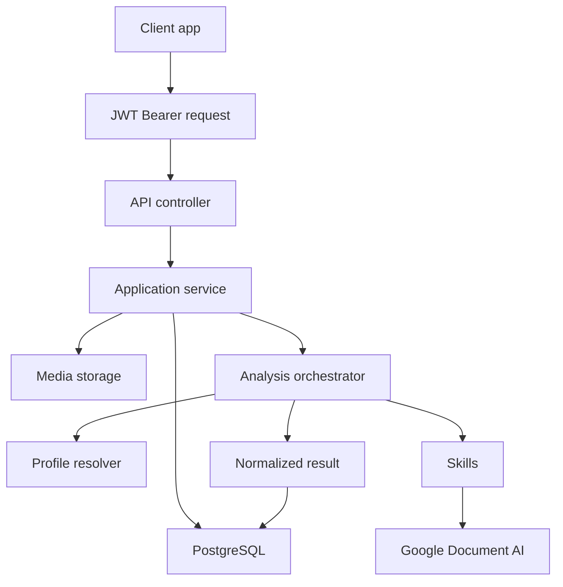
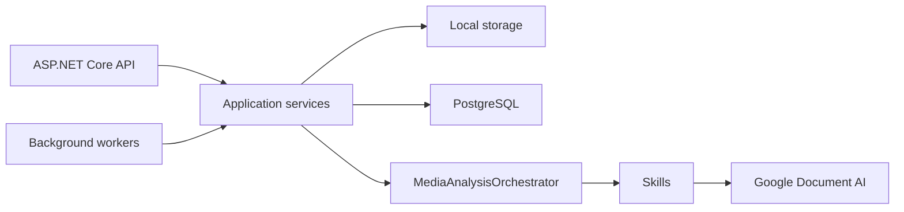

# Architecture

DeValpo.MediaIntelligence is a standalone API for analyzing documents, images, videos and future live-video buffers.

## Layers

- `Contracts`: public DTOs and API-facing enums.
- `Domain`: persistence entities and core data model.
- `Application`: use cases, orchestration, profile resolution and provider/storage abstractions.
- `Infrastructure`: EF Core, PostgreSQL, local storage, Google Document AI and skills.
- `Api`: controllers, middleware, Swagger, health checks and composition.

Dependency direction:

```text
Domain
Contracts
Application -> Domain + Contracts
Infrastructure -> Application + Domain + Contracts
Api -> Application + Infrastructure + Contracts
```

## End-To-End Flow



## Runtime Components



## Profiles, Skills And Capabilities

- A capability describes what the platform can do.
- A skill is an executable unit that produces fields, labels, entities, clips or issues.
- A profile selects skills, order, thresholds and review rules for a use case.
