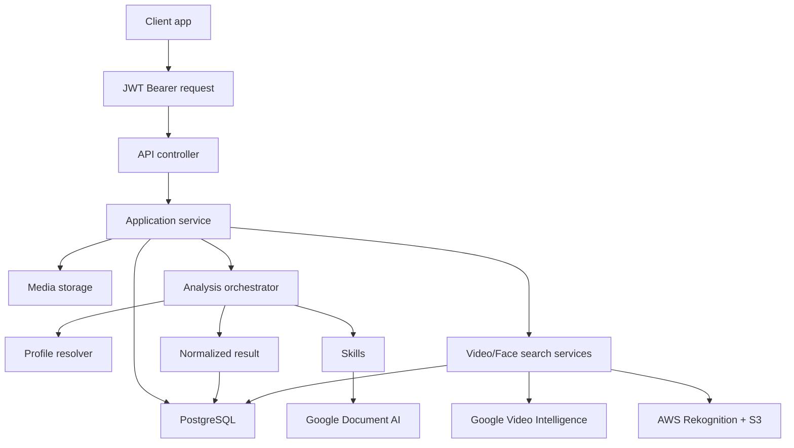
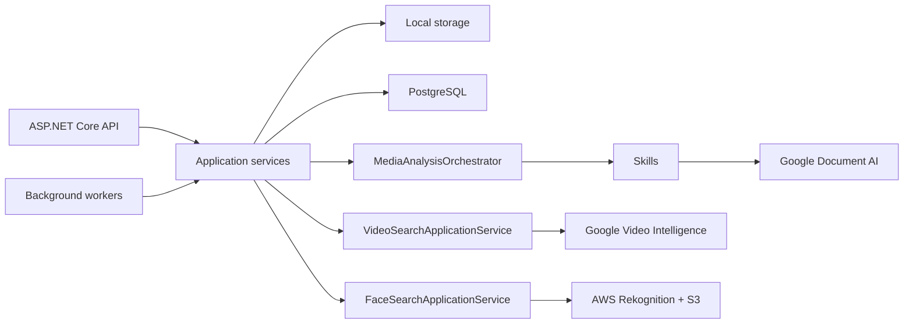

# Architecture

DeValpo.MediaIntelligence is a standalone API for analyzing documents, images, videos and future live-video buffers.

## Layers

- `Contracts`: public DTOs and API-facing enums.
- `Domain`: persistence entities and core data model.
- `Application`: use cases, orchestration, profile resolution and provider/storage abstractions.
- `Infrastructure`: EF Core, PostgreSQL, local storage, Google Document AI, Google Video Intelligence, AWS Rekognition and skills.
- `Api`: controllers, middleware, Swagger, health checks and composition.

Dependency direction:

```text
Domain
Contracts
Application -> Domain + Contracts
Infrastructure -> Application + Domain + Contracts
Api -> Application + Infrastructure + Contracts
```

## End-To-End Flow



## Runtime Components



## Profiles, Skills And Capabilities

- A capability describes what the platform can do.
- A skill is an executable unit that produces fields, labels, entities, clips or issues.
- A profile selects skills, order, thresholds and review rules for a use case.

## Cloud Providers

- Google Document AI processes documents.
- Google Video Intelligence processes visible-number OCR and generic face occurrences in videos.
- AWS Rekognition processes consented face comparison against reference images.
- Each provider lives in its own Infrastructure namespace and uses separate options and credentials.

## Model And Mapper Convention

- Canonical use-case models live under `Application/<Feature>/Models`.
- External providers do not project directly to public DTOs; they first convert SDK responses to canonical Application models.
- Mappers that know external SDKs live under `Infrastructure/Providers/<Provider>/<Service>/Mappers`.
- Use `ToDomain...` names when converting SDK/provider data to internal models and `ToDto...` only when the result is a `Contracts` DTO.
