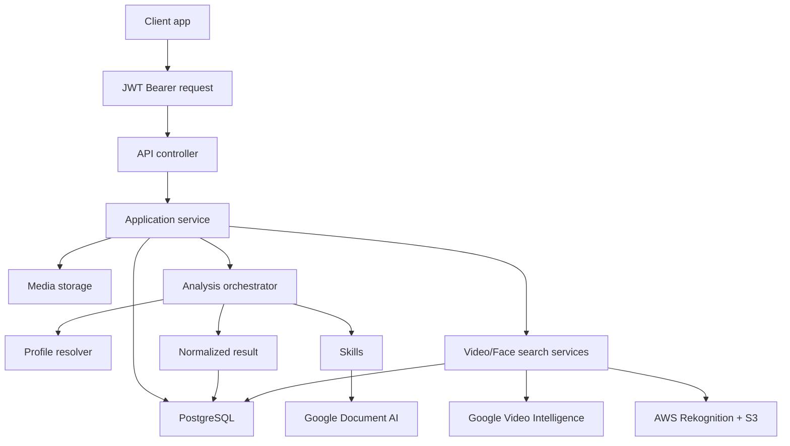
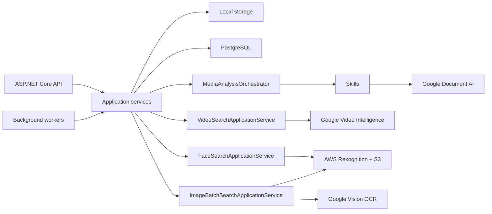

# Architecture

DeValpo.MediaIntelligence is a standalone API for analyzing documents, images and videos. This is the canonical architecture reference;
see [processing flows](architecture/PROCESSING_FLOWS.md) for runtime sequences.

## Layers

- `Contracts`: public DTOs and API-facing enums.
- `Domain`: persistence entities and core data model.
- `Application`: use cases, orchestration, profile resolution and provider/storage abstractions.
- `Infrastructure`: EF Core, PostgreSQL, local storage, Google Document AI, Google Video Intelligence, AWS Rekognition and skills.
- `Api`: controllers, middleware, Swagger, health checks and composition.

Dependency direction:

```text
Domain
Contracts
Application -> Domain + Contracts
Infrastructure -> Application + Domain + Contracts
Api -> Application + Infrastructure + Contracts
```

## End-To-End Flow



## Runtime Components



## Profiles, Skills And Capabilities

- A capability describes what the platform can do.
- A skill is an executable unit that produces fields, labels, entities, clips or issues.
- A profile selects skills, order, thresholds and review rules for a use case.

## Cloud Providers

- Google Document AI processes documents.
- Google Video Intelligence processes visible-number OCR and generic face occurrences in videos.
- AWS Rekognition processes consented face comparison against reference images.
- Each provider lives in its own Infrastructure namespace and uses separate options and credentials.

## Model And Mapper Convention

- Canonical use-case models live under `Application/<Feature>/Models`.
- External providers do not project directly to public DTOs; they first convert SDK responses to canonical Application models.
- Mappers that know external SDKs live under `Infrastructure/Providers/<Provider>/<Service>/Mappers`.
- Use `ToDomain...` names when converting SDK/provider data to internal models and `ToDto...` only when the result is a `Contracts` DTO.

## Composition And Boundaries

The solution contains five production projects and one test project.
`Api/Program.cs` composes `AddApplication()` and `AddInfrastructure()`, binds
options and configures JWT, Serilog, health checks and feature-gated controllers
and hosted workers. Workers currently run with the API, not as independent services.

- Controllers validate requests/access and call Application use cases.
- Application owns provider/storage interfaces and may depend on Domain and Contracts, not provider SDK models.
- Infrastructure implements those interfaces and owns SDK/EF mappings.
- Domain stores normalized state, not credentials or raw provider responses.
- Public Contracts do not expose EF or cloud-provider types.

## Persistence And External Systems

`MediaIntelligenceDbContext` persists clients, API-key hashes, profiles, jobs,
asset metadata, normalized results, review tasks, audit, retention and webhook
state, plus video and image-batch entities. Migrations belong to
`Infrastructure/Persistence/Migrations`; binary media is not stored in PostgreSQL.
Local uploads use configured media storage. S3/GCS references use configured
bucket allowlists; provider-compatible staging is used when required.
Google Vision adds image OCR alongside Document AI, Video Intelligence and AWS.

## Internal Entry Points

| Area | Main services / interfaces |
| --- | --- |
| Client access | `IClientAccessApplicationService`, `IClientAccessTokenService`, `IRequestClientAccessService` |
| Ingestion / jobs | `IUploadedFileValidationService`, `IMediaAnalysisApplicationService`, `IAnalysisJobApplicationService`, `IMediaAssetStorage` |
| Orchestration | `IMediaAnalysisOrchestrator`, `IAnalysisProfileResolver`, `IMediaAnalysisSkill` |
| Google credentials / clients | `IGoogleCredentialProvider`, `IGoogleDocumentAiClientFactory`, `IGoogleDocumentAiStatusService` |
| Review / callbacks | `IHumanReviewApplicationService`, `IWebhookDeliveryApplicationService`, `IWebhookDeliveryProcessor` |
| Operations / governance | `IOperationalMetricsApplicationService`, `IAuditApplicationService`, `IRetentionApplicationService` |

Provider-neutral interfaces are separated from their Infrastructure implementations.
[Runtime configuration](development/CONFIGURATION_GUIDE.md) and
[data model](data-model.en.md) describe the operational options and entities.
