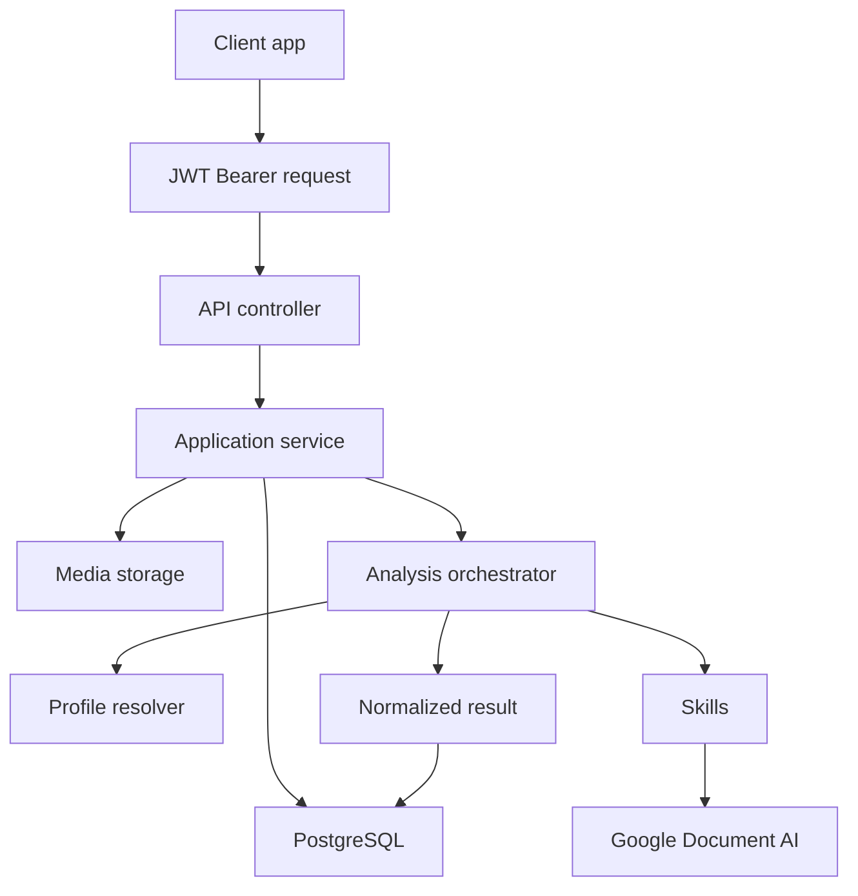
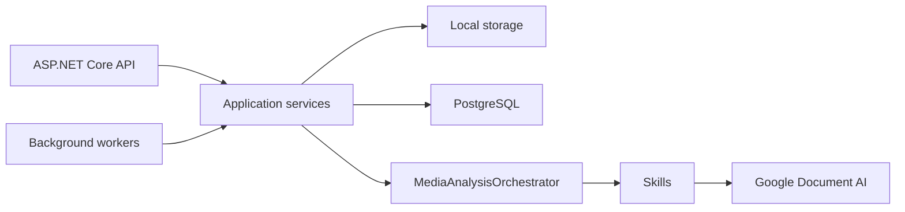

# Arquitectura

DeValpo.MediaIntelligence es una API independiente para analizar documentos, imagenes, videos y futuros buffers de video en vivo.

## Capas

- `Contracts`: DTOs publicos y enums expuestos por API.
- `Domain`: entidades de persistencia y modelo principal.
- `Application`: casos de uso, orquestacion, perfiles y abstracciones de proveedores/storage.
- `Infrastructure`: EF Core, PostgreSQL, storage local, Google Document AI y skills.
- `Api`: controladores, middleware, Swagger, health checks y composicion.

Direccion de dependencias:

```text
Domain
Contracts
Application -> Domain + Contracts
Infrastructure -> Application + Domain + Contracts
Api -> Application + Infrastructure + Contracts
```

## Flujo End-To-End



## Componentes En Runtime



## Profiles, Skills Y Capabilities

- Una capability describe que puede hacer la plataforma.
- Un skill es una unidad ejecutable que produce campos, labels, entidades, clips o issues.
- Un profile selecciona skills, orden, umbrales y reglas de revision para un caso de uso.
