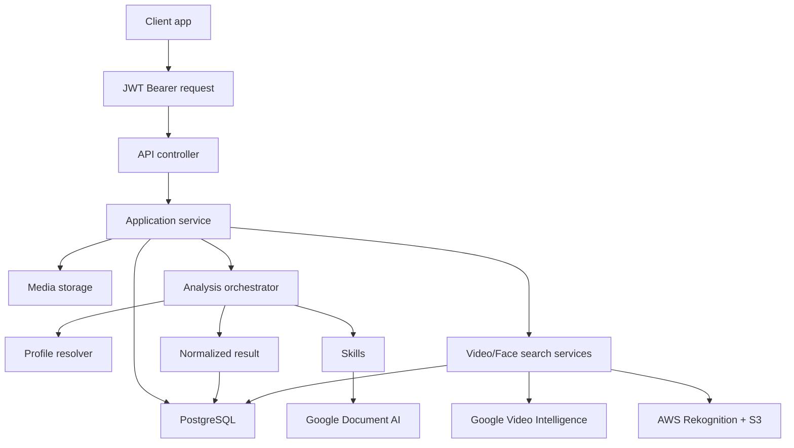
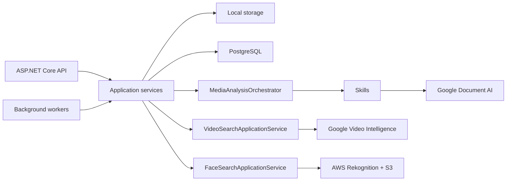

# Arquitectura

DeValpo.MediaIntelligence es una API independiente para analizar documentos, imagenes, videos y futuros buffers de video en vivo.

## Capas

- `Contracts`: DTOs publicos y enums expuestos por API.
- `Domain`: entidades de persistencia y modelo principal.
- `Application`: casos de uso, orquestacion, perfiles y abstracciones de proveedores/storage.
- `Infrastructure`: EF Core, PostgreSQL, storage local, Google Document AI, Google Video Intelligence, AWS Rekognition y skills.
- `Api`: controladores, middleware, Swagger, health checks y composicion.

Direccion de dependencias:

```text
Domain
Contracts
Application -> Domain + Contracts
Infrastructure -> Application + Domain + Contracts
Api -> Application + Infrastructure + Contracts
```

## Flujo End-To-End



## Componentes En Runtime



## Profiles, Skills Y Capabilities

- Una capability describe que puede hacer la plataforma.
- Un skill es una unidad ejecutable que produce campos, labels, entidades, clips o issues.
- Un profile selecciona skills, orden, umbrales y reglas de revision para un caso de uso.

## Providers Cloud

- Google Document AI procesa documentos.
- Google Video Intelligence procesa OCR de numeros visibles y ocurrencias genericas de caras en videos.
- AWS Rekognition procesa comparacion facial consentida contra imagenes de referencia.
- Cada provider vive en su propio namespace de Infrastructure y usa opciones/credenciales separadas.

## Convencion De Modelos Y Mappers

- Los modelos canonicos de cada caso de uso viven bajo `Application/<Feature>/Models`.
- Los providers externos no proyectan directo a DTOs publicos; primero convierten respuestas del SDK a modelos canonicos de Application.
- Los mappers que conocen SDKs externos viven en `Infrastructure/Providers/<Provider>/<Service>/Mappers`.
- Usar nombres `ToDomain...` para convertir SDK/proveedor a modelo interno y `ToDto...` solo cuando el resultado sea un DTO de `Contracts`.
