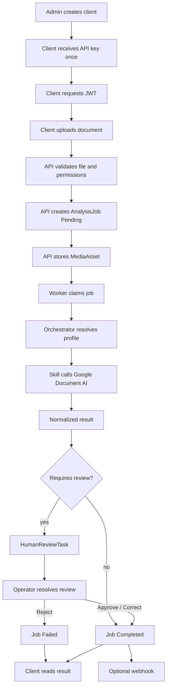
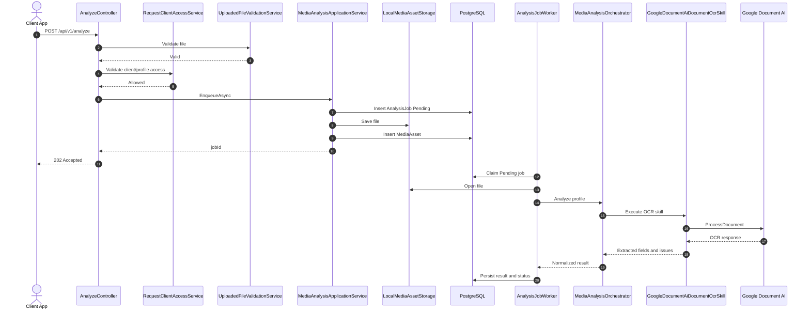
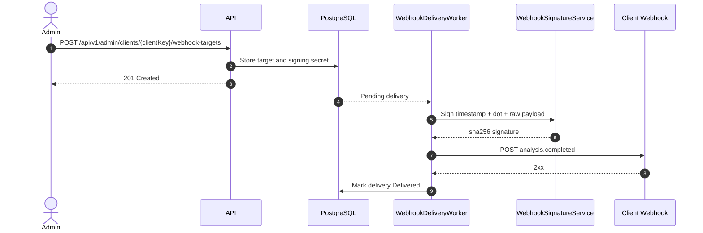

# Processing Flows

## Common Job Lifecycle

1. A protected controller validates client access and request shape.
2. The application service persists a pending job and its asset metadata.
3. A hosted worker resets interrupted work at startup, then polls and claims the
   next pending job.
4. The service calls provider-neutral orchestration or a search provider,
   persists normalized results/issues and records retries or terminal failure.
5. Completion can enqueue signed webhook deliveries; a separate worker retries
   due deliveries with bounded exponential backoff.

## Documents

`POST /api/v1/analyze` accepts a validated multipart asset for an analysis
profile. `MediaAnalysisApplicationService` stores it locally, then
`AnalysisJobWorker` invokes the registered analysis skills. The implemented
production OCR skill is Google Document AI; normalized fields, labels, entities,
issues and review state are persisted.

## Video Target Search

Video jobs are created through `video-search-jobs`. `VideoSearchJobWorker`
processes pending work through Google Video Intelligence. Source videos already
in the configured GCS bucket can be used directly; other local/S3/GCS sources
are staged in GCS before the remote operation. Text and generic face occurrences
are normalized and persisted.

## Face Search

Face-search routes and workers are registered only when
`AwsRekognition:FaceSearchEnabled` is true. The workflow indexes reference
faces, runs Rekognition video face search, persists matches and attempts to
delete temporary Rekognition `FaceId` values. It deliberately does not delete
staged S3 files after processing.

## Image Batch Search

When `ImageBatchSearch:Enabled` is true, image jobs are processed by configured
providers. AWS supports visible-number and face-reference search; Google Vision
supports visible-number/OCR and reports face-reference search as unsupported.
Results are grouped by `targetKey` and persisted with issues.

## Cloud References, Review And Webhooks

`assetSelectorJson` resolves explicit assets or a prefix through S3/GCS browsers.
The resolver rejects public/signed URLs and buckets outside configured allow-lists.
Human-review tasks are created and progressed through protected endpoints.
Webhook targets are admin-managed; deliveries contain a normalized event payload
and are signed with HMAC-SHA256 before sending.

## Document Analysis Overview

Implementation diagrams, not recordings of a new execution. Authentication is
covered by the [API access sequence](../api.md).

## Document Analysis Sequence

## Webhook Delivery Sequence

