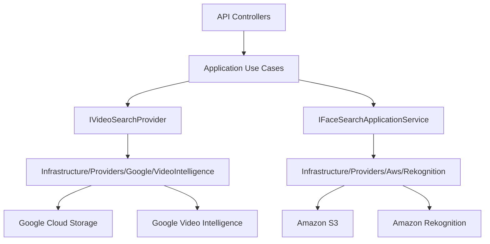
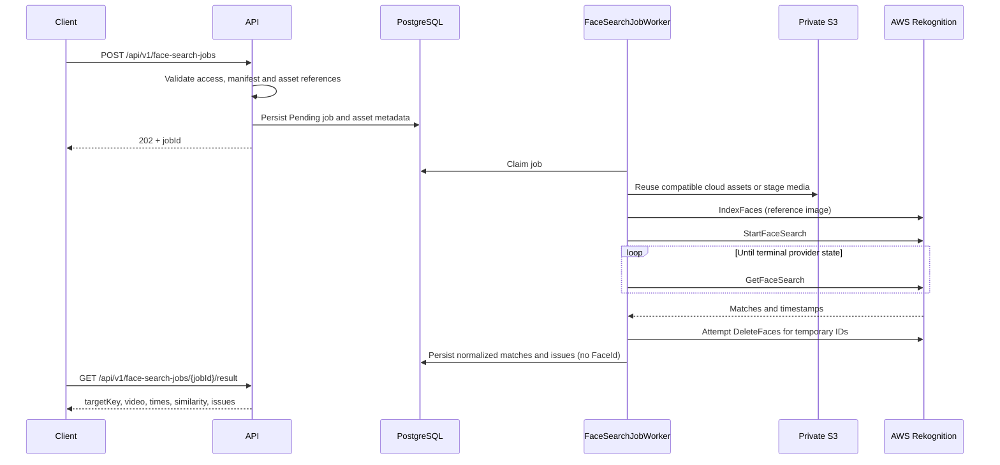

# AWS Rekognition Face Search

This page defines the architecture and contracts for face search in videos with Amazon Rekognition.

AWS Rekognition does not replace Google Video Intelligence. Google remains the base flow for visible-number OCR and generic face detection. AWS Rekognition is added as a separate provider for comparing reference images against faces found in videos.

Official references:

- [Amazon Rekognition collections](https://docs.aws.amazon.com/rekognition/latest/dg/collections.html)
- [Amazon Rekognition Video stored video operations](https://docs.aws.amazon.com/rekognition/latest/dg/video.html)
- [StartFaceSearch API](https://docs.aws.amazon.com/rekognition/latest/APIReference/API_StartFaceSearch.html)
- [Configuring Amazon Rekognition Video](https://docs.aws.amazon.com/rekognition/latest/dg/api-video-roles.html)

## Current State

The API can start without AWS credentials. Face-search routes/workers are feature-gated
by `FaceSearchEnabled`; enabled routes accept only `event-face-search-v1`.
A disabled provider can return an issue rather than simulated matches.
The [saved pilot evidence](examples/video-result-evidence.en.md) demonstrates the real flow.
Setup/remote-check commands below are for separately authorized installation work,
not prerequisites to replay the offline demo.

| Piece | State |
| --- | --- |
| `GET /api/v1/providers/aws-rekognition/status` | Implemented |
| `GET /api/v1/providers/aws-rekognition/status?checkRemote=true` | Implemented, requires operator/admin JWT |
| `POST /api/v1/face-search-jobs` | Implemented, requires JWT and profile access |
| AWS face search worker | Implemented |
| Real S3 staging | Implemented, requires real credentials |
| Real Rekognition collection | Implemented, requires real credentials |
| Simulated results | Forbidden |

## No-Credentials Mode

Use this configuration to start the API without AWS:

```env
AwsRekognition__Enabled=false
AwsRekognition__FaceSearchEnabled=false
AwsRekognition__Region=
AwsRekognition__BucketName=
AwsRekognition__CollectionId=
AwsRekognition__CredentialsPath=
AwsRekognition__ProfileName=
AwsRekognition__AllowUserCredentials=false
AwsRekognition__MinSimilarity=90
AwsRekognition__UsePolling=true
AwsRekognition__PollingIntervalSeconds=5
AwsRekognition__PollingTimeoutSeconds=900
AwsRekognition__StagingPrefix=staging
AwsRekognition__DeleteStagedObjectsAfterProcessing=false
```

Check basic status:

```powershell
curl.exe http://localhost:8085/api/v1/providers/aws-rekognition/status
```

Expected response:

```json
{
  "enabled": false,
  "configured": false,
  "credentialSourcePresent": false,
  "credentialFilePresent": false,
  "region": "",
  "bucketName": "",
  "collectionId": "",
  "profileName": "",
  "missingFields": [],
  "message": "AWS Rekognition is disabled by configuration."
}
```

## Separated Architecture



Rules:

- Google processes visible numbers and generic face occurrences.
- AWS processes face comparison against reference images.
- Providers are not mixed inside the same class.
- Buckets and credentials are not shared between providers.
- Application defines contracts; Infrastructure talks to cloud SDKs.

## Goal

Allow a client to submit:

- one or more real videos;
- one or more reference images;
- one opaque `targetKey` per participant;
- an optional `consentReferenceId` issued outside MediaIntelligence.

The system must return time ranges where AWS finds a face similar to the reference image.

## AWS Requirements

| Resource | Purpose |
| --- | --- |
| AWS Account | Active account with billing enabled. |
| Region | Single region for S3 and Rekognition. Initial recommendation: `us-east-1`. |
| Private S3 bucket | Original assets or temporary staging for videos and reference images. |
| Rekognition collection | Temporary facial vector container for the job. |
| IAM app user/role | Allows upload to S3, face indexing and result lookup. |

V1 uses polling with `GetFaceSearch`. SNS/SQS is reserved for a future extension because it requires additional infrastructure.

## Minimum Permissions

```text
s3:PutObject
s3:GetObject
s3:GetBucketLocation
rekognition:DescribeCollection
rekognition:IndexFaces
rekognition:DeleteFaces
rekognition:StartFaceSearch
rekognition:GetFaceSearch
```

## Configuration With Real AWS

When real credentials and resources exist:

```env
AwsRekognition__Enabled=true
AwsRekognition__FaceSearchEnabled=true
AwsRekognition__Region=<aws-region>
AwsRekognition__BucketName=<private-s3-bucket>
AwsRekognition__CollectionId=<rekognition-collection-id>
AwsRekognition__CredentialsPath=/run/secrets/aws-credentials
AwsRekognition__ProfileName=<profile-name>
AwsRekognition__AllowUserCredentials=true
AwsRekognition__MinSimilarity=90
AwsRekognition__UsePolling=true
```

Do not version access keys. For local development, use an AWS CLI profile or secure variables outside the repository. For production, use managed roles or a secret manager.
`UsePolling=true` is required in v1; `SnsTopicArn` and `RoleArn` are not used by the current worker.

Validate remote AWS resources:

```powershell
curl.exe "http://localhost:8085/api/v1/providers/aws-rekognition/status?checkRemote=true" `
  -H "Authorization: Bearer $token"
```

The remote check validates:

- an AWS credential source exists;
- the S3 bucket is reachable;
- the Rekognition collection exists;
- credentials permit those readiness operations, not necessarily every indexing/search operation.


### Local Credentials And Diagnosis

For a local named profile (never commit credentials or print their contents):

```powershell
aws configure --profile <profile-name>
Copy-Item "$env:USERPROFILE/.aws/credentials" secrets/aws-credentials
```

Compose mounts that ignored file at `/run/secrets/aws-credentials`. Production
uses managed roles or externally managed secrets, not local user credentials.
See [cloud identities](reference/cloud-identities-and-provider-profiles.md) and
[production permissions](reference/production-cloud-credentials.md).

When separately authorized to inspect resources:

```powershell
aws sts get-caller-identity --profile <profile-name>
aws s3api get-bucket-location --bucket <private-s3-bucket> --profile <profile-name>
aws rekognition describe-collection --collection-id <rekognition-collection-id> --region <aws-region> --profile <profile-name>
```

Keep account/resource identifiers out of shared logs. `s3:ListBucket` is needed
for prefix selection; `ExplicitAssets` does not enumerate a prefix. Collection
creation is setup work, not a runtime permission requirement. The production
policy guide separates collection, S3 and video-job permissions; do not broaden
all resources to `*` just because one job action requires a different scope.

Polling settings are `PollingIntervalSeconds` and `PollingTimeoutSeconds` under
`AwsRekognition` (5 and 900 in the example). `UsePolling=true` is required;
`SnsTopicArn` and `RoleArn` are unused by the current worker. Keep
`DeleteStagedObjectsAfterProcessing=false`; bucket lifecycle owns file cleanup.

| Symptom | Check |
| --- | --- |
| `configured=false` | Enabled flags, region, bucket, collection and mounted credential profile |
| Access denied | The denied action and resource; readiness success does not prove search permission |
| `Unsupported codec/format` | Use a separately approved H.264 copy; do not overwrite the original |
| Zero matches with issues | Read the issue before treating the result as a successful empty search |
| Cleanup failure | Temporary face cleanup is attempted; do not claim universal cleanup from one successful run |

## Preparation Commands

Validate AWS CLI:

```powershell
aws --version
aws sts get-caller-identity
```

Create a private bucket:

```powershell
$region = "us-east-1"
$bucketName = "<private-s3-bucket>"

aws s3api create-bucket `
  --bucket $bucketName `
  --region $region

aws s3api put-public-access-block `
  --bucket $bucketName `
  --public-access-block-configuration BlockPublicAcls=true,IgnorePublicAcls=true,BlockPublicPolicy=true,RestrictPublicBuckets=true
```

Create a collection:

```powershell
$collectionId = "<rekognition-collection-id>"

aws rekognition create-collection `
  --collection-id $collectionId `
  --region $region
```

Validate the collection:

```powershell
aws rekognition describe-collection `
  --collection-id $collectionId `
  --region $region
```

## Processing Flow



## Implemented Contract

Existing endpoints (subject to feature configuration and authorization):

```http
POST /api/v1/face-search-jobs
GET  /api/v1/face-search-jobs/{jobId}
GET  /api/v1/face-search-jobs/{jobId}/result
```

`POST /api/v1/face-search-jobs`:

```text
clientKey
profileKey=event-face-search-v1
optional consentReferenceId
manifestJson
videos[]
referenceImages[]
optional assetSelectorJson
optional referenceAssetSelectorJson
```

Minimum manifest:

```json
{
  "minSimilarity": 90,
  "targets": [
    {
      "targetKey": "participant-001",
      "referenceImageKey": "reference-1"
    }
  ]
}
```

Illustrative result fragment (not a recorded run):

```json
{
  "jobId": "00000000-0000-0000-0000-000000000000",
  "status": "Completed",
  "faceMatches": [
    {
      "targetKey": "participant-001",
      "videoKey": "video-1",
      "startTimeSeconds": 83.2,
      "endTimeSeconds": 83.2,
      "similarity": 94.7,
      "matchType": "FaceReference",
      "sourceProvider": "AwsRekognition"
    }
  ]
}
```

## Mandatory Rules

- `consentReferenceId` is optional; missing reference does not block processing. The external platform owns authorization and consent records.
- Opaque `targetKey` is required.
- Reject `name`, `rut`, `email`, `phone`, `userId`, `personId`.
- `FaceSearchEnabled=false` by default.
- Do not mix Google `VisibleNumber` matches with AWS `FaceReference` matches.
- Do not permanently store reference images without an explicit retention policy.
- Audit consent, indexing, search, result read and deletion.
- Do not delete staged objects from the job; file cleanup depends on bucket lifecycle policy with a short TTL.
- The provider attempts temporary `DeleteFaces` cleanup in `finally`; errors/cancellation require operational attention. Face IDs are not persisted by this video workflow.
- Later revocation by target/job is outside v1 because the API does not persist `FaceId`; if a persistent index is defined, that extension must add storage and consent-based deletion.
- Do not return fake matches.
