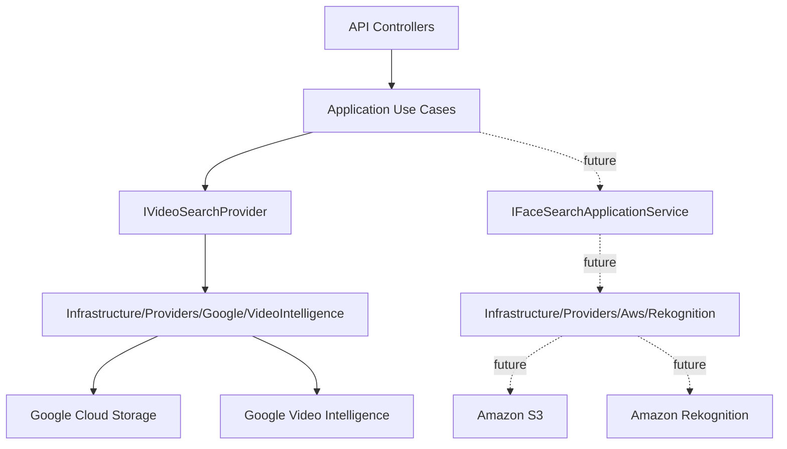
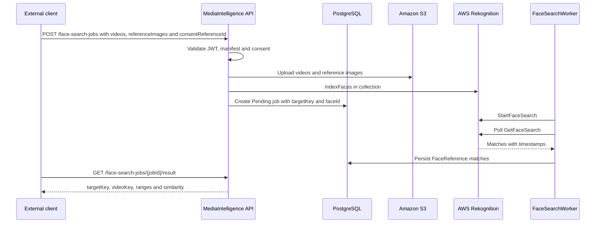

# AWS Rekognition Face Search

This page defines the Phase 2 architecture and requirements for face search in videos with Amazon Rekognition.

Phase 2 does not replace Google Video Intelligence. Google remains the base flow for visible-number OCR and generic face detection. AWS Rekognition is added as a separate provider for comparing reference images against faces found in videos.

Official references:

- [Amazon Rekognition collections](https://docs.aws.amazon.com/rekognition/latest/dg/collections.html)
- [Amazon Rekognition Video stored video operations](https://docs.aws.amazon.com/rekognition/latest/dg/video.html)
- [StartFaceSearch API](https://docs.aws.amazon.com/rekognition/latest/APIReference/API_StartFaceSearch.html)
- [Configuring Amazon Rekognition Video](https://docs.aws.amazon.com/rekognition/latest/dg/api-video-roles.html)

## Current State

The API can run without AWS credentials today. It exposes local status, keeps AWS disabled by default, and hides facial job endpoints while `AwsRekognition__FaceSearchEnabled=false`.

| Piece | State |
| --- | --- |
| `GET /api/v1/providers/aws-rekognition/status` | Implemented |
| `GET /api/v1/providers/aws-rekognition/status?checkRemote=true` | Implemented, requires operator/admin JWT |
| `POST /api/v1/face-search-jobs` | Implemented, hidden behind feature flag |
| AWS face search worker | Implemented, not registered when the flag is off |
| Real S3 staging | Implemented, requires real credentials |
| Real Rekognition collection | Implemented, requires real credentials |
| Simulated results | Forbidden |

## No-Credentials Mode

Use this configuration to start the API without AWS:

```env
AwsRekognition__Enabled=false
AwsRekognition__FaceSearchEnabled=false
AwsRekognition__Region=
AwsRekognition__BucketName=
AwsRekognition__CollectionId=
AwsRekognition__MinSimilarity=90
AwsRekognition__UsePolling=true
AwsRekognition__PollingIntervalSeconds=5
AwsRekognition__PollingTimeoutSeconds=900
AwsRekognition__StagingPrefix=face-search
AwsRekognition__DeleteStagedObjectsAfterProcessing=true
AwsRekognition__SnsTopicArn=
AwsRekognition__RoleArn=
```

Check basic status:

```powershell
curl.exe http://localhost:8085/api/v1/providers/aws-rekognition/status
```

Expected response:

```json
{
  "enabled": false,
  "configured": false,
  "credentialSourcePresent": false,
  "region": "",
  "bucketName": "",
  "collectionId": "",
  "missingFields": [],
  "message": "AWS Rekognition is disabled by configuration."
}
```

## Separated Architecture



Rules:

- Google processes visible numbers and generic face occurrences.
- AWS will process face comparison against reference images.
- Providers are not mixed inside the same class.
- Buckets and credentials are not shared between providers.
- Application defines contracts; Infrastructure talks to cloud SDKs.

## Phase 2 Goal

Allow a client to submit:

- one or more real videos;
- one or more reference images;
- one opaque `targetKey` per participant;
- a `consentReferenceId` issued outside MediaIntelligence.

The system must return time ranges where AWS finds a face similar to the reference image.

## AWS Requirements

| Resource | Purpose |
| --- | --- |
| AWS Account | Active account with billing enabled. |
| Region | Single region for S3, Rekognition, SNS/SQS. Initial recommendation: `us-east-1`. |
| Private S3 bucket | Staging for videos and reference images. |
| Rekognition collection | Facial vector container indexed by `targetKey`. |
| IAM app user/role | Allows upload to S3, face indexing and result lookup. |
| IAM service role | Allows Rekognition Video to publish to SNS if async notification mode is used. |
| SNS topic | Video analysis completion notification. |
| SQS queue | Queue subscribed to SNS so the worker can process completions. |

For the fast MVP, polling with `GetFaceSearch` is enough. SNS/SQS can wait for the product phase.

## Minimum Permissions

```text
s3:PutObject
s3:GetObject
s3:DeleteObject
s3:GetBucketLocation
rekognition:CreateCollection
rekognition:DescribeCollection
rekognition:IndexFaces
rekognition:DeleteFaces
rekognition:ListFaces
rekognition:StartFaceSearch
rekognition:GetFaceSearch
iam:PassRole
```

If SNS/SQS is enabled:

```text
sns:Publish
sqs:ReceiveMessage
sqs:DeleteMessage
sqs:GetQueueAttributes
```

## Configuration With Real AWS

When real credentials and resources exist:

```env
AwsRekognition__Enabled=true
AwsRekognition__FaceSearchEnabled=true
AwsRekognition__Region=<aws-region>
AwsRekognition__BucketName=<private-s3-bucket>
AwsRekognition__CollectionId=<rekognition-collection-id>
AwsRekognition__MinSimilarity=90
AwsRekognition__UsePolling=true
AwsRekognition__SnsTopicArn=
AwsRekognition__RoleArn=
```

Do not version access keys. For local development, use an AWS CLI profile or secure variables outside the repository. For production, use managed roles or a secret manager.

Validate remote AWS resources:

```powershell
curl.exe "http://localhost:8085/api/v1/providers/aws-rekognition/status?checkRemote=true" `
  -H "Authorization: Bearer $token"
```

The remote check validates:

- an AWS credential source exists;
- the S3 bucket is reachable;
- the Rekognition collection exists;
- credentials have enough permissions.

## Preparation Commands

Validate AWS CLI:

```powershell
aws --version
aws sts get-caller-identity
```

Create a private bucket:

```powershell
$region = "us-east-1"
$bucketName = "<private-s3-bucket>"

aws s3api create-bucket `
  --bucket $bucketName `
  --region $region

aws s3api put-public-access-block `
  --bucket $bucketName `
  --public-access-block-configuration BlockPublicAcls=true,IgnorePublicAcls=true,BlockPublicPolicy=true,RestrictPublicBuckets=true
```

Create a collection:

```powershell
$collectionId = "<rekognition-collection-id>"

aws rekognition create-collection `
  --collection-id $collectionId `
  --region $region
```

Validate the collection:

```powershell
aws rekognition describe-collection `
  --collection-id $collectionId `
  --region $region
```

## Recommended Phase 2A Flow



## Future Contract

Future endpoints, only after the real provider is implemented:

```http
POST /api/v1/face-search-jobs
GET  /api/v1/face-search-jobs/{jobId}
GET  /api/v1/face-search-jobs/{jobId}/result
```

`POST /api/v1/face-search-jobs`:

```text
clientKey
profileKey=event-face-search-v1
consentReferenceId
manifestJson
videos[]
referenceImages[]
```

Minimum manifest:

```json
{
  "minSimilarity": 90,
  "targets": [
    {
      "targetKey": "participant-001"
    }
  ]
}
```

Expected result:

```json
{
  "jobId": "00000000-0000-0000-0000-000000000000",
  "status": "Completed",
  "faceMatches": [
    {
      "targetKey": "participant-001",
      "videoKey": "video-1",
      "startTimeSeconds": 83.2,
      "endTimeSeconds": 95.8,
      "similarity": 94.7,
      "matchType": "FaceReference",
      "sourceProvider": "AwsRekognition"
    }
  ]
}
```

## Mandatory Rules

- `consentReferenceId` is required.
- Opaque `targetKey` is required.
- Reject `name`, `rut`, `email`, `phone`, `userId`, `personId`.
- `FaceSearchEnabled=false` by default.
- Do not mix Google `VisibleNumber` matches with AWS `FaceReference` matches.
- Do not permanently store reference images without an explicit retention policy.
- Audit consent, indexing, search, result read and deletion.
- Delete temporary S3 objects after completing or failing the job.
- Allow `DeleteFaces` by target/job when consent is revoked.
- Do not return fake matches.

## QA Without Credentials

Checklist to validate that the API runs without AWS:

```powershell
curl.exe http://localhost:8085/health
curl.exe http://localhost:8085/api/v1/providers/aws-rekognition/status
curl.exe -s -o NUL -w "%{http_code}" "http://localhost:8085/api/v1/providers/aws-rekognition/status?checkRemote=true"
curl.exe -s -o NUL -w "%{http_code}" -X POST "http://localhost:8085/api/v1/face-search-jobs" -H "Authorization: Bearer $token"
```

Expected result:

| Validation | Result |
| --- | --- |
| `/health` | `200` |
| Basic AWS status | `enabled=false`, `configured=false` |
| `checkRemote=true` without token | `401` |
| `checkRemote=true` with token without operational scope | `403` |
| `POST /api/v1/face-search-jobs` with operator token | `404` until the real provider is implemented |

If remote status is tested with AWS enabled, use real credentials and real resources. Do not use simulated responses.

## Criteria Before Implementing AWS Jobs

Before implementing the real facial search flow:

1. AWS CLI authenticates correctly.
2. Private S3 bucket is created.
3. Rekognition collection is created.
4. IAM permissions are defined.
5. Polling or SNS/SQS is chosen for the MVP.
6. An external `consentReferenceId` source exists.
7. Real reference image and real video exist for a local smoke test.
