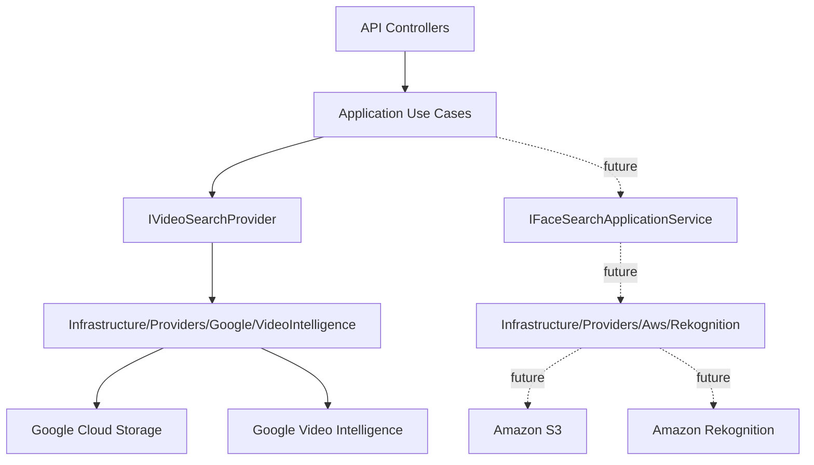

# AWS Rekognition Face Search

This page defines the Phase 2 architecture for face search in videos with Amazon Rekognition. The system can run without AWS credentials today: it exposes local status, keeps AWS disabled by default, and does not publish facial job endpoints.

## Current State

| Piece | State |
| --- | --- |
| `GET /api/v1/providers/aws-rekognition/status` | Implemented |
| `GET /api/v1/providers/aws-rekognition/status?checkRemote=true` | Implemented, requires operator/admin JWT |
| `POST /api/v1/face-search-jobs` | Not implemented |
| AWS face search worker | Not implemented |
| Real S3 staging | Waiting for credentials |
| Real Rekognition collection | Waiting for credentials |
| Simulated results | Forbidden |

## No-Credentials Mode

Use this configuration to start the API without AWS:

```env
AwsRekognition__Enabled=false
AwsRekognition__FaceSearchEnabled=false
AwsRekognition__Region=
AwsRekognition__BucketName=
AwsRekognition__CollectionId=
AwsRekognition__MinSimilarity=90
AwsRekognition__UsePolling=true
AwsRekognition__SnsTopicArn=
AwsRekognition__RoleArn=
```

Check basic status:

```powershell
curl.exe http://localhost:8085/api/v1/providers/aws-rekognition/status
```

Expected response:

```json
{
  "enabled": false,
  "configured": false,
  "credentialSourcePresent": false,
  "region": "",
  "bucketName": "",
  "collectionId": "",
  "missingFields": [],
  "message": "AWS Rekognition is disabled by configuration."
}
```

## Separated Architecture



Rules:

- Google processes visible numbers and generic face occurrences.
- AWS will process face comparison against reference images.
- Providers are not mixed inside the same class.
- Buckets and credentials are not shared between providers.
- Application defines contracts; Infrastructure talks to cloud SDKs.

## Real AWS Preparation

Required resources:

| Resource | Use |
| --- | --- |
| AWS Account | Account with billing enabled. |
| Region | Single region for S3 and Rekognition. |
| Private S3 bucket | Staging for videos and reference images. |
| Rekognition collection | Facial vector container keyed by `targetKey`. |
| IAM app user/role | Scoped access to S3 and Rekognition. |

Minimum permissions for the real Phase 2:

```text
s3:PutObject
s3:GetObject
s3:DeleteObject
s3:GetBucketLocation
rekognition:CreateCollection
rekognition:DescribeCollection
rekognition:IndexFaces
rekognition:DeleteFaces
rekognition:ListFaces
rekognition:StartFaceSearch
rekognition:GetFaceSearch
```

## Remote Status

When real credentials and resources exist:

```env
AwsRekognition__Enabled=true
AwsRekognition__FaceSearchEnabled=true
AwsRekognition__Region=<aws-region>
AwsRekognition__BucketName=<private-s3-bucket>
AwsRekognition__CollectionId=<rekognition-collection-id>
AwsRekognition__MinSimilarity=90
AwsRekognition__UsePolling=true
```

Validate remote AWS resources:

```powershell
curl.exe "http://localhost:8085/api/v1/providers/aws-rekognition/status?checkRemote=true" `
  -H "Authorization: Bearer $token"
```

The remote check validates:

- an AWS credential source exists;
- the S3 bucket is reachable;
- the Rekognition collection exists;
- credentials have enough permissions.

## Future Contract

Future endpoints, only after the real provider is implemented:

```http
POST /api/v1/face-search-jobs
GET  /api/v1/face-search-jobs/{jobId}
GET  /api/v1/face-search-jobs/{jobId}/result
```

Future input:

```text
clientKey
profileKey=event-face-search-v1
consentReferenceId
manifestJson
videos[]
referenceImages[]
```

Mandatory rules:

- `consentReferenceId` is required.
- Opaque `targetKey` is required.
- Reject `name`, `rut`, `email`, `phone`, `userId`, `personId`.
- Do not permanently store reference images without a retention policy.
- Do not enable `FaceSearchEnabled` by default.
- Do not return fake matches.

## QA Without Credentials

Checklist to validate that the API runs without AWS:

```powershell
curl.exe http://localhost:8085/health
curl.exe http://localhost:8085/api/v1/providers/aws-rekognition/status
curl.exe -s -o NUL -w "%{http_code}" "http://localhost:8085/api/v1/providers/aws-rekognition/status?checkRemote=true"
curl.exe -s -o NUL -w "%{http_code}" -X POST "http://localhost:8085/api/v1/face-search-jobs" -H "Authorization: Bearer $token"
```

Expected result:

| Validation | Result |
| --- | --- |
| `/health` | `200` |
| Basic AWS status | `enabled=false`, `configured=false` |
| `checkRemote=true` without token | `401` |
| `checkRemote=true` with token without operational scope | `403` |
| `POST /api/v1/face-search-jobs` with operator token | `404` until the real provider is implemented |

If remote status is tested with AWS enabled, use real credentials and real resources. Do not use simulated responses.
