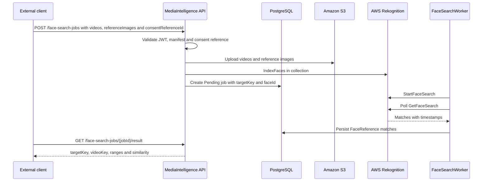

# AWS Rekognition Face Search Requirements

This page defines what is required to implement Phase 2 face search in videos with Amazon Rekognition.

Phase 2 does not replace Google Video Intelligence. Google remains the base flow for visible-number OCR and generic face detection. AWS Rekognition is added as a separate provider for comparing reference images against faces found in videos.

Official references:

- [Amazon Rekognition collections](https://docs.aws.amazon.com/rekognition/latest/dg/collections.html)
- [Amazon Rekognition Video stored video operations](https://docs.aws.amazon.com/rekognition/latest/dg/video.html)
- [StartFaceSearch API](https://docs.aws.amazon.com/rekognition/latest/APIReference/API_StartFaceSearch.html)
- [Configuring Amazon Rekognition Video](https://docs.aws.amazon.com/rekognition/latest/dg/api-video-roles.html)

## Goal

Allow a client to submit:

- one or more real videos;
- one or more reference images;
- one opaque `targetKey` per participant;
- a `consentReferenceId` issued outside MediaIntelligence.

The system must return time ranges where AWS finds a face similar to the reference image.

## AWS Requirements

| Resource | Purpose |
| --- | --- |
| AWS Account | Active account with billing enabled. |
| Region | Single region for S3, Rekognition, SNS/SQS. Initial recommendation: `us-east-1`. |
| S3 bucket | Private staging for videos and reference images. |
| Rekognition collection | Container for facial vectors indexed by `targetKey`. |
| App IAM user/role | Uploads to S3, indexes faces and reads results. |
| IAM service role | Allows Rekognition Video to publish to SNS if notification mode is used. |
| SNS topic | Completion notification for video analysis. |
| SQS queue | Queue subscribed to SNS for worker completions. |

For the fast MVP, polling with `GetFaceSearch` is enough. SNS/SQS can wait for the product phase.

## Minimum Permissions

The application credential needs scoped permissions for development resources:

```text
s3:PutObject
s3:GetObject
s3:DeleteObject
rekognition:CreateCollection
rekognition:DescribeCollection
rekognition:IndexFaces
rekognition:DeleteFaces
rekognition:ListFaces
rekognition:StartFaceSearch
rekognition:GetFaceSearch
iam:PassRole
```

If SNS/SQS is enabled:

```text
sns:Publish
sqs:ReceiveMessage
sqs:DeleteMessage
sqs:GetQueueAttributes
```

## Expected Configuration

Local development variables:

```env
AwsRekognition__Enabled=true
AwsRekognition__Region=us-east-1
AwsRekognition__BucketName=<private-s3-bucket>
AwsRekognition__CollectionId=<rekognition-collection-id>
AwsRekognition__FaceSearchEnabled=true
AwsRekognition__MinSimilarity=90
AwsRekognition__UsePolling=true
AwsRekognition__SnsTopicArn=
AwsRekognition__RoleArn=
```

Do not version access keys. For local development, use an AWS CLI profile or secure environment outside the repo. For production, use managed roles or a secret manager.

## Preparation Commands

Validate AWS CLI:

```powershell
aws --version
aws sts get-caller-identity
```

Create a private bucket:

```powershell
$region = "us-east-1"
$bucketName = "<private-s3-bucket>"

aws s3api create-bucket `
  --bucket $bucketName `
  --region $region

aws s3api put-public-access-block `
  --bucket $bucketName `
  --public-access-block-configuration BlockPublicAcls=true,IgnorePublicAcls=true,BlockPublicPolicy=true,RestrictPublicBuckets=true
```

Create a collection:

```powershell
$collectionId = "<rekognition-collection-id>"

aws rekognition create-collection `
  --collection-id $collectionId `
  --region $region
```

Validate the collection:

```powershell
aws rekognition describe-collection `
  --collection-id $collectionId `
  --region $region
```

## Recommended Phase 2A Flow



## Future Contract

Future endpoints:

```http
GET  /api/v1/providers/aws-rekognition/status
POST /api/v1/face-search-jobs
GET  /api/v1/face-search-jobs/{jobId}
GET  /api/v1/face-search-jobs/{jobId}/result
```

`POST /api/v1/face-search-jobs`:

```text
clientKey
profileKey=event-face-search-v1
consentReferenceId
manifestJson
videos[]
referenceImages[]
```

Minimum manifest:

```json
{
  "minSimilarity": 90,
  "targets": [
    {
      "targetKey": "participant-001"
    }
  ]
}
```

Expected result:

```json
{
  "jobId": "00000000-0000-0000-0000-000000000000",
  "status": "Completed",
  "faceMatches": [
    {
      "targetKey": "participant-001",
      "videoKey": "video-1",
      "startTimeSeconds": 83.2,
      "endTimeSeconds": 95.8,
      "similarity": 94.7,
      "matchType": "FaceReference",
      "sourceProvider": "AwsRekognition"
    }
  ]
}
```

## Mandatory Rules

- `consentReferenceId` is required.
- Opaque `targetKey` is required.
- Reject `name`, `rut`, `email`, `phone`, `userId`, `personId`.
- `FaceSearchEnabled=false` by default.
- Do not mix Google `VisibleNumber` results with AWS `FaceReference` results.
- Do not store reference images permanently unless a retention policy explicitly allows it.
- Audit consent, indexing, search, result reads and deletion.
- Delete temporary S3 objects after the job completes or fails.
- Allow `DeleteFaces` by target/job when consent is revoked.

## Ready-To-Implement Criteria

Before implementation starts:

1. AWS CLI authenticates successfully.
2. Private S3 bucket exists.
3. Rekognition collection exists.
4. IAM permissions are defined.
5. MVP mode is chosen: polling or SNS/SQS.
6. An external system can issue `consentReferenceId`.
7. A real reference image and a real video are available for local smoke testing.

## Out Of Scope For This PR

- .NET AWS implementation.
- Public face search endpoints.
- AWS credentials.
- Real images or videos.
- Exported test results.

