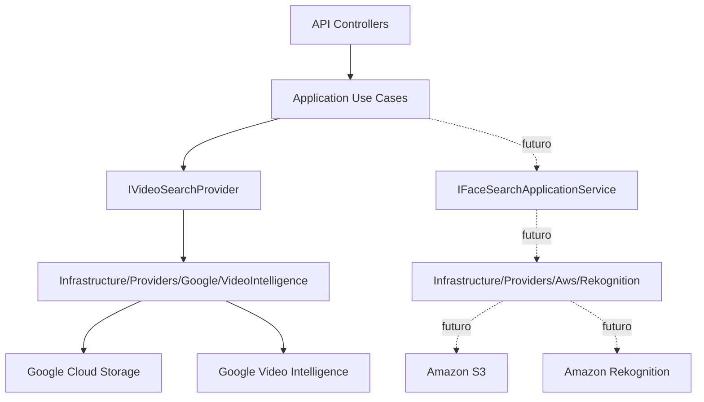
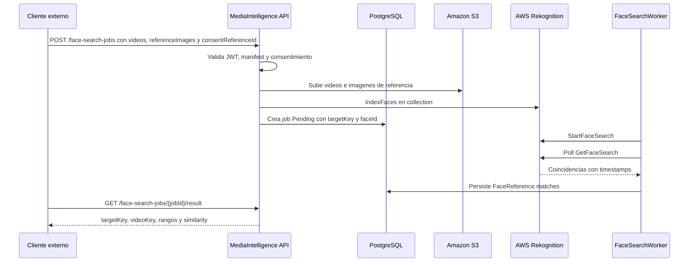

# AWS Rekognition Face Search

Esta pagina define la arquitectura y los requisitos de Fase 2 para busqueda facial en videos con Amazon Rekognition.

La Fase 2 no reemplaza Google Video Intelligence. Google sigue siendo el flujo base para OCR de numeros visibles y deteccion generica de caras. AWS Rekognition se agrega como provider separado para comparar imagenes de referencia contra caras detectadas en videos.

Referencias oficiales:

- [Amazon Rekognition collections](https://docs.aws.amazon.com/rekognition/latest/dg/collections.html)
- [Amazon Rekognition Video stored video operations](https://docs.aws.amazon.com/rekognition/latest/dg/video.html)
- [StartFaceSearch API](https://docs.aws.amazon.com/rekognition/latest/APIReference/API_StartFaceSearch.html)
- [Configuring Amazon Rekognition Video](https://docs.aws.amazon.com/rekognition/latest/dg/api-video-roles.html)

## Estado Actual

Hoy la API puede operar sin credenciales AWS. Expone status local, mantiene AWS apagado por defecto y no publica endpoints de jobs faciales.

| Pieza | Estado |
| --- | --- |
| `GET /api/v1/providers/aws-rekognition/status` | Implementado |
| `GET /api/v1/providers/aws-rekognition/status?checkRemote=true` | Implementado, requiere JWT operator/admin |
| `POST /api/v1/face-search-jobs` | No implementado |
| Worker AWS face search | No implementado |
| S3 staging real | Pendiente de credenciales |
| Rekognition collection real | Pendiente de credenciales |
| Resultados simulados | Prohibidos |

## Modo Sin Credenciales

Usar esta configuracion para levantar la API sin AWS:

```env
AwsRekognition__Enabled=false
AwsRekognition__FaceSearchEnabled=false
AwsRekognition__Region=
AwsRekognition__BucketName=
AwsRekognition__CollectionId=
AwsRekognition__MinSimilarity=90
AwsRekognition__UsePolling=true
AwsRekognition__SnsTopicArn=
AwsRekognition__RoleArn=
```

Validar status basico:

```powershell
curl.exe http://localhost:8085/api/v1/providers/aws-rekognition/status
```

Respuesta esperada:

```json
{
  "enabled": false,
  "configured": false,
  "credentialSourcePresent": false,
  "region": "",
  "bucketName": "",
  "collectionId": "",
  "missingFields": [],
  "message": "AWS Rekognition is disabled by configuration."
}
```

## Arquitectura Separada



Reglas:

- Google procesa numeros visibles y caras genericas.
- AWS procesara comparacion facial contra imagenes de referencia.
- No se mezclan providers en la misma clase.
- No se comparten buckets ni credenciales entre providers.
- Application define contratos; Infrastructure habla con SDKs cloud.

## Objetivo Fase 2

Permitir que un cliente envie:

- uno o mas videos reales;
- una o mas imagenes de referencia;
- un `targetKey` opaco por participante;
- un `consentReferenceId` emitido fuera de MediaIntelligence.

El sistema debe devolver rangos de tiempo donde AWS encuentra una cara similar a la referencia.

## Requisitos AWS

| Recurso | Uso |
| --- | --- |
| AWS Account | Cuenta activa con billing habilitado. |
| Region | Region unica para S3, Rekognition, SNS/SQS. Recomendado inicial: `us-east-1`. |
| S3 bucket privado | Staging para videos e imagenes de referencia. |
| Rekognition collection | Contenedor de vectores faciales indexados por `targetKey`. |
| IAM user/role app | Permite subir a S3, indexar caras y consultar resultados. |
| IAM service role | Permite a Rekognition Video publicar en SNS si se usa modo async con notificaciones. |
| SNS topic | Notificacion de termino de analisis de video. |
| SQS queue | Cola suscrita a SNS para que el worker procese completions. |

Para MVP rapido se puede usar polling con `GetFaceSearch` y dejar SNS/SQS para la fase producto.

## Permisos Minimos

```text
s3:PutObject
s3:GetObject
s3:DeleteObject
s3:GetBucketLocation
rekognition:CreateCollection
rekognition:DescribeCollection
rekognition:IndexFaces
rekognition:DeleteFaces
rekognition:ListFaces
rekognition:StartFaceSearch
rekognition:GetFaceSearch
iam:PassRole
```

Si se habilita SNS/SQS:

```text
sns:Publish
sqs:ReceiveMessage
sqs:DeleteMessage
sqs:GetQueueAttributes
```

## Configuracion Con AWS Real

Cuando existan credenciales y recursos reales:

```env
AwsRekognition__Enabled=true
AwsRekognition__FaceSearchEnabled=true
AwsRekognition__Region=<aws-region>
AwsRekognition__BucketName=<private-s3-bucket>
AwsRekognition__CollectionId=<rekognition-collection-id>
AwsRekognition__MinSimilarity=90
AwsRekognition__UsePolling=true
AwsRekognition__SnsTopicArn=
AwsRekognition__RoleArn=
```

No versionar access keys. Para desarrollo local usar AWS CLI profile o variables seguras fuera del repo. Para produccion usar roles administrados o secret manager.

Validar remoto:

```powershell
curl.exe "http://localhost:8085/api/v1/providers/aws-rekognition/status?checkRemote=true" `
  -H "Authorization: Bearer $token"
```

El check remoto valida:

- que exista una fuente de credenciales AWS;
- que el bucket S3 sea alcanzable;
- que la collection Rekognition exista;
- que la credencial tenga permisos suficientes.

## Comandos De Preparacion

Validar AWS CLI:

```powershell
aws --version
aws sts get-caller-identity
```

Crear bucket privado:

```powershell
$region = "us-east-1"
$bucketName = "<private-s3-bucket>"

aws s3api create-bucket `
  --bucket $bucketName `
  --region $region

aws s3api put-public-access-block `
  --bucket $bucketName `
  --public-access-block-configuration BlockPublicAcls=true,IgnorePublicAcls=true,BlockPublicPolicy=true,RestrictPublicBuckets=true
```

Crear collection:

```powershell
$collectionId = "<rekognition-collection-id>"

aws rekognition create-collection `
  --collection-id $collectionId `
  --region $region
```

Validar collection:

```powershell
aws rekognition describe-collection `
  --collection-id $collectionId `
  --region $region
```

## Flujo Fase 2A Recomendado



## Contrato Futuro

Endpoints futuros, solo cuando el provider real este implementado:

```http
POST /api/v1/face-search-jobs
GET  /api/v1/face-search-jobs/{jobId}
GET  /api/v1/face-search-jobs/{jobId}/result
```

`POST /api/v1/face-search-jobs`:

```text
clientKey
profileKey=event-face-search-v1
consentReferenceId
manifestJson
videos[]
referenceImages[]
```

Manifest minimo:

```json
{
  "minSimilarity": 90,
  "targets": [
    {
      "targetKey": "participant-001"
    }
  ]
}
```

Resultado esperado:

```json
{
  "jobId": "00000000-0000-0000-0000-000000000000",
  "status": "Completed",
  "faceMatches": [
    {
      "targetKey": "participant-001",
      "videoKey": "video-1",
      "startTimeSeconds": 83.2,
      "endTimeSeconds": 95.8,
      "similarity": 94.7,
      "matchType": "FaceReference",
      "sourceProvider": "AwsRekognition"
    }
  ]
}
```

## Reglas Obligatorias

- `consentReferenceId` obligatorio.
- `targetKey` opaco obligatorio.
- Rechazar `name`, `rut`, `email`, `phone`, `userId`, `personId`.
- `FaceSearchEnabled=false` por defecto.
- No mezclar resultados de Google `VisibleNumber` con AWS `FaceReference`.
- No guardar imagenes de referencia permanentemente salvo definicion explicita de retencion.
- Registrar auditoria de consentimiento, indexacion, busqueda, resultado leido y borrado.
- Borrar objetos temporales de S3 despues de completar o fallar el job.
- Permitir `DeleteFaces` por target/job cuando el consentimiento se revoque.
- No devolver coincidencias fake.

## QA Sin Credenciales

Checklist para validar que la API opera sin AWS:

```powershell
curl.exe http://localhost:8085/health
curl.exe http://localhost:8085/api/v1/providers/aws-rekognition/status
curl.exe -s -o NUL -w "%{http_code}" "http://localhost:8085/api/v1/providers/aws-rekognition/status?checkRemote=true"
curl.exe -s -o NUL -w "%{http_code}" -X POST "http://localhost:8085/api/v1/face-search-jobs" -H "Authorization: Bearer $token"
```

Resultado esperado:

| Validacion | Resultado |
| --- | --- |
| `/health` | `200` |
| status AWS basico | `enabled=false`, `configured=false` |
| `checkRemote=true` sin token | `401` |
| `checkRemote=true` con token sin scope operativo | `403` |
| `POST /api/v1/face-search-jobs` con token operator | `404` hasta implementar el provider real |

Si el status remoto se prueba con AWS habilitado, debe usarse una credencial real y recursos reales. No usar respuestas simuladas.

## Criterio Para Implementar Jobs AWS

Antes de empezar codigo del flujo facial real:

1. AWS CLI autentica correctamente.
2. S3 bucket privado creado.
3. Rekognition collection creada.
4. Permisos IAM definidos.
5. Se decide si MVP usa polling o SNS/SQS.
6. Existe forma externa de emitir `consentReferenceId`.
7. Existe imagen real de referencia y video real para smoke test local.
