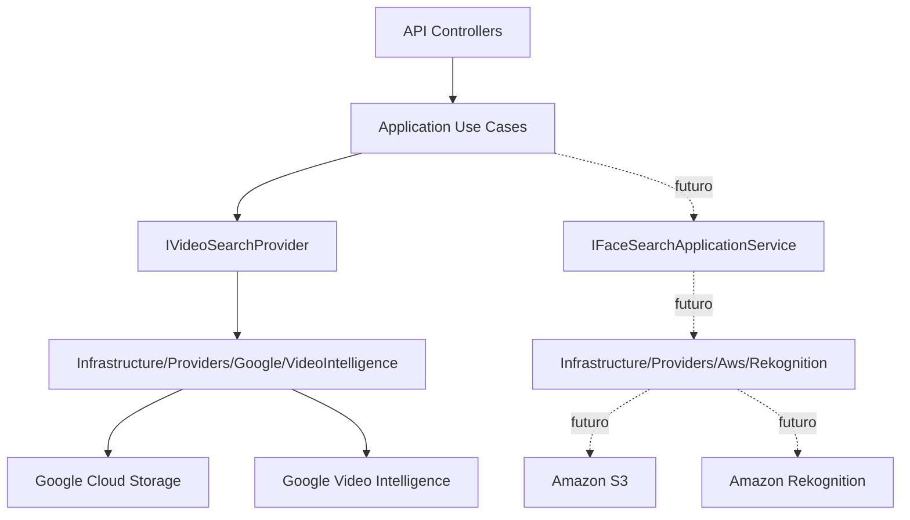

# AWS Rekognition Face Search

Esta pagina define la arquitectura de Fase 2 para busqueda facial en videos con Amazon Rekognition. Hoy el sistema puede operar sin credenciales AWS: expone status local, mantiene la configuracion apagada y no publica endpoints de jobs faciales.

## Estado Actual

| Pieza | Estado |
| --- | --- |
| `GET /api/v1/providers/aws-rekognition/status` | Implementado |
| `GET /api/v1/providers/aws-rekognition/status?checkRemote=true` | Implementado, requiere JWT operator/admin |
| `POST /api/v1/face-search-jobs` | No implementado |
| Worker AWS face search | No implementado |
| S3 staging real | Pendiente de credenciales |
| Rekognition collection real | Pendiente de credenciales |
| Resultados simulados | Prohibidos |

## Modo Sin Credenciales

Usar esta configuracion para levantar la API sin AWS:

```env
AwsRekognition__Enabled=false
AwsRekognition__FaceSearchEnabled=false
AwsRekognition__Region=
AwsRekognition__BucketName=
AwsRekognition__CollectionId=
AwsRekognition__MinSimilarity=90
AwsRekognition__UsePolling=true
AwsRekognition__SnsTopicArn=
AwsRekognition__RoleArn=
```

Validar status basico:

```powershell
curl.exe http://localhost:8085/api/v1/providers/aws-rekognition/status
```

Respuesta esperada:

```json
{
  "enabled": false,
  "configured": false,
  "credentialSourcePresent": false,
  "region": "",
  "bucketName": "",
  "collectionId": "",
  "missingFields": [],
  "message": "AWS Rekognition is disabled by configuration."
}
```

## Arquitectura Separada



Reglas:

- Google procesa numeros visibles y caras genericas.
- AWS procesara comparacion facial contra imagenes de referencia.
- No se mezclan providers en la misma clase.
- No se comparten buckets ni credenciales entre providers.
- Application define contratos; Infrastructure habla con SDKs cloud.

## Preparacion AWS Real

Recursos necesarios:

| Recurso | Uso |
| --- | --- |
| AWS Account | Cuenta con billing activo. |
| Region | Region unica para S3 y Rekognition. |
| S3 bucket privado | Staging de videos e imagenes de referencia. |
| Rekognition collection | Contenedor de vectores faciales por `targetKey`. |
| IAM user/role app | Acceso acotado a S3 y Rekognition. |

Permisos minimos para Fase 2 real:

```text
s3:PutObject
s3:GetObject
s3:DeleteObject
s3:GetBucketLocation
rekognition:CreateCollection
rekognition:DescribeCollection
rekognition:IndexFaces
rekognition:DeleteFaces
rekognition:ListFaces
rekognition:StartFaceSearch
rekognition:GetFaceSearch
```

## Status Remoto

Cuando existan credenciales y recursos reales:

```env
AwsRekognition__Enabled=true
AwsRekognition__FaceSearchEnabled=true
AwsRekognition__Region=<aws-region>
AwsRekognition__BucketName=<private-s3-bucket>
AwsRekognition__CollectionId=<rekognition-collection-id>
AwsRekognition__MinSimilarity=90
AwsRekognition__UsePolling=true
```

Validar remoto:

```powershell
curl.exe "http://localhost:8085/api/v1/providers/aws-rekognition/status?checkRemote=true" `
  -H "Authorization: Bearer $token"
```

El check remoto valida:

- que exista una fuente de credenciales AWS;
- que el bucket S3 sea alcanzable;
- que la collection Rekognition exista;
- que la credencial tenga permisos suficientes.

## Contrato Futuro

Endpoints futuros, solo cuando el provider real este implementado:

```http
POST /api/v1/face-search-jobs
GET  /api/v1/face-search-jobs/{jobId}
GET  /api/v1/face-search-jobs/{jobId}/result
```

Entrada futura:

```text
clientKey
profileKey=event-face-search-v1
consentReferenceId
manifestJson
videos[]
referenceImages[]
```

Reglas obligatorias:

- `consentReferenceId` obligatorio.
- `targetKey` opaco obligatorio.
- Rechazar `name`, `rut`, `email`, `phone`, `userId`, `personId`.
- No guardar imagenes de referencia permanentemente sin politica de retencion.
- No activar `FaceSearchEnabled` por defecto.
- No devolver coincidencias fake.

## QA Sin Credenciales

Checklist para validar que la API opera sin AWS:

```powershell
curl.exe http://localhost:8085/health
curl.exe http://localhost:8085/api/v1/providers/aws-rekognition/status
curl.exe -s -o NUL -w "%{http_code}" "http://localhost:8085/api/v1/providers/aws-rekognition/status?checkRemote=true"
curl.exe -s -o NUL -w "%{http_code}" -X POST "http://localhost:8085/api/v1/face-search-jobs" -H "Authorization: Bearer $token"
```

Resultado esperado:

| Validacion | Resultado |
| --- | --- |
| `/health` | `200` |
| status AWS basico | `enabled=false`, `configured=false` |
| `checkRemote=true` sin token | `401` |
| `checkRemote=true` con token sin scope operativo | `403` |
| `POST /api/v1/face-search-jobs` con token operator | `404` hasta implementar el provider real |

Si el status remoto se prueba con AWS habilitado, debe usarse una credencial real y recursos reales. No usar respuestas simuladas.
