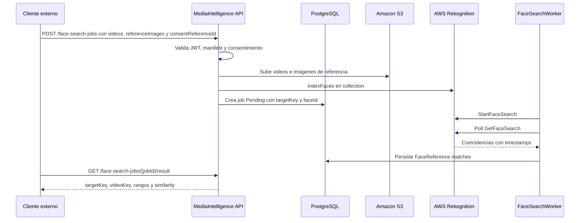

# Requisitos AWS Rekognition Face Search

Esta pagina define lo necesario para implementar la Fase 2 de busqueda facial en videos con Amazon Rekognition.

La Fase 2 no reemplaza Google Video Intelligence. Google sigue siendo el flujo base para OCR de numeros visibles y deteccion generica de caras. AWS Rekognition se agrega como proveedor separado para comparar imagenes de referencia contra caras detectadas en videos.

Referencias oficiales:

- [Amazon Rekognition collections](https://docs.aws.amazon.com/rekognition/latest/dg/collections.html)
- [Amazon Rekognition Video stored video operations](https://docs.aws.amazon.com/rekognition/latest/dg/video.html)
- [StartFaceSearch API](https://docs.aws.amazon.com/rekognition/latest/APIReference/API_StartFaceSearch.html)
- [Configuring Amazon Rekognition Video](https://docs.aws.amazon.com/rekognition/latest/dg/api-video-roles.html)

## Objetivo

Permitir que un cliente envie:

- uno o mas videos reales;
- una o mas imagenes de referencia;
- un `targetKey` opaco por participante;
- un `consentReferenceId` emitido fuera de MediaIntelligence.

El sistema debe devolver rangos de tiempo donde AWS encuentra una cara similar a la referencia.

## Requisitos AWS

| Recurso | Uso |
| --- | --- |
| AWS Account | Cuenta activa con billing habilitado. |
| Region | Region unica para S3, Rekognition, SNS/SQS. Recomendado inicial: `us-east-1`. |
| S3 bucket | Staging privado para videos e imagenes de referencia. |
| Rekognition collection | Contenedor de vectores faciales indexados por `targetKey`. |
| IAM user/role app | Permite subir a S3, indexar caras y consultar resultados. |
| IAM service role | Permite a Rekognition Video publicar en SNS si se usa modo async con notificaciones. |
| SNS topic | Notificacion de termino de analisis de video. |
| SQS queue | Cola suscrita a SNS para que el worker procese completions. |

Para MVP rapido se puede usar polling con `GetFaceSearch` y dejar SNS/SQS para la fase producto.

## Permisos Minimos

La credencial de la aplicacion necesita permisos acotados a los recursos de desarrollo:

```text
s3:PutObject
s3:GetObject
s3:DeleteObject
rekognition:CreateCollection
rekognition:DescribeCollection
rekognition:IndexFaces
rekognition:DeleteFaces
rekognition:ListFaces
rekognition:StartFaceSearch
rekognition:GetFaceSearch
iam:PassRole
```

Si se habilita SNS/SQS:

```text
sns:Publish
sqs:ReceiveMessage
sqs:DeleteMessage
sqs:GetQueueAttributes
```

## Configuracion Esperada

Variables locales de desarrollo:

```env
AwsRekognition__Enabled=true
AwsRekognition__Region=us-east-1
AwsRekognition__BucketName=<private-s3-bucket>
AwsRekognition__CollectionId=<rekognition-collection-id>
AwsRekognition__FaceSearchEnabled=true
AwsRekognition__MinSimilarity=90
AwsRekognition__UsePolling=true
AwsRekognition__SnsTopicArn=
AwsRekognition__RoleArn=
```

No versionar access keys. Para desarrollo local usar AWS CLI profile o variables seguras fuera del repo. Para produccion usar roles administrados o secret manager.

## Comandos De Preparacion

Validar AWS CLI:

```powershell
aws --version
aws sts get-caller-identity
```

Crear bucket privado:

```powershell
$region = "us-east-1"
$bucketName = "<private-s3-bucket>"

aws s3api create-bucket `
  --bucket $bucketName `
  --region $region

aws s3api put-public-access-block `
  --bucket $bucketName `
  --public-access-block-configuration BlockPublicAcls=true,IgnorePublicAcls=true,BlockPublicPolicy=true,RestrictPublicBuckets=true
```

Crear collection:

```powershell
$collectionId = "<rekognition-collection-id>"

aws rekognition create-collection `
  --collection-id $collectionId `
  --region $region
```

Validar collection:

```powershell
aws rekognition describe-collection `
  --collection-id $collectionId `
  --region $region
```

## Flujo Fase 2A Recomendado



## Contrato Futuro

Endpoints futuros:

```http
GET  /api/v1/providers/aws-rekognition/status
POST /api/v1/face-search-jobs
GET  /api/v1/face-search-jobs/{jobId}
GET  /api/v1/face-search-jobs/{jobId}/result
```

`POST /api/v1/face-search-jobs`:

```text
clientKey
profileKey=event-face-search-v1
consentReferenceId
manifestJson
videos[]
referenceImages[]
```

Manifest minimo:

```json
{
  "minSimilarity": 90,
  "targets": [
    {
      "targetKey": "participant-001"
    }
  ]
}
```

Resultado esperado:

```json
{
  "jobId": "00000000-0000-0000-0000-000000000000",
  "status": "Completed",
  "faceMatches": [
    {
      "targetKey": "participant-001",
      "videoKey": "video-1",
      "startTimeSeconds": 83.2,
      "endTimeSeconds": 95.8,
      "similarity": 94.7,
      "matchType": "FaceReference",
      "sourceProvider": "AwsRekognition"
    }
  ]
}
```

## Reglas Obligatorias

- `consentReferenceId` obligatorio.
- `targetKey` opaco obligatorio.
- Rechazar `name`, `rut`, `email`, `phone`, `userId`, `personId`.
- `FaceSearchEnabled=false` por defecto.
- No mezclar resultados de Google `VisibleNumber` con AWS `FaceReference`.
- No guardar imagenes de referencia permanentemente salvo definicion explicita de retencion.
- Registrar auditoria de consentimiento, indexacion, busqueda, resultado leido y borrado.
- Borrar objetos temporales de S3 despues de completar o fallar el job.
- Permitir `DeleteFaces` por target/job cuando el consentimiento se revoque.

## Criterio Para Implementar

Antes de empezar codigo:

1. AWS CLI autentica correctamente.
2. S3 bucket privado creado.
3. Rekognition collection creada.
4. Permisos IAM definidos.
5. Se decide si MVP usa polling o SNS/SQS.
6. Existe forma externa de emitir `consentReferenceId`.
7. Existe imagen real de referencia y video real para smoke test local.

## Fuera De Alcance De Esta PR

- Implementacion .NET de AWS.
- Endpoints publicos de face search.
- Credenciales AWS.
- Imagenes o videos reales.
- Resultados exportados de pruebas.

