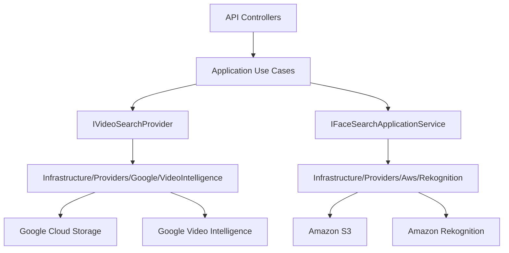
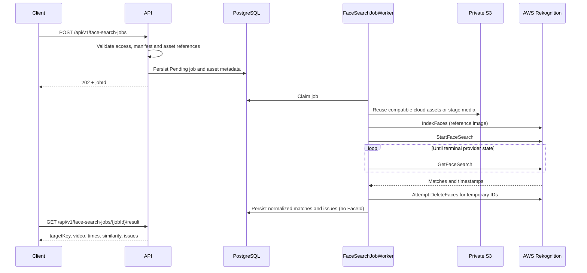

# AWS Rekognition Face Search

Esta pagina define la arquitectura y los contratos para busqueda facial en videos con Amazon Rekognition.

AWS Rekognition no reemplaza Google Video Intelligence. Google sigue siendo el flujo base para OCR de numeros visibles y deteccion generica de caras. AWS Rekognition se agrega como provider separado para comparar imagenes de referencia contra caras detectadas en videos.

Para el paso a paso completo de cuenta AWS, IAM user, IAM group, named profile, access key local, bucket, collection y diferencias con produccion, ver [Credenciales, usuarios y perfiles cloud](reference/cloud-identities-and-provider-profiles.md).

Referencias oficiales:

- [Amazon Rekognition collections](https://docs.aws.amazon.com/rekognition/latest/dg/collections.html)
- [Amazon Rekognition Video stored video operations](https://docs.aws.amazon.com/rekognition/latest/dg/video.html)
- [StartFaceSearch API](https://docs.aws.amazon.com/rekognition/latest/APIReference/API_StartFaceSearch.html)
- [Configuring Amazon Rekognition Video](https://docs.aws.amazon.com/rekognition/latest/dg/api-video-roles.html)

## Estado Actual

La API puede iniciar sin credenciales AWS. Las rutas y workers faciales dependen
de `FaceSearchEnabled`; el perfil admitido es `event-face-search-v1`. Un proveedor
deshabilitado puede devolver una incidencia, no coincidencias simuladas.
La [evidencia del piloto](examples/video-result-evidence.md) muestra el flujo real.
Los comandos de instalación/consulta remota requieren autorización separada;
no son requisitos para reproducir la demo offline.

| Pieza | Estado |
| --- | --- |
| `GET /api/v1/providers/aws-rekognition/status` | Implementado |
| `GET /api/v1/providers/aws-rekognition/status?checkRemote=true` | Implementado, requiere JWT operator/admin |
| `POST /api/v1/face-search-jobs` | Implementado, requiere JWT y acceso al perfil |
| Worker AWS face search | Implementado |
| S3 staging real | Implementado, requiere credenciales reales |
| Rekognition collection real | Implementado, requiere credenciales reales |
| Resultados simulados | Prohibidos |

## Modo Sin Credenciales

Usar esta configuracion para levantar la API sin AWS:

```env
AwsRekognition__Enabled=false
AwsRekognition__FaceSearchEnabled=false
AwsRekognition__Region=
AwsRekognition__BucketName=
AwsRekognition__CollectionId=
AwsRekognition__CredentialsPath=
AwsRekognition__ProfileName=
AwsRekognition__AllowUserCredentials=false
AwsRekognition__MinSimilarity=90
AwsRekognition__UsePolling=true
AwsRekognition__PollingIntervalSeconds=5
AwsRekognition__PollingTimeoutSeconds=900
AwsRekognition__StagingPrefix=staging
AwsRekognition__DeleteStagedObjectsAfterProcessing=false
```

Validar status basico:

```powershell
curl.exe http://localhost:8085/api/v1/providers/aws-rekognition/status
```

Respuesta esperada:

```json
{
  "enabled": false,
  "configured": false,
  "credentialSourcePresent": false,
  "credentialFilePresent": false,
  "region": "",
  "bucketName": "",
  "collectionId": "",
  "profileName": "",
  "missingFields": [],
  "message": "AWS Rekognition is disabled by configuration."
}
```

## Arquitectura Separada



Reglas:

- Google procesa numeros visibles y caras genericas.
- AWS procesa comparación facial contra imágenes de referencia.
- No se mezclan providers en la misma clase.
- No se comparten buckets ni credenciales entre providers.
- Application define contratos; Infrastructure habla con SDKs cloud.

## Objetivo

Permitir que un cliente envie:

- uno o mas videos reales;
- una o mas imagenes de referencia;
- un `targetKey` opaco por participante;
- un `consentReferenceId` opcional emitido fuera de MediaIntelligence.

El sistema debe devolver rangos de tiempo donde AWS encuentra una cara similar a la referencia.

## Requisitos AWS

| Recurso | Uso |
| --- | --- |
| AWS Account | Cuenta activa con billing habilitado. |
| Region | Region unica para S3 y Rekognition. Recomendado inicial: `us-east-1`. |
| S3 bucket privado | Assets originales o staging temporal para videos e imagenes de referencia. |
| Rekognition collection | Contenedor temporal de vectores faciales para el job. |
| IAM user/role app | Permite subir a S3, indexar caras y consultar resultados. |

V1 usa polling con `GetFaceSearch`. SNS/SQS queda reservado para una ampliación futura porque requiere infraestructura adicional.

## Permisos Minimos

```text
s3:PutObject
s3:GetObject
s3:GetBucketLocation
rekognition:DescribeCollection
rekognition:IndexFaces
rekognition:DeleteFaces
rekognition:StartFaceSearch
rekognition:GetFaceSearch
```

## Configuracion Con AWS Real

Cuando existan credenciales y recursos reales:

```env
AwsRekognition__Enabled=true
AwsRekognition__FaceSearchEnabled=true
AwsRekognition__Region=<aws-region>
AwsRekognition__BucketName=<private-s3-bucket>
AwsRekognition__CollectionId=<rekognition-collection-id>
AwsRekognition__CredentialsPath=/run/secrets/aws-credentials
AwsRekognition__ProfileName=<profile-name>
AwsRekognition__AllowUserCredentials=true
AwsRekognition__MinSimilarity=90
AwsRekognition__UsePolling=true
```

No versionar access keys. Para desarrollo local usar AWS CLI profile o variables seguras fuera del repo. Para produccion usar roles administrados o secret manager.
`UsePolling=true` es obligatorio en v1; `SnsTopicArn` y `RoleArn` no son usados por el worker actual.

Validar remoto:

```powershell
curl.exe "http://localhost:8085/api/v1/providers/aws-rekognition/status?checkRemote=true" `
  -H "Authorization: Bearer $token"
```

El check remoto valida:

- que exista una fuente de credenciales AWS;
- que el bucket S3 sea alcanzable;
- que la collection Rekognition exista;
- que la credencial permita esas operaciones de diagnóstico; no acredita todas las acciones de búsqueda/indexación.


### Credenciales Locales Y Diagnóstico

Para un perfil local, sin versionar ni imprimir credenciales:

```powershell
aws configure --profile <profile-name>
Copy-Item "$env:USERPROFILE/.aws/credentials" secrets/aws-credentials
```

Compose monta ese archivo ignorado en `/run/secrets/aws-credentials`.
Producción usa roles administrados o secretos externos, no credenciales de
usuario local. Consulta [identidades cloud](reference/cloud-identities-and-provider-profiles.md)
y [permisos productivos](reference/production-cloud-credentials.md).

Solo con autorización para inspeccionar recursos:

```powershell
aws sts get-caller-identity --profile <profile-name>
aws s3api get-bucket-location --bucket <private-s3-bucket> --profile <profile-name>
aws rekognition describe-collection --collection-id <rekognition-collection-id> --region <aws-region> --profile <profile-name>
```

No compartas IDs de cuenta/recursos en logs. `s3:ListBucket` corresponde a
selección por prefijo; `ExplicitAssets` no enumera prefijos. Crear una colección
es tarea de instalación, no requisito de permisos runtime. La guía productiva
separa permisos de colección, S3 y trabajos de video: no amplíes todos los
recursos a `*` porque una acción de job necesite otro alcance.

El polling usa `PollingIntervalSeconds` y `PollingTimeoutSeconds` bajo
`AwsRekognition` (5 y 900 en el ejemplo). `UsePolling=true` es obligatorio;
`SnsTopicArn` y `RoleArn` no los usa el worker actual. Mantén
`DeleteStagedObjectsAfterProcessing=false`: el ciclo de vida administra archivos.

| Síntoma | Revisar |
| --- | --- |
| `configured=false` | Flags, región, bucket, colección y perfil de credenciales montadas |
| Acceso denegado | Acción y recurso rechazados; readiness no acredita todos los permisos de búsqueda |
| `Unsupported codec/format` | Copia H.264 autorizada por separado; no sobrescribir el original |
| Cero coincidencias con incidencias | Leer el issue antes de considerarlo una búsqueda vacía exitosa |
| Fallo de limpieza | Se intenta limpiar caras temporales; una ejecución exitosa no acredita todos los casos |

## Comandos De Preparacion

Validar AWS CLI:

```powershell
aws --version
aws sts get-caller-identity
```

Crear bucket privado:

```powershell
$region = "us-east-1"
$bucketName = "<private-s3-bucket>"

aws s3api create-bucket `
  --bucket $bucketName `
  --region $region

aws s3api put-public-access-block `
  --bucket $bucketName `
  --public-access-block-configuration BlockPublicAcls=true,IgnorePublicAcls=true,BlockPublicPolicy=true,RestrictPublicBuckets=true
```

Crear collection:

```powershell
$collectionId = "<rekognition-collection-id>"

aws rekognition create-collection `
  --collection-id $collectionId `
  --region $region
```

Validar collection:

```powershell
aws rekognition describe-collection `
  --collection-id $collectionId `
  --region $region
```

## Flujo De Procesamiento



## Contrato Implementado

Endpoints existentes, sujetos a configuración y autorización:

```http
POST /api/v1/face-search-jobs
GET  /api/v1/face-search-jobs/{jobId}
GET  /api/v1/face-search-jobs/{jobId}/result
```

`POST /api/v1/face-search-jobs`:

```text
clientKey
profileKey=event-face-search-v1
consentReferenceId opcional
manifestJson
videos[]
referenceImages[]
assetSelectorJson opcional
referenceAssetSelectorJson opcional
```

Manifest minimo:

```json
{
  "minSimilarity": 90,
  "targets": [
    {
      "targetKey": "participant-001",
      "referenceImageKey": "reference-1"
    }
  ]
}
```

Fragmento ilustrativo de resultado (no es una ejecución registrada):

```json
{
  "jobId": "00000000-0000-0000-0000-000000000000",
  "status": "Completed",
  "faceMatches": [
    {
      "targetKey": "participant-001",
      "videoKey": "video-1",
      "startTimeSeconds": 83.2,
      "endTimeSeconds": 83.2,
      "similarity": 94.7,
      "matchType": "FaceReference",
      "sourceProvider": "AwsRekognition"
    }
  ]
}
```

## Reglas Obligatorias

- `consentReferenceId` es opcional; su ausencia no bloquea procesamiento. La plataforma externa administra autorización y registros de consentimiento.
- `targetKey` opaco obligatorio.
- Rechazar `name`, `rut`, `email`, `phone`, `userId`, `personId`.
- `FaceSearchEnabled=false` por defecto.
- No mezclar resultados de Google `VisibleNumber` con AWS `FaceReference`.
- No guardar imagenes de referencia permanentemente salvo definicion explicita de retencion.
- Registrar auditoria de consentimiento, indexacion, busqueda, resultado leido y borrado.
- No borrar objetos staged desde el job; la limpieza de archivos depende de lifecycle policy del bucket con TTL corto.
- El proveedor intenta `DeleteFaces` en `finally`; errores/cancelación requieren atención operativa. Este flujo de video no persiste FaceId.
- La revocacion posterior por target/job queda fuera de v1 porque la API no persiste `FaceId`; si se define un indice persistente, esa ampliación debe agregar almacenamiento y borrado por consentimiento.
- No devolver coincidencias fake.
