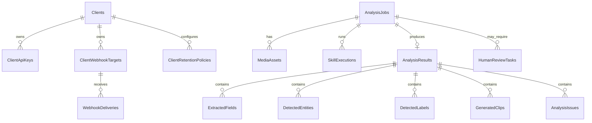

# Data Model

The model persists clients, API keys, jobs, assets, results, human review, webhooks, audit and retention.

## Key Entities

| Entity | Purpose |
| --- | --- |
| `Clients` | Client or integration consuming the platform. |
| `ClientApiKeys` | API key hashes, scopes and expiration. |
| `AnalysisJobs` | Main asynchronous work unit. |
| `MediaAssets` | Metadata and local path of uploaded files. |
| `SkillExecutions` | Evidence of skills executed for a job. |
| `AnalysisResults` | Persisted normalized result. |
| `HumanReviewTasks` | Tasks created when a result requires review. |
| `ClientWebhookTargets` | External URLs configured by client. |
| `WebhookDeliveries` | Delivery attempts and retries. |
| `AuditEvents` | Sanitized traceability events. |

## Rules

- Binary files are not stored in PostgreSQL; they live in local storage or Docker volume.
- Raw secrets and API keys must not be persisted.
- Full OCR text must not appear in audit events or webhook payloads.
