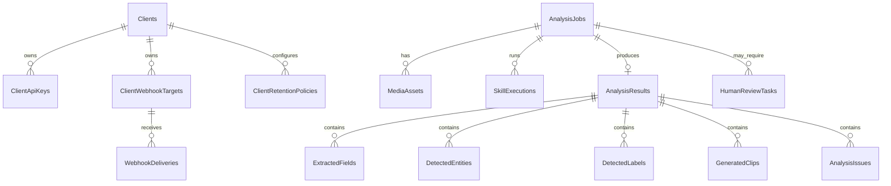

# Modelo De Datos

El modelo persiste clientes, API keys, jobs, assets, resultados, revision humana, webhooks, auditoria y retencion.

## Entidades Clave

| Entidad | Uso |
| --- | --- |
| `Clients` | Cliente/integracion que consume la plataforma. |
| `ClientApiKeys` | Hashes de API keys, scopes y expiracion. |
| `AnalysisJobs` | Unidad principal de trabajo asincrono. |
| `MediaAssets` | Metadata y ruta local del archivo subido. |
| `SkillExecutions` | Evidencia de skills ejecutados por job. |
| `AnalysisResults` | Resultado normalizado persistido. |
| `HumanReviewTasks` | Tareas creadas cuando el resultado requiere revision. |
| `ClientWebhookTargets` | URLs externas configuradas por cliente. |
| `WebhookDeliveries` | Intentos de entrega y reintentos. |
| `AuditEvents` | Eventos sanitizados para trazabilidad. |

## Reglas

- Los binarios no se guardan en PostgreSQL; quedan en storage local o volumen Docker.
- Secretos y API keys crudas no deben persistirse.
- OCR completo no debe aparecer en auditoria ni payloads de webhook.
