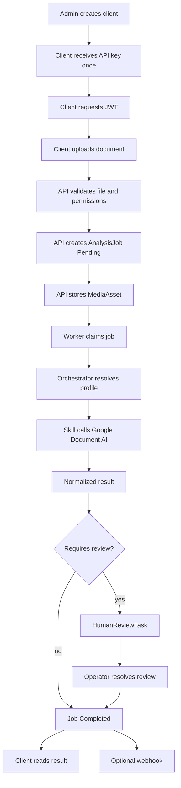
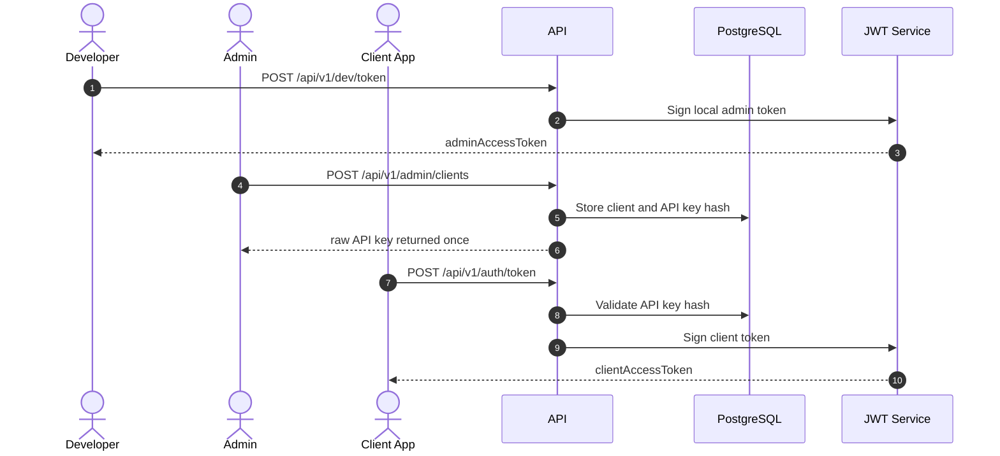
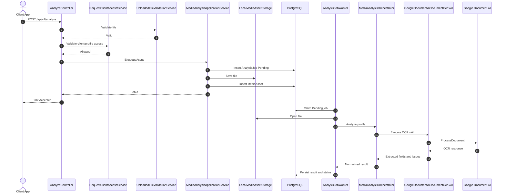
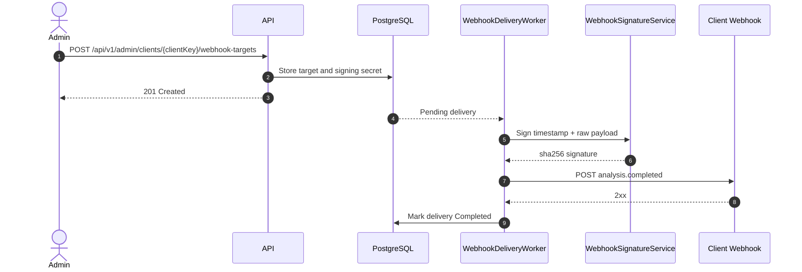

# Implementation Guide

This guide explains how to use `DeValpo.MediaIntelligence` from zero: what to configure, which endpoints to call, which internal services participate and how to validate a real document flow.

The goal is that an integrator can follow this page without guessing.

## 1. Overview

`DeValpo.MediaIntelligence` is a multi-client API for document and media analysis. The main flow is:

1. An operator creates a client and API key.
2. The client exchanges the API key for a JWT.
3. The client uploads a real document.
4. The API stores the file and creates a job.
5. A worker processes the job with the configured profile.
6. Google Document AI extracts text and data.
7. The result is persisted.
8. The client polls the job and result.
9. If needed, an operator resolves human review.
10. If enabled, the system sends webhook `analysis.completed`.



## 2. Requirements

| Requirement | Purpose |
| --- | --- |
| Docker Desktop | Run API and PostgreSQL locally. |
| .NET SDK 10.0.x | Build, tests and local execution outside Docker. |
| Google Cloud CLI | Create local ADC and validate Document AI access. |
| PostgreSQL 17 | Database when running outside Docker. |
| Google Document AI Processor | Real OCR for documents. |
| JWT signing key | Sign local or production tokens. |

Expected local files:

```text
deploy/.env
secrets/google-application-default-credentials.json
```

These files must not be versioned.

## 3. Local Configuration

Create local env file:

```powershell
Copy-Item deploy\.env.example deploy\.env
```

Configure minimum values:

```text
Database__ApplyMigrationsOnStartup=true
GoogleDocumentAi__Enabled=true
GoogleDocumentAi__ProjectId=<project-id>
GoogleDocumentAi__Location=<location>
GoogleDocumentAi__ProcessorId=<processor-id>
GoogleDocumentAi__CredentialsPath=/run/secrets/google-application-default-credentials.json
GoogleDocumentAi__AllowUserCredentials=true
Jwt__Issuer=DeValpo.MediaIntelligence
Jwt__Audience=DeValpo.MediaIntelligence.Api
Jwt__SigningKey=<local-dev-secret-min-32-chars>
Jwt__RequireHttpsMetadata=false
```

Create ADC credential:

```powershell
gcloud auth application-default login
gcloud auth application-default set-quota-project <project-id>
Copy-Item "$env:APPDATA\gcloud\application_default_credentials.json" secrets\google-application-default-credentials.json
```

The complete Google CLI, ADC, temporary Google token, processor validation and Docker mount implementation is documented in [local tokens and Google secrets](local-tokens-and-google-secrets.md).

Start services:

```powershell
docker compose -f deploy\docker-compose.yml config
docker compose -f deploy\docker-compose.yml up --build
```

Validate status:

```powershell
curl.exe http://localhost:8085/health
curl.exe http://localhost:8085/ready
```

## 4. Roles And Tokens

| Role | Token | Purpose |
| --- | --- | --- |
| Local development | `POST /api/v1/dev/token` | Create local tokens in `Development`. |
| Admin | JWT with `media-intelligence:admin` scope | Create clients, API keys, webhooks, audit and retention. |
| Client | JWT from `POST /api/v1/auth/token` | Upload documents and query owned jobs. |
| Operator | Operational or admin JWT | Human review and metrics. |

Authentication flow:



## 5. Client Implementation Flow

### Step 1: Create Local Admin Token

Only for local Docker in `Development`:

```powershell
$adminTokenJson = curl.exe -s -X POST http://localhost:8085/api/v1/dev/token `
  -H "Content-Type: application/json" `
  -d "{\"subject\":\"local-admin\",\"clientKey\":\"admin\",\"scope\":\"admin media-intelligence:admin\"}"

$adminToken = ($adminTokenJson | ConvertFrom-Json).accessToken
```

### Step 2: Create Client

```powershell
$clientJson = curl.exe -s -X POST http://localhost:8085/api/v1/admin/clients `
  -H "Authorization: Bearer $adminToken" `
  -H "Content-Type: application/json" `
  -d "{\"clientKey\":\"my-client\",\"displayName\":\"My Client\",\"contactEmail\":\"ops@example.com\",\"allowedProfileKeys\":[\"generic-document-ocr-v1\"],\"keyName\":\"primary\",\"scope\":\"media-intelligence:client\"}"

$client = $clientJson | ConvertFrom-Json
$apiKey = $client.apiKey
```

The API key is returned once. Store it in the client secret manager.

### Step 3: Exchange API Key For JWT

```powershell
$tokenJson = curl.exe -s -X POST http://localhost:8085/api/v1/auth/token `
  -H "Content-Type: application/json" `
  -d "{\"clientKey\":\"my-client\",\"apiKey\":\"$apiKey\"}"

$clientToken = ($tokenJson | ConvertFrom-Json).accessToken
```

### Step 4: Validate Catalog

```powershell
curl.exe http://localhost:8085/api/v1/capabilities `
  -H "Authorization: Bearer $clientToken"

curl.exe http://localhost:8085/api/v1/profiles `
  -H "Authorization: Bearer $clientToken"

curl.exe http://localhost:8085/api/v1/skills `
  -H "Authorization: Bearer $clientToken"
```

### Step 5: Validate Google Document AI

```powershell
curl.exe "http://localhost:8085/api/v1/providers/google-document-ai/status?checkRemote=true" `
  -H "Authorization: Bearer $adminToken"
```

### Step 6: Upload Real Document

```powershell
$jobJson = curl.exe -s -X POST http://localhost:8085/api/v1/analyze `
  -H "Authorization: Bearer $clientToken" `
  -F "clientKey=my-client" `
  -F "profileKey=generic-document-ocr-v1" `
  -F "assetType=Document" `
  -F "metadataJson={\"source\":\"manual-implementation-test\"}" `
  -F "file=@<local-path-to-document.pdf>"

$job = $jobJson | ConvertFrom-Json
$jobId = $job.jobId
```

### Step 7: Poll Job Status

```powershell
curl.exe "http://localhost:8085/api/v1/analysis-jobs/$jobId" `
  -H "Authorization: Bearer $clientToken"
```

Possible statuses:

| Status | Meaning |
| --- | --- |
| `Pending` | Job created, not yet claimed by worker. |
| `Running` | Worker is executing skills. |
| `Completed` | Result is ready. |
| `RequiresReview` | Result requires human review. |
| `Failed` | Terminal error. |
| `Cancelled` | Job was cancelled. |

### Step 8: Read Result

```powershell
curl.exe "http://localhost:8085/api/v1/analysis-jobs/$jobId/result" `
  -H "Authorization: Bearer $clientToken"
```

## 6. Endpoints By Area

| Area | Method | Route | Purpose |
| --- | --- | --- | --- |
| Health | GET | `/health` | Lightweight liveness. |
| Health | GET | `/ready` | Dependency readiness. |
| Development | POST | `/api/v1/dev/token` | Development-only local token. |
| Auth | POST | `/api/v1/auth/token` | Exchange API key for JWT. |
| Admin | POST | `/api/v1/admin/clients` | Create client and API key. |
| Catalog | GET | `/api/v1/capabilities` | List capabilities. |
| Catalog | GET | `/api/v1/profiles` | List profiles. |
| Catalog | GET | `/api/v1/skills` | List skills. |
| Provider | GET | `/api/v1/providers/google-document-ai/status` | Google Document AI status. |
| Analysis | POST | `/api/v1/analyze` | Upload file and enqueue job. |
| Jobs | GET | `/api/v1/analysis-jobs/{jobId}` | Job status. |
| Jobs | GET | `/api/v1/analysis-jobs/{jobId}/result` | Persisted result. |
| Human review | GET/POST | `/api/v1/human-review-tasks/*` | Review tasks. |
| Webhooks | GET/POST | webhook target and delivery routes | Configure and inspect callbacks. |
| Operations | GET | `/api/v1/operations/metrics` | Operational counters. |
| Governance | GET/PUT/POST | audit and retention routes | Audit and data lifecycle. |

## 7. Internal Services

| Service | Layer | Responsibility |
| --- | --- | --- |
| `IClientAccessApplicationService` | Application | Create clients, rotate and revoke API keys. |
| `IClientAccessTokenService` | Api | Issue JWT from valid API key. |
| `IRequestClientAccessService` | Api | Validate token access to client/profile. |
| `IUploadedFileValidationService` | Api | Validate extension, size, content type and signature. |
| `IMediaAnalysisApplicationService` | Application | Enqueue analysis and read results. |
| `IAnalysisJobApplicationService` | Application | Create, query and cancel jobs. |
| `IMediaAnalysisOrchestrator` | Application | Execute skills from profile. |
| `IAnalysisProfileResolver` | Application | Resolve profile and associated skills. |
| `IMediaAnalysisSkill` | Infrastructure | Execute one analysis skill. |
| `IGoogleDocumentAiStatusService` | Infrastructure | Validate local/remote Google configuration. |
| `IGoogleDocumentAiClientFactory` | Infrastructure | Build Google Document AI client. |
| `IGoogleCredentialProvider` | Infrastructure | Load credentials without exposing secrets. |
| `IMediaAssetStorage` | Infrastructure | Save and open uploaded files. |
| `IHumanReviewApplicationService` | Application | Manage human review tasks. |
| `IWebhookDeliveryProcessor` | Infrastructure | Send signed webhook and handle retries. |
| `IAuditApplicationService` | Application | Record sanitized audit events. |
| `IRetentionApplicationService` | Application | Query, update and execute retention. |

## 8. Real Analysis Sequence



## 9. Webhook Sequence



## 10. Implementation Checklist

- [ ] `deploy/.env` exists locally and is not versioned.
- [ ] Google ADC exists under `secrets/` and is not versioned.
- [ ] `docker compose config` passes.
- [ ] API and PostgreSQL start.
- [ ] `/health` responds.
- [ ] `/ready` responds according to configured dependencies.
- [ ] Local admin token is generated in Development.
- [ ] Real client is created with one-time API key.
- [ ] API key is exchanged for client JWT.
- [ ] Catalog responds with JWT.
- [ ] Google remote status returns `configured=true`.
- [ ] Real document is processed with `generic-document-ocr-v1`.
- [ ] Job reaches `Completed` or `RequiresReview`.
- [ ] Result is read through endpoint.
- [ ] Human review works if applicable.
- [ ] Webhook is signed and delivered if applicable.
- [ ] Audit does not contain secrets or full OCR text.
