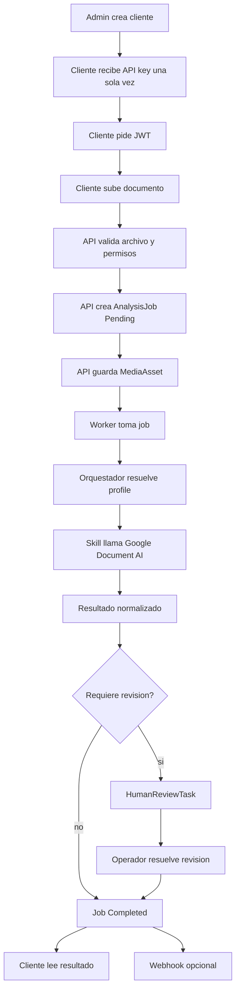
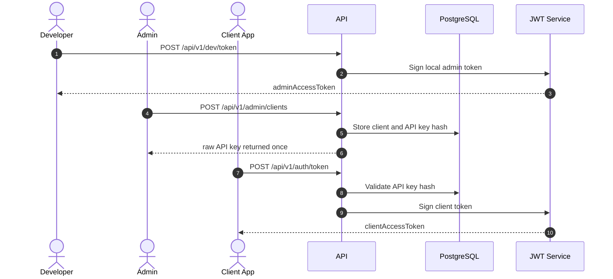
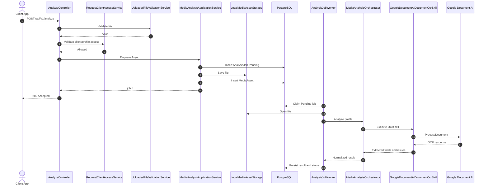
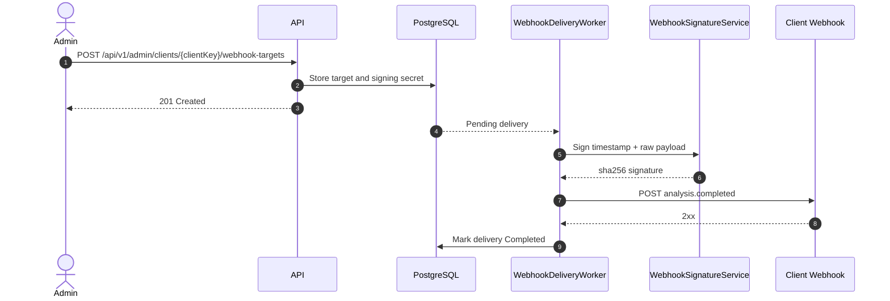

# Guia De Implementacion

Esta guia explica como usar `DeValpo.MediaIntelligence` desde cero: que configurar, que endpoints llamar, que servicios internos participan y como validar un flujo real de documento.

El objetivo es que un integrador pueda tomar esta pagina y ejecutar la plataforma sin adivinar.

## 1. Vista General

`DeValpo.MediaIntelligence` funciona como una API multi-cliente para analizar documentos y medios. El flujo principal es:

1. Un operador crea un cliente y una API key.
2. El cliente cambia la API key por un JWT.
3. El cliente sube un documento real.
4. La API guarda el archivo y crea un job.
5. Un worker procesa el job con el perfil configurado.
6. Google Document AI extrae texto y datos.
7. El resultado queda persistido.
8. El cliente consulta el job y el resultado.
9. Si aplica, un operador resuelve revision humana.
10. Si aplica, el sistema envia webhook `analysis.completed`.



## 2. Requisitos Para Implementar

| Requisito | Para que sirve |
| --- | --- |
| Docker Desktop | Levantar API y PostgreSQL localmente. |
| .NET SDK 10.0.x | Build, tests y ejecucion local fuera de Docker. |
| Google Cloud CLI | Crear ADC local y validar acceso a Document AI. |
| PostgreSQL 17 | Base de datos cuando se ejecuta fuera de Docker. |
| Google Document AI Processor | OCR real para documentos. |
| JWT signing key | Firmar tokens locales o productivos. |

Archivos locales esperados:

```text
deploy/.env
secrets/google-application-default-credentials.json
```

Estos archivos no deben versionarse.

## 3. Configuracion Local

Crear archivo local:

```powershell
Copy-Item deploy\.env.example deploy\.env
```

Configurar valores minimos:

```text
Database__ApplyMigrationsOnStartup=true
GoogleDocumentAi__Enabled=true
GoogleDocumentAi__ProjectId=<project-id>
GoogleDocumentAi__Location=<location>
GoogleDocumentAi__ProcessorId=<processor-id>
GoogleDocumentAi__CredentialsPath=/run/secrets/google-application-default-credentials.json
GoogleDocumentAi__AllowUserCredentials=true
Jwt__Issuer=DeValpo.MediaIntelligence
Jwt__Audience=DeValpo.MediaIntelligence.Api
Jwt__SigningKey=<local-dev-secret-min-32-chars>
Jwt__RequireHttpsMetadata=false
```

Crear credencial ADC:

```powershell
gcloud auth application-default login
gcloud auth application-default set-quota-project <project-id>
Copy-Item "$env:APPDATA\gcloud\application_default_credentials.json" secrets\google-application-default-credentials.json
```

La implementacion completa de Google CLI, ADC, token temporal de Google, validacion del processor y montaje Docker esta documentada en [tokens y secretos Google](local-tokens-and-google-secrets.md).

Levantar servicios:

```powershell
docker compose -f deploy\docker-compose.yml config
docker compose -f deploy\docker-compose.yml up --build
```

Validar estado:

```powershell
curl.exe http://localhost:8085/health
curl.exe http://localhost:8085/ready
```

## 4. Roles Y Tokens

| Rol | Token | Uso |
| --- | --- | --- |
| Desarrollo local | `POST /api/v1/dev/token` | Crear tokens locales en `Development`. |
| Admin | JWT con scope `media-intelligence:admin` | Crear clientes, API keys, webhooks, auditoria y retencion. |
| Cliente | JWT emitido por `POST /api/v1/auth/token` | Subir documentos y consultar sus propios jobs. |
| Operador | JWT con scope operativo o admin | Human review y metricas. |

Flujo de autenticacion:



## 5. Flujo De Implementacion Cliente

### Paso 1: Crear Token Admin Local

Solo para Docker local en `Development`:

```powershell
$adminTokenJson = curl.exe -s -X POST http://localhost:8085/api/v1/dev/token `
  -H "Content-Type: application/json" `
  -d "{\"subject\":\"local-admin\",\"clientKey\":\"admin\",\"scope\":\"admin media-intelligence:admin\"}"

$adminToken = ($adminTokenJson | ConvertFrom-Json).accessToken
```

### Paso 2: Crear Cliente

```powershell
$clientJson = curl.exe -s -X POST http://localhost:8085/api/v1/admin/clients `
  -H "Authorization: Bearer $adminToken" `
  -H "Content-Type: application/json" `
  -d "{\"clientKey\":\"my-client\",\"displayName\":\"My Client\",\"contactEmail\":\"ops@example.com\",\"allowedProfileKeys\":[\"generic-document-ocr-v1\"],\"keyName\":\"primary\",\"scope\":\"media-intelligence:client\"}"

$client = $clientJson | ConvertFrom-Json
$apiKey = $client.apiKey
```

La API key se entrega una sola vez. Guardarla en un secret manager del cliente.

### Paso 3: Cambiar API Key Por JWT

```powershell
$tokenJson = curl.exe -s -X POST http://localhost:8085/api/v1/auth/token `
  -H "Content-Type: application/json" `
  -d "{\"clientKey\":\"my-client\",\"apiKey\":\"$apiKey\"}"

$clientToken = ($tokenJson | ConvertFrom-Json).accessToken
```

### Paso 4: Validar Catalogo

```powershell
curl.exe http://localhost:8085/api/v1/capabilities `
  -H "Authorization: Bearer $clientToken"

curl.exe http://localhost:8085/api/v1/profiles `
  -H "Authorization: Bearer $clientToken"

curl.exe http://localhost:8085/api/v1/skills `
  -H "Authorization: Bearer $clientToken"
```

### Paso 5: Validar Google Document AI

```powershell
curl.exe "http://localhost:8085/api/v1/providers/google-document-ai/status?checkRemote=true" `
  -H "Authorization: Bearer $adminToken"
```

Respuesta esperada:

```json
{
  "enabled": true,
  "configured": true,
  "credentialFilePresent": true,
  "projectId": "<project-id>",
  "location": "<location>",
  "processorId": "<processor-id>",
  "missingFields": [],
  "message": "..."
}
```

### Paso 6: Subir Documento Real

```powershell
$jobJson = curl.exe -s -X POST http://localhost:8085/api/v1/analyze `
  -H "Authorization: Bearer $clientToken" `
  -F "clientKey=my-client" `
  -F "profileKey=generic-document-ocr-v1" `
  -F "assetType=Document" `
  -F "metadataJson={\"source\":\"manual-implementation-test\"}" `
  -F "file=@<ruta-local-al-documento.pdf>"

$job = $jobJson | ConvertFrom-Json
$jobId = $job.jobId
```

Respuesta:

```json
{
  "jobId": "00000000-0000-0000-0000-000000000000",
  "status": "Pending",
  "processingAttempts": 0,
  "createdAt": "2026-07-07T00:00:00Z"
}
```

### Paso 7: Consultar Estado Del Job

```powershell
curl.exe "http://localhost:8085/api/v1/analysis-jobs/$jobId" `
  -H "Authorization: Bearer $clientToken"
```

Estados posibles:

| Estado | Significado |
| --- | --- |
| `Pending` | Job creado, aun no tomado por worker. |
| `Running` | Worker ejecutando skills. |
| `Completed` | Resultado listo. |
| `RequiresReview` | Resultado requiere revision humana. |
| `Failed` | Error terminal. |
| `Cancelled` | Job cancelado. |

### Paso 8: Leer Resultado

```powershell
curl.exe "http://localhost:8085/api/v1/analysis-jobs/$jobId/result" `
  -H "Authorization: Bearer $clientToken"
```

Respuesta resumida:

```json
{
  "jobId": "00000000-0000-0000-0000-000000000000",
  "confidence": 0.89,
  "requiresHumanReview": false,
  "extractedFields": [],
  "detectedEntities": [],
  "detectedLabels": [],
  "generatedClips": [],
  "issues": [],
  "createdAt": "2026-07-07T00:00:00Z"
}
```

## 6. Endpoints Por Area

| Area | Metodo | Ruta | Uso |
| --- | --- | --- | --- |
| Salud | GET | `/health` | Liveness liviano. |
| Salud | GET | `/ready` | Readiness con dependencias. |
| Desarrollo | POST | `/api/v1/dev/token` | Token local solo Development. |
| Auth | POST | `/api/v1/auth/token` | Cambia API key por JWT. |
| Admin | POST | `/api/v1/admin/clients` | Crea cliente y API key. |
| Admin | POST | `/api/v1/admin/clients/{clientKey}/api-keys/{apiKeyId}/rotate` | Rota API key. |
| Admin | POST | `/api/v1/admin/clients/{clientKey}/api-keys/{apiKeyId}/revoke` | Revoca API key. |
| Catalogo | GET | `/api/v1/capabilities` | Lista capacidades. |
| Catalogo | GET | `/api/v1/profiles` | Lista perfiles. |
| Catalogo | GET | `/api/v1/skills` | Lista skills. |
| Proveedor | GET | `/api/v1/providers/google-document-ai/status` | Estado Google Document AI. |
| Analisis | POST | `/api/v1/analyze` | Sube archivo y encola job. |
| Jobs | POST | `/api/v1/analysis-jobs` | Crea job sin archivo. |
| Jobs | GET | `/api/v1/analysis-jobs/{jobId}` | Estado del job. |
| Jobs | GET | `/api/v1/analysis-jobs/{jobId}/result` | Resultado persistido. |
| Jobs | POST | `/api/v1/analysis-jobs/{jobId}/cancel` | Cancela job no terminal. |
| Human review | GET | `/api/v1/human-review-tasks` | Lista tareas. |
| Human review | GET | `/api/v1/human-review-tasks/{taskId}` | Detalle de tarea. |
| Human review | POST | `/api/v1/human-review-tasks/{taskId}/start` | Toma tarea. |
| Human review | POST | `/api/v1/human-review-tasks/{taskId}/complete` | Cierra revision. |
| Webhooks | POST | `/api/v1/admin/clients/{clientKey}/webhook-targets` | Registra target. |
| Webhooks | GET | `/api/v1/admin/clients/{clientKey}/webhook-targets` | Lista targets. |
| Webhooks | GET | `/api/v1/webhook-deliveries` | Historial de entregas. |
| Operacion | GET | `/api/v1/operations/metrics` | Contadores operativos. |
| Gobierno | GET | `/api/v1/admin/audit-events` | Auditoria sanitizada. |
| Retencion | GET | `/api/v1/admin/clients/{clientKey}/retention-policy` | Consulta politica. |
| Retencion | PUT | `/api/v1/admin/clients/{clientKey}/retention-policy` | Actualiza politica. |
| Retencion | POST | `/api/v1/admin/clients/{clientKey}/retention-policy/execute` | Ejecuta limpieza. |

## 7. Servicios Internos

| Servicio | Capa | Responsabilidad |
| --- | --- | --- |
| `IClientAccessApplicationService` | Application | Crear clientes, rotar y revocar API keys. |
| `IClientAccessTokenService` | Api | Emitir JWT desde API key valida. |
| `IRequestClientAccessService` | Api | Validar que el token pueda operar sobre cliente/profile. |
| `IUploadedFileValidationService` | Api | Validar extension, tamano, content type y firma. |
| `IMediaAnalysisApplicationService` | Application | Encolar analisis y leer resultados. |
| `IAnalysisJobApplicationService` | Application | Crear, consultar y cancelar jobs. |
| `IMediaAnalysisOrchestrator` | Application | Ejecutar skills segun profile. |
| `IAnalysisProfileResolver` | Application | Resolver profile y skills asociados. |
| `IMediaAnalysisSkill` | Infrastructure | Ejecutar una habilidad de analisis. |
| `IGoogleDocumentAiStatusService` | Infrastructure | Validar configuracion local/remota de Google. |
| `IGoogleDocumentAiClientFactory` | Infrastructure | Construir cliente Google Document AI. |
| `IGoogleCredentialProvider` | Infrastructure | Cargar credenciales sin exponer secretos. |
| `IMediaAssetStorage` | Infrastructure | Guardar y abrir archivos subidos. |
| `IHumanReviewApplicationService` | Application | Gestionar tareas de revision humana. |
| `IWebhookDeliveryApplicationService` | Application | Consultar entregas de webhooks. |
| `IWebhookDeliveryProcessor` | Infrastructure | Enviar webhook firmado y manejar reintentos. |
| `IOperationalMetricsApplicationService` | Application | Construir metricas operativas. |
| `IAuditApplicationService` | Application | Registrar eventos sanitizados. |
| `IRetentionApplicationService` | Application | Consultar, actualizar y ejecutar retencion. |

## 8. Secuencia De Analisis Real



## 9. Secuencia De Webhook



Headers salientes:

```text
X-DeValpo-Event-Id: <webhookDeliveryId>
X-DeValpo-Event-Type: analysis.completed
X-DeValpo-Timestamp: <unixSeconds>
X-DeValpo-Signature: sha256=<hex-hmac>
```

Payload resumido:

```json
{
  "eventType": "analysis.completed",
  "jobId": "00000000-0000-0000-0000-000000000000",
  "clientKey": "my-client",
  "profileKey": "generic-document-ocr-v1",
  "jobStatus": "Completed",
  "confidence": 0.89,
  "requiresHumanReview": false,
  "resultUrl": "/api/v1/analysis-jobs/<jobId>/result"
}
```

El payload no debe incluir texto OCR completo, secretos ni contenido crudo del documento.

## 10. Human Review

Cuando `requiresHumanReview=true`, un operador debe resolver la tarea.

Listar tareas:

```powershell
curl.exe "http://localhost:8085/api/v1/human-review-tasks?status=Pending" `
  -H "Authorization: Bearer $adminToken"
```

Tomar tarea:

```powershell
curl.exe -X POST "http://localhost:8085/api/v1/human-review-tasks/<taskId>/start" `
  -H "Authorization: Bearer $adminToken" `
  -H "Content-Type: application/json" `
  -d "{\"comment\":\"Review started\"}"
```

Completar tarea:

```powershell
curl.exe -X POST "http://localhost:8085/api/v1/human-review-tasks/<taskId>/complete" `
  -H "Authorization: Bearer $adminToken" `
  -H "Content-Type: application/json" `
  -d "{\"decision\":\"Approve\",\"comment\":\"Accepted\"}"
```

Decisiones soportadas:

| Decision | Uso |
| --- | --- |
| `Approve` | Acepta resultado. |
| `Correct` | Guarda correcciones. |
| `Reject` | Rechaza resultado. |

## 11. Operacion Y Diagnostico

Comandos utiles:

```powershell
docker compose -f deploy\docker-compose.yml ps
docker compose -f deploy\docker-compose.yml logs media-intelligence-api
curl.exe http://localhost:8085/health
curl.exe http://localhost:8085/ready
```

Metricas:

```powershell
curl.exe http://localhost:8085/api/v1/operations/metrics `
  -H "Authorization: Bearer $adminToken"
```

Errores comunes:

| Sintoma | Causa probable | Accion |
| --- | --- | --- |
| `401` | Falta JWT o esta vencido. | Regenerar token y revisar header Authorization. |
| `403` | Scope o clientKey incorrecto. | Revisar claims, scopes y allowed profiles. |
| `400` al subir archivo | Archivo invalido. | Revisar extension, tamano, firma y PDF completo. |
| Google `configured=false` | Configuracion incompleta. | Revisar ProjectId, Location, ProcessorId y CredentialsPath. |
| Credencial Google invalida | ADC mal montado o sin permisos. | Revisar archivo en `/run/secrets` y permisos del proyecto. |
| Job queda `Pending` | Worker no esta corriendo. | Revisar logs del contenedor API. |
| Job queda `Failed` | Error en skill o proveedor. | Revisar issues del resultado y logs. |
| Webhook falla | URL, TLS o firma. | Revisar `/api/v1/webhook-deliveries`. |

## 12. Checklist De Implementacion

- [ ] `deploy/.env` existe localmente y no esta versionado.
- [ ] Google ADC esta en `secrets/` y no esta versionado.
- [ ] `docker compose config` pasa.
- [ ] API y PostgreSQL levantan.
- [ ] `/health` responde.
- [ ] `/ready` responde segun dependencias configuradas.
- [ ] Token admin local se genera en Development.
- [ ] Cliente real se crea con API key de una sola entrega.
- [ ] API key se cambia por JWT cliente.
- [ ] Catalogo responde con JWT.
- [ ] Google status remoto responde `configured=true`.
- [ ] Documento real se procesa con `generic-document-ocr-v1`.
- [ ] Job llega a `Completed` o `RequiresReview`.
- [ ] Resultado se lee por endpoint.
- [ ] Human review funciona si aplica.
- [ ] Webhook se firma y entrega si aplica.
- [ ] Auditoria no contiene secretos ni OCR completo.

## 13. Que Documentacion Existe Para Profundizar

| Tema | Documento |
| --- | --- |
| Inicio | [index.md](index.md) |
| Primeros pasos | [getting-started.md](getting-started.md) |
| API | [api.md](api.md) |
| Flujos por endpoint | [api-endpoint-flows.md](api-endpoint-flows.md) |
| Arquitectura | [architecture.md](architecture.md) |
| Seguridad | [security.md](security.md) |
| Operacion | [operations.md](operations.md) |
| QA | [qa.md](qa.md) |
| Roadmap | [roadmap.md](roadmap.md) |
