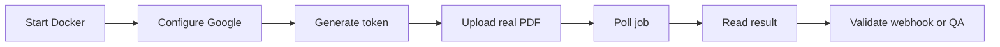

# DeValpo MediaIntelligence

Reusable document and media intelligence engine with multi-client API access, JWT, persisted jobs, Google Document AI, human review, webhooks and Docker operations.

=== "Client"

    Use the API to upload real documents, poll jobs and read normalized results.

    - Request your `clientKey` and API key.
    - Exchange the API key for a JWT.
    - Upload the document with `POST /api/v1/analyze`.
    - Read the result from `/api/v1/analysis-jobs/{jobId}/result`.

=== "Admin"

    Create clients, rotate API keys, configure webhooks and define retention.

    - Use a token with `media-intelligence:admin` scope.
    - Create clients from `/api/v1/admin/clients`.
    - Register client webhook targets.
    - Review audit events and retention policies.

=== "Operator"

    Validate health, readiness, metrics and human-review tasks.

    - `/health` confirms the process is alive.
    - `/ready` validates required dependencies.
    - `/api/v1/operations/metrics` returns counters.
    - `/api/v1/human-review-tasks` manages reviews.

=== "QA"

    Validate real flows, not mocks, using real documents and Google Document AI.

    - Validate Docker Compose.
    - Validate JWT and scopes.
    - Validate real OCR.
    - Validate webhooks and retention.

## Fast Path

## Key Pages

- [Getting started](getting-started.md): minimum commands to run and test locally.
- [Implementation guide](implementation-guide.md): complete steps to integrate clients, endpoints, services and real validation.
- [API](api.md): contracts, authentication and role-based usage.
- [Endpoint flows](api-endpoint-flows.md): endpoint sequence diagrams.
- [Architecture](architecture.md): components and internal flow.
- [Security](security.md): JWT, API keys, secrets and sensitive data.
- [Operations](operations.md): health, readiness, Docker, Google and runbooks.
- [QA](qa.md): real validation and certification phases.
- [Roadmap](roadmap.md): path from MVP to product.
