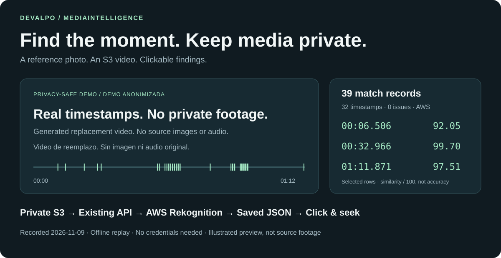

# MediaIntelligence

**Find moments in your videos using a reference photo.**
A cloud-first backend that accepts private media references, processes
asynchronous jobs and returns findings your interface can display.



## Try It Without Cloud

The included sample uses **39 real records at 32 timestamps** from a saved AWS
search. The video is a **labeled, generated replacement**: it contains no source
frames, audio or identities. It demonstrates navigation, not facial-recognition accuracy.

From the repository root, with Python 3.10+:

```powershell
python scripts/local-viewer/serve.py --video docs/assets/demo/public-demo-media-withheld.mp4 --result docs/assets/demo/public-result.json
```

Open the `Visor local:` URL printed in the terminal. Select a finding and choose
**Reproducir desde aquí** to play from that moment. No AWS account, credentials,
API or database are needed.

## Explore The Project

| To understand… | Start here |
| --- | --- |
| What the real execution returned | [Results and provenance](examples/video-result-evidence.en.md) |
| How cloud-first works | [Architecture](architecture.en.md) and [S3/GCS references](cloud-asset-references-and-staging.en.md) |
| How to integrate | [API](api.en.md) and [Getting Started](getting-started.en.md) |
| How to configure facial search | [AWS Rekognition](aws-rekognition-face-search.en.md) |
| What Google adds | [Video search](video-target-search.en.md) and [document analysis](modules/document-analysis.md) |
| How to operate and protect data | [Operations](operations.en.md) and [security](security.en.md) |

The demonstrated journey is facial search in S3 video. Bibs, words and codes
follow the [documented product direction](roadmap.en.md); they are not presented
as a complete delivered experience. Workers run with the API: no deployed
autoscaling or measured load capacity is claimed.

## For Contributors And AI

[Project context](context/PROJECT_CONTEXT.md) ·
[Active decisions](context/ACTIVE_DECISIONS.md) ·
[Development guide](development/DEVELOPMENT_GUIDE.md) ·
[Processing flows](architecture/PROCESSING_FLOWS.md)
