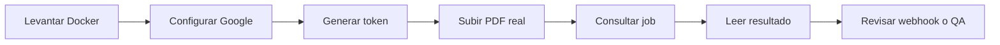

# DeValpo MediaIntelligence

Motor reutilizable para inteligencia documental y multimedia con API multi-cliente, JWT, jobs persistidos, Google Document AI, revision humana, webhooks y operacion Docker.

=== "Cliente"

    Usa la API para subir documentos reales, consultar jobs y leer resultados normalizados.

    - Solicita tu `clientKey` y API key.
    - Cambia la API key por un JWT.
    - Sube el documento con `POST /api/v1/analyze`.
    - Consulta el resultado con `/api/v1/analysis-jobs/{jobId}/result`.

=== "Admin"

    Crea clientes, rota API keys, configura webhooks y define retencion.

    - Usa un token con scope `media-intelligence:admin`.
    - Crea clientes desde `/api/v1/admin/clients`.
    - Registra webhooks por cliente.
    - Revisa auditoria y politicas de retencion.

=== "Operador"

    Valida salud, readiness, metricas y tareas de revision humana.

    - `/health` confirma proceso vivo.
    - `/ready` valida dependencias.
    - `/api/v1/operations/metrics` entrega contadores.
    - `/api/v1/human-review-tasks` permite gestionar revisiones.

=== "QA"

    Prueba flujos reales, no mocks, usando documentos reales y Google Document AI.

    - Valida Docker Compose.
    - Valida JWT y scopes.
    - Valida OCR real.
    - Valida webhooks y retencion.

## Ruta Rapida

## Paginas Clave

- [Primeros pasos](getting-started.md): comandos minimos para levantar y probar.
- [Guia de implementacion](implementation-guide.md): pasos completos para integrar clientes, endpoints, servicios y validacion real.
- [API](api.md): contratos, autenticacion y uso por rol.
- [Flujos de endpoints](api-endpoint-flows.md): diagramas de secuencia por endpoint.
- [Arquitectura](architecture.md): componentes y flujo interno.
- [Seguridad](security.md): JWT, API keys, secretos y datos sensibles.
- [Operacion](operations.md): health, readiness, Docker, Google y runbooks.
- [QA](qa.md): validacion real y fases de certificacion.
- [Roadmap](roadmap.md): camino de MVP a producto.
