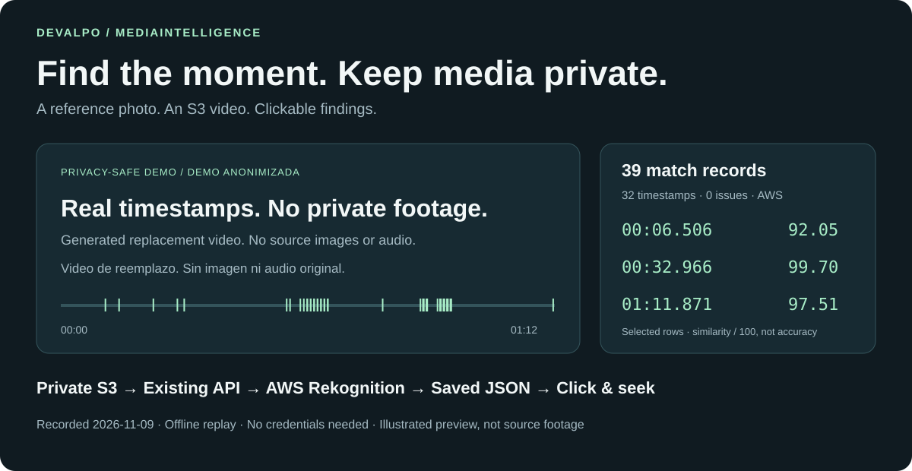

# MediaIntelligence

**Encuentra momentos en tus videos mediante una foto de referencia.**
Un backend cloud-first que recibe referencias a medios privados, procesa
trabajos asíncronos y devuelve coincidencias que tu interfaz puede mostrar.



## Pruébalo Sin Cloud

La muestra incluida usa **39 registros reales en 32 timestamps** de una búsqueda
AWS guardada. El video es un **reemplazo generado y etiquetado**: no incluye
fotogramas, audio ni identidades del original. Muestra la navegación, no acredita
precisión de reconocimiento facial.

Desde la raíz del repositorio, con Python 3.10+:

```powershell
python scripts/local-viewer/serve.py --video docs/assets/demo/public-demo-media-withheld.mp4 --result docs/assets/demo/public-result.json
```

Abre la URL `Visor local:` que imprime la terminal. Selecciona un hallazgo y pulsa
**Reproducir desde aquí**. No necesitas cuenta AWS, credenciales, API ni base de datos.

## Explora El Proyecto

| Quieres entender… | Empieza aquí |
| --- | --- |
| Qué devolvió la ejecución real | [Resultados y procedencia](examples/video-result-evidence.md) |
| Cómo funciona cloud-first | [Arquitectura](architecture.md) y [referencias S3/GCS](cloud-asset-references-and-staging.md) |
| Cómo consumirlo | [API](api.md) y [primeros pasos](getting-started.md) |
| Cómo configurar reconocimiento facial | [AWS Rekognition](aws-rekognition-face-search.md) |
| Qué aporta Google | [Búsqueda de video](video-target-search.md) y [análisis documental](modules/document-analysis.md) |
| Cómo operarlo y proteger datos | [Operación](operations.md) y [seguridad](security.md) |

El recorrido demostrado es facial en video S3. Dorsales, palabras y códigos
siguen el [alcance y dirección documentados](roadmap.md); no se presentan como
una experiencia completa ya entregada. Los workers se alojan con la API:
no se afirma autoescalado desplegado ni capacidad de carga medida.

## Para Colaboradores E IA

[Contexto del proyecto](context/PROJECT_CONTEXT.md) ·
[Decisiones vigentes](context/ACTIVE_DECISIONS.md) ·
[Guía de desarrollo](development/DEVELOPMENT_GUIDE.md) ·
[Flujos de procesamiento](architecture/PROCESSING_FLOWS.md)
