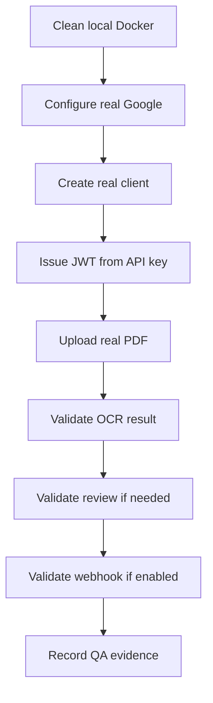

# QA

QA must validate real product flows. Mocks must not be used to certify the MVP.

## Gates

| Gate | What It Validates |
| --- | --- |
| Base hygiene | No secrets, personal paths or dangerous configuration. |
| Security | JWT, scopes, API keys and client isolation. |
| Ingestion | Real files, binary validation and controlled errors. |
| Jobs | Persistence, worker, states and results. |
| Google | Real processor and credentials outside the repository. |
| Human review | Tasks, start, complete and corrections. |
| Webhooks | HMAC signature, retries and history. |
| Operations | Health, readiness, metrics and runbooks. |

## Real QA Flow

## Evidence

- [QA review](qa-review.md)
- [Phase 0](archive/qa-phase-0-base-hygiene.md)
- [Phase 1](archive/qa-phase-1-foundation-hardening.md)
- [Phase 2](archive/qa-phase-2-customer-access-security.md)
- [Phase 3](archive/qa-phase-3-tenant-isolation.md)
- [Phase 4](archive/qa-phase-4-async-jobs-worker.md)
- [Phase 5](archive/qa-phase-5-file-ingestion-validation.md)
- [Phase 6](archive/qa-phase-6-human-review-workflow.md)
- [Phase 7](archive/qa-phase-7-webhook-delivery.md)
- [Phase 8](archive/qa-phase-8-observability-readiness.md)
- [Phase 9](archive/qa-phase-9-security-governance-retention.md)
- [Phase 10](archive/qa-phase-10-cicd-staging-release.md)
- [Phase 11](archive/qa-phase-11-product-certification.md)
