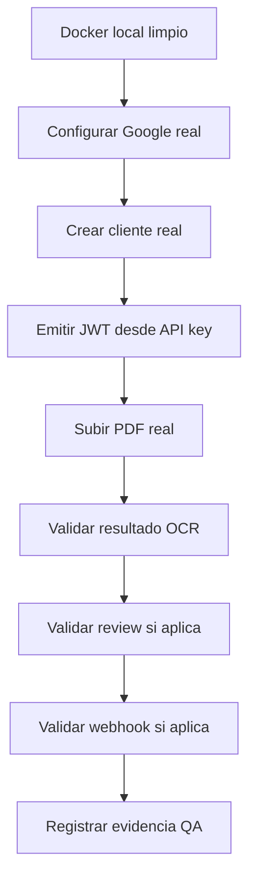

# QA

QA debe probar flujos reales de producto. No se deben usar mocks para certificar el MVP.

## Gates

| Gate | Que valida |
| --- | --- |
| Base hygiene | Sin secretos, rutas personales ni configuracion peligrosa. |
| Seguridad | JWT, scopes, API keys y aislamiento por cliente. |
| Ingestion | Archivos reales, validacion binaria y errores controlados. |
| Jobs | Persistencia, worker, estados y resultados. |
| Google | Processor real y credenciales fuera del repo. |
| Human review | Tareas, start, complete y correcciones. |
| Webhooks | Firma HMAC, reintentos e historial. |
| Operacion | Health, readiness, metricas y runbooks. |

## Flujo QA Real

## Evidencia

- [QA review](qa-review.md)
- [Fase 0](qa-phase-0-base-hygiene.md)
- [Fase 1](qa-phase-1-foundation-hardening.md)
- [Fase 2](qa-phase-2-customer-access-security.md)
- [Fase 3](qa-phase-3-tenant-isolation.md)
- [Fase 4](qa-phase-4-async-jobs-worker.md)
- [Fase 5](qa-phase-5-file-ingestion-validation.md)
- [Fase 6](qa-phase-6-human-review-workflow.md)
- [Fase 7](qa-phase-7-webhook-delivery.md)
- [Fase 8](qa-phase-8-observability-readiness.md)
- [Fase 9](qa-phase-9-security-governance-retention.md)
- [Fase 10](qa-phase-10-cicd-staging-release.md)
- [Fase 11](qa-phase-11-product-certification.md)
