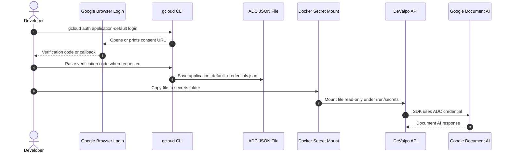

# Local Tokens And Google Secrets Setup

This guide explains how to install Google Cloud CLI, generate the Google credential used by this project, mount it in Docker and then generate the local/admin/client tokens needed to run `DeValpo.MediaIntelligence`.

Follow the steps in order.

For the broader production view of Google/AWS identities, users, named profiles, IAM groups, service accounts and MediaIntelligence profile keys, see [Cloud credentials, users and profiles](cloud-identities-and-provider-profiles.md).

## What You Need

- Windows PowerShell.
- Docker Desktop running.
- Google Cloud CLI installed or permission to install it.
- Access to the Google Cloud project that will host Document AI:

```text
<google-cloud-project-id>
```

- Existing Document AI processor:

```text
ProjectId: <google-cloud-project-id>
Location: <document-ai-location>
ProcessorId: <document-ai-processor-id>
Type: OCR_PROCESSOR
```

Use the real values from your Google Cloud project. For local examples in this repository, replace the placeholders consistently in `deploy/.env`, `gcloud` commands and status checks.

## Important Files

These files are safe to commit:

```text
deploy/.env.example
secrets/.gitkeep
docs/local-tokens-and-google-secrets.md
```

These files are local secrets. Never commit them:

```text
deploy/.env
secrets/google-application-default-credentials.json
secrets/google-document-ai.json
```

The repo already ignores these files with `.gitignore`.

## Token And Secret Types

There are three different things. Do not mix them.

| Name | Generated by | Used by | Purpose |
| --- | --- | --- | --- |
| Google CLI access token | `gcloud auth print-access-token` | Manual REST checks only | Lets you call Google REST APIs from PowerShell for diagnostics. It expires quickly. |
| Google ADC credential file | `gcloud auth application-default login` | The .NET Google SDK inside this API | Lets `GoogleDocumentAiDocumentOcrSkill` call Document AI. This is the important credential for this project. |
| DeValpo JWT | `/api/v1/dev/token` or `/api/v1/auth/token` | DeValpo API clients | Protects this API. It is not accepted by Google. |

The most important Google step for this implementation is **creating the ADC credential file** and copying it to `secrets/google-application-default-credentials.json`.

### 1. Google ADC Credential

This lets the API call Google Document AI.

Local file:

```text
secrets/google-application-default-credentials.json
```

Docker path:

```text
/run/secrets/google-application-default-credentials.json
```

### 2. Local Admin JWT Token

This lets an operator create API clients in local Docker Development.

You generate it from:

```text
POST http://localhost:8085/api/v1/dev/token
```

This endpoint is only for Development. Do not use it as the customer auth flow.

### 3. Client API Key And JWT Token

This is the real client access flow.

1. An operator creates a client through `POST /api/v1/admin/clients`.
2. The API returns the raw API key once.
3. The platform stores only the API key hash.
4. The client exchanges the API key through `POST /api/v1/auth/token`.
5. The API returns a short-lived JWT.

Use it as:

```text
Authorization: Bearer <accessToken>
```

## Step 1: Confirm Google CLI Works

If `gcloud` is not installed, install the Google Cloud CLI first.

Official install page:

```text
https://docs.cloud.google.com/sdk/docs/install-sdk
```

Windows install checklist:

1. Download the Google Cloud CLI installer from the official page.
2. Run the installer.
3. Keep the option that adds `gcloud` to PATH.
4. Open a new PowerShell window.
5. Run `gcloud --version`.

If PowerShell does not recognize `gcloud`, close and reopen PowerShell. If it still fails, restart Windows or add the Google Cloud SDK `bin` folder to PATH.

Run:

```powershell
gcloud --version
```

Then:

```powershell
gcloud config list
```

Expected project:

```text
<google-cloud-project-id>
```

If the project is different, run:

```powershell
gcloud config set project <google-cloud-project-id>
```

If this is the first time using the CLI on the machine, initialize it:

```powershell
gcloud init
```

This authorizes the Google Cloud CLI itself. It is useful for commands such as `gcloud services list`. It is **not enough** for the .NET Google SDK used by this API; the SDK uses ADC from Step 4.

## Step 2: Confirm Document AI API Is Enabled

Run:

```powershell
gcloud services list --enabled --project <google-cloud-project-id> --filter="documentai.googleapis.com"
```

Expected output:

```text
NAME: documentai.googleapis.com
TITLE: Cloud Document AI API
```

If it is missing, enable it:

```powershell
gcloud services enable documentai.googleapis.com --project <google-cloud-project-id>
```

## Step 3: Confirm The Processor Exists

The installed `gcloud` may not include the `documentai` command group. Use REST with your `gcloud` token.

This token is only for manual validation:

```powershell
gcloud auth print-access-token
```

Do not put this access token in `deploy/.env`, Docker secrets, source code or documentation. It is short-lived and belongs only in the current terminal session.

Run:

```powershell
$googleToken = gcloud auth print-access-token
$headers = @{ Authorization = "Bearer $googleToken" }

Invoke-RestMethod `
  -Method Get `
  -Headers $headers `
  -Uri "https://us-documentai.googleapis.com/v1/projects/<google-cloud-project-id>/locations/us/processors" |
  ConvertTo-Json -Depth 10
```

Look for this processor:

```text
name: projects/<google-cloud-project-number>/locations/us/processors/<document-ai-processor-id>
displayName: <document-ai-processor-display-name>
type: OCR_PROCESSOR
state: ENABLED
```

For this project, use:

```text
GoogleDocumentAi__ProjectId=<google-cloud-project-id>
GoogleDocumentAi__Location=us
GoogleDocumentAi__ProcessorId=<document-ai-processor-id>
```

## Step 4: Create Google ADC Credentials

Service account key creation is blocked in this project by policy:

```text
constraints/iam.disableServiceAccountKeyCreation
```

That is expected. Use Application Default Credentials instead.

This is the credential flow implemented by this project:



Stop Docker first so the local login callback is not blocked:

```powershell
docker compose -f deploy\docker-compose.yml down
```

Start Google ADC login:

```powershell
gcloud auth application-default login --no-launch-browser
```

If the normal browser flow works on your machine, this also works:

```powershell
gcloud auth application-default login
```

Use `--no-launch-browser` when the CLI opens the wrong browser, hangs waiting for a local callback, or when you are authenticating from a terminal that cannot launch a browser.

If `gcloud` looks frozen, wait at least 45 seconds. This local CLI can be slow.

When it prints a Google URL:

1. Copy the URL.
2. Open it in your browser.
3. Sign in.
4. Allow the requested permissions.
5. Google will show a verification code.
6. Copy that code.
7. Paste it back into PowerShell.
8. Press Enter.

Expected final message:

```text
Credentials saved to file: [<application-default-credentials-path>]
```

On Windows, the default path is normally:

```text
%APPDATA%\gcloud\application_default_credentials.json
```

For this project, that means:

```powershell
$adcPath = "$env:APPDATA\gcloud\application_default_credentials.json"
Test-Path $adcPath
```

Expected output:

```text
True
```

What this generated:

```text
application_default_credentials.json
```

What this did not generate:

```text
Google API key
service account key
DeValpo JWT
```

The generated file is a local Google credential. Treat it as a secret.

## Step 5: Set The Quota Project

Run:

```powershell
gcloud auth application-default set-quota-project <google-cloud-project-id>
```

Expected result:

```text
Quota project "<google-cloud-project-id>" was added to ADC
```

## Step 5.1: Validate The Google Token And ADC Before Docker

There are two validations.

### A. Validate the short-lived Google CLI access token

This confirms your Google user can call Google APIs from the terminal:

```powershell
$googleAccessToken = gcloud auth print-access-token
if ([string]::IsNullOrWhiteSpace($googleAccessToken)) {
  throw "Google access token was not generated."
}

$googleAccessToken.Substring(0, 12)
```

Expected:

```text
ya29...
```

Do not store this token. Do not copy it to `.env`. It expires and is only for terminal diagnostics.

### B. Validate the Document AI processor with that token

```powershell
$headers = @{ Authorization = "Bearer $googleAccessToken" }

$processor = Invoke-RestMethod `
  -Method Get `
  -Headers $headers `
  -Uri "https://us-documentai.googleapis.com/v1/projects/<google-cloud-project-id>/locations/us/processors/<document-ai-processor-id>"

$processor | ConvertTo-Json -Depth 10
```

Expected fields:

```text
name
displayName
type
state
```

Expected `state`:

```text
ENABLED
```

If this fails with `403`, the Google account lacks permission. If it fails with `404`, the project, location or processor ID is wrong.

### C. Validate ADC has the quota project

```powershell
gcloud auth application-default print-access-token | Out-Null
gcloud auth application-default set-quota-project <google-cloud-project-id>
```

If `print-access-token` fails here, re-run:

```powershell
gcloud auth application-default login --no-launch-browser
```

## Step 6: Validate The ADC File Exists

Run:

```powershell
Test-Path "$env:APPDATA\gcloud\application_default_credentials.json"
```

Expected output:

```text
True
```

## Step 7: Copy ADC Into The Docker Secrets Folder

Run from the repo root:

```powershell
Copy-Item "$env:APPDATA\gcloud\application_default_credentials.json" `
  secrets\google-application-default-credentials.json `
  -Force
```

Validate:

```powershell
Test-Path "secrets\google-application-default-credentials.json"
```

Expected output:

```text
True
```

Do not print this file. Do not paste its contents into chat. Do not commit it.

## Step 8: Create deploy/.env

If `deploy\.env` does not exist:

```powershell
Copy-Item deploy\.env.example deploy\.env
```

Open `deploy\.env` and set:

```text
ASPNETCORE_ENVIRONMENT=Development
ASPNETCORE_URLS=http://+:8080
ConnectionStrings__MediaIntelligence=Host=postgres;Port=5432;Database=media_intelligence;Username=postgres;Password=postgres
Database__ApplyMigrationsOnStartup=true
Storage__Provider=Local
Storage__LocalRootPath=/app/storage/media-assets

GoogleDocumentAi__Enabled=true
GoogleDocumentAi__ProjectId=<google-cloud-project-id>
GoogleDocumentAi__Location=us
GoogleDocumentAi__ProcessorId=<document-ai-processor-id>
GoogleDocumentAi__CredentialsPath=/run/secrets/google-application-default-credentials.json
GoogleDocumentAi__AllowUserCredentials=true

Jwt__Issuer=DeValpo.MediaIntelligence
Jwt__Audience=DeValpo.MediaIntelligence.Api
Jwt__SigningKey=local-dev-secret-change-me-1234567890
Jwt__RequireHttpsMetadata=false

MediaAnalysis__MaxFileSizeBytes=104857600
Swagger__Enabled=true
POSTGRES_DB=media_intelligence
POSTGRES_USER=postgres
POSTGRES_PASSWORD=postgres
```

The JWT signing key must have at least 32 characters.

This is the important wiring:

```text
Host ADC file:
secrets/google-application-default-credentials.json

Docker mounted path:
/run/secrets/google-application-default-credentials.json

Application setting:
GoogleDocumentAi__CredentialsPath=/run/secrets/google-application-default-credentials.json
```

The .NET Google SDK reads the mounted ADC file from `GoogleDocumentAi__CredentialsPath`. The application does not use `gcloud auth print-access-token` at runtime.

## Step 9: Start Docker

Run:

```powershell
docker compose -f deploy\docker-compose.yml up --build -d
```

Check containers:

```powershell
docker compose -f deploy\docker-compose.yml ps
```

Expected:

```text
media-intelligence-api        Up
media-intelligence-postgres   Up (healthy)
```

## Step 10: Check Health

Run:

```powershell
curl.exe http://localhost:8085/health
```

Expected:

```json
{"status":"Healthy"}
```

The exact response can include extra health details.

## Step 11: Generate A Local Admin Token

Run:

```powershell
$adminTokenResponse = Invoke-RestMethod `
  -Method Post `
  -Uri http://localhost:8085/api/v1/dev/token `
  -ContentType "application/json" `
  -Body (@{
    subject = "local-admin"
    clientKey = "admin"
    scope = "admin media-intelligence:admin"
  } | ConvertTo-Json -Compress)

$adminToken = $adminTokenResponse.accessToken
```

Validate:

```powershell
$adminToken.Length
```

Expected: a number greater than `100`.

## Step 12: Create A Client API Key And JWT

Create a client:

```powershell
$clientKey = "local-client-" + (Get-Date -Format "yyyyMMddHHmmss")

$clientResponse = Invoke-RestMethod `
  -Method Post `
  -Uri http://localhost:8085/api/v1/admin/clients `
  -ContentType "application/json" `
  -Headers @{ Authorization = "Bearer $adminToken" } `
  -Body (@{
    clientKey = $clientKey
    displayName = "Local Client"
    contactEmail = "ops@example.com"
    allowedProfileKeys = @("generic-document-ocr-v1")
    keyName = "primary"
    scope = "media-intelligence:client"
    expiresAt = $null
  } | ConvertTo-Json -Compress)
```

Important:

- `$clientResponse.apiKey` is shown once.
- Store it in a secure client-side secret store.
- The database stores only a hash, not this raw value.

Exchange the API key for a client JWT:

```powershell
$tokenResponse = Invoke-RestMethod `
  -Method Post `
  -Uri http://localhost:8085/api/v1/auth/token `
  -ContentType "application/json" `
  -Body (@{
    clientKey = $clientKey
    apiKey = $clientResponse.apiKey
  } | ConvertTo-Json -Compress)

$token = $tokenResponse.accessToken
```

Validate:

```powershell
$token.Length
```

Expected: a number greater than `100`.

## Step 13: Confirm Protected Endpoints Require JWT

Without token:

```powershell
curl.exe -s -o NUL -w "%{http_code}" http://localhost:8085/api/v1/capabilities
```

Expected:

```text
401
```

With token:

```powershell
curl.exe -s -o NUL -w "%{http_code}" `
  http://localhost:8085/api/v1/capabilities `
  -H "Authorization: Bearer $token"
```

Expected:

```text
200
```

## Step 14: Validate Google Document AI Local Status

Run:

```powershell
curl.exe http://localhost:8085/api/v1/providers/google-document-ai/status
```

Expected:

```json
{
  "enabled": true,
  "configured": true,
  "credentialFilePresent": true,
  "projectId": "<google-cloud-project-id>",
  "location": "us",
  "processorId": "<document-ai-processor-id>",
  "missingFields": []
}
```

## Step 15: Validate Google Document AI Remote Status

Run:

```powershell
curl.exe "http://localhost:8085/api/v1/providers/google-document-ai/status?checkRemote=true" `
  -H "Authorization: Bearer $adminToken"
```

Expected:

```json
{
  "enabled": true,
  "configured": true,
  "credentialFilePresent": true,
  "projectId": "<google-cloud-project-id>",
  "location": "us",
  "processorId": "<document-ai-processor-id>",
  "missingFields": [],
  "message": "Google Document AI processor is reachable."
}
```

## Step 16: Analyze A Real PDF

Example:

```powershell
$pdfPath = "<path-to-your-document.pdf>"

$analyzeJson = curl.exe -s -X POST http://localhost:8085/api/v1/analyze `
  -H "Authorization: Bearer $token" `
  -F "clientKey=$clientKey" `
  -F "profileKey=generic-document-ocr-v1" `
  -F "assetType=Document" `
  -F "file=@$pdfPath"

$queuedJob = $analyzeJson | ConvertFrom-Json
$jobId = $queuedJob.jobId
```

Expected:

```json
{
  "jobId": "...",
  "status": "Pending",
  "processingAttempts": 0,
  "createdAt": "..."
}
```

Poll until the job reaches `Completed` or `RequiresReview`:

```powershell
curl.exe "http://localhost:8085/api/v1/analysis-jobs/$jobId" `
  -H "Authorization: Bearer $token"
```

Then read the result:

```powershell
curl.exe "http://localhost:8085/api/v1/analysis-jobs/$jobId/result" `
  -H "Authorization: Bearer $token"
```

Expected result shape:

```json
{
  "jobId": "...",
  "confidence": 0.89,
  "requiresHumanReview": false,
  "extractedFields": [
    {
      "name": "provider",
      "value": "google-document-ai"
    },
    {
      "name": "processor_id",
      "value": "<document-ai-processor-id>"
    },
    {
      "name": "text",
      "value": "..."
    }
  ],
  "issues": []
}
```

## Troubleshooting

### gcloud login looks frozen

Wait 45 seconds.

This CLI has been observed taking around 40 seconds to print output.

### Google shows a verification code

That is expected with:

```powershell
gcloud auth application-default login --no-launch-browser
```

Copy the code from the browser and paste it into PowerShell.

### Key creation is blocked

If this command fails:

```powershell
gcloud iam service-accounts keys create ...
```

with:

```text
constraints/iam.disableServiceAccountKeyCreation
```

do not fight it. Use ADC instead. This guide already uses ADC.

### credentialFilePresent is false

Check that `deploy\.env` has:

```text
GoogleDocumentAi__CredentialsPath=/run/secrets/google-application-default-credentials.json
GoogleDocumentAi__AllowUserCredentials=true
```

Then check the local file exists:

```powershell
Test-Path "secrets\google-application-default-credentials.json"
```

### Google credentials are invalid

Regenerate ADC:

```powershell
gcloud auth application-default login --no-launch-browser
gcloud auth application-default set-quota-project <google-cloud-project-id>
Copy-Item "$env:APPDATA\gcloud\application_default_credentials.json" `
  secrets\google-application-default-credentials.json `
  -Force
docker compose -f deploy\docker-compose.yml up --build -d
```

### Google processor is not found

Confirm these values:

```text
GoogleDocumentAi__ProjectId=<google-cloud-project-id>
GoogleDocumentAi__Location=us
GoogleDocumentAi__ProcessorId=<document-ai-processor-id>
```

### curl cannot open the PDF

This means the local file path is wrong.

Validate first:

```powershell
Test-Path $pdfPath
```

Expected:

```text
True
```

Then run the `curl` command again.

## Final Checklist

Before saying the local MVP base works, all checks must pass:

```text
[ ] deploy/.env exists
[ ] secrets/google-application-default-credentials.json exists
[ ] docker compose ps shows API up and PostgreSQL healthy
[ ] /health returns 200
[ ] /api/v1/capabilities returns 401 without token
[ ] /api/v1/dev/token returns local admin accessToken in Development
[ ] /api/v1/admin/clients returns one-time apiKey with admin token
[ ] /api/v1/auth/token exchanges apiKey for client accessToken
[ ] /api/v1/capabilities returns 200 with client token
[ ] /api/v1/providers/google-document-ai/status?checkRemote=true says processor is reachable with admin token
[ ] /api/v1/analyze returns 202 and jobId from a real PDF
[ ] /api/v1/analysis-jobs/{jobId} reaches Completed or RequiresReview
[ ] /api/v1/analysis-jobs/{jobId}/result returns extracted text from a real PDF
```
