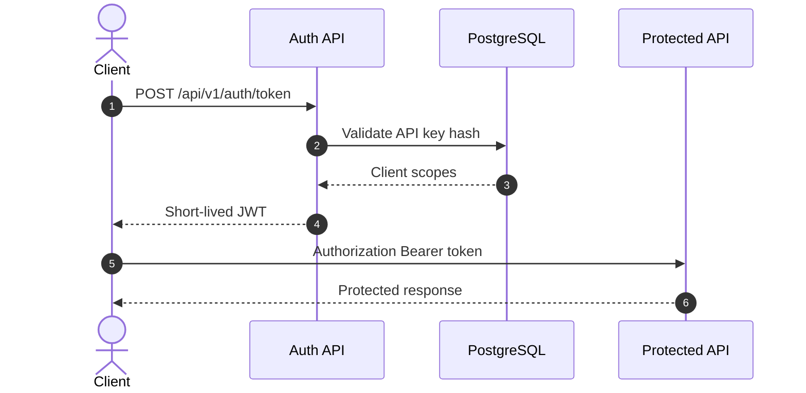

# Security

MVP security is based on JWT Bearer, per-client API keys, secrets outside the repository, sanitized audit and controlled data exposure.

## Access Model

## Rules

- Raw API keys are returned once.
- PostgreSQL stores hashes, not raw API keys.
- Functional endpoints require JWT Bearer.
- Tokens must include the expected client and scope.
- Swagger must not be exposed publicly in release environments.
- Google credentials, JWT signing keys and webhook secrets are not versioned.

## Local Secrets

Files allowed in the repository:

- `deploy/.env.example`
- `secrets/.gitkeep`

Files forbidden in the repository:

- `deploy/.env`
- `secrets/*.json`
- ADC or service account credentials.

## Sensitive Data

These must not appear in logs, audit, Swagger examples or webhooks:

- API keys.
- JWT signing keys.
- Google credential JSON.
- Webhook signing secrets.
- Full OCR text.
- Document content.

More detail: [local tokens and Google secrets](local-tokens-and-google-secrets.md) and [security runbook](runbooks/security-governance-retention.md).
