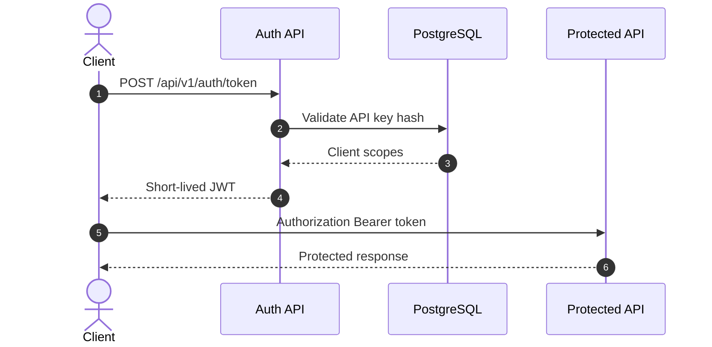

# Seguridad

La seguridad del MVP se basa en JWT Bearer, API keys por cliente, secretos fuera del repo, auditoria sanitizada y control de exposicion de datos.

## Modelo De Acceso

## Reglas

- Las API keys crudas se devuelven una sola vez.
- PostgreSQL guarda hashes, no API keys crudas.
- Los endpoints funcionales requieren JWT Bearer.
- Los tokens deben incluir cliente y scope esperado.
- Swagger no debe exponerse publicamente en release.
- Google credentials, JWT signing keys y webhook secrets no se versionan.

## Secretos Locales

Archivos permitidos en repo:

- `deploy/.env.example`
- `secrets/.gitkeep`

Archivos prohibidos en repo:

- `deploy/.env`
- `secrets/*.json`
- Credenciales ADC o service account.

## Datos Sensibles

No deben aparecer en logs, auditoria, Swagger examples o webhooks:

- API keys.
- JWT signing keys.
- Google credential JSON.
- Webhook signing secrets.
- Texto OCR completo.
- Contenido de documentos.

Mas detalle: [tokens y secretos Google](reference/local-tokens-and-google-secrets.md) y [runbook de seguridad](runbooks/security-governance-retention.md).
