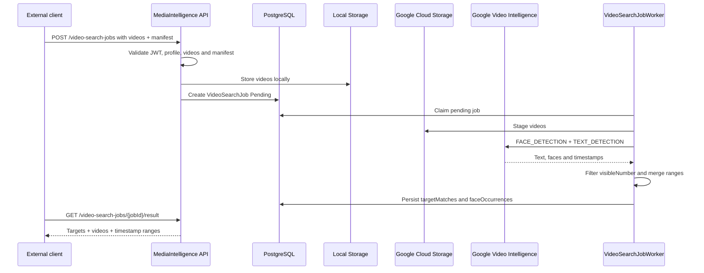

# Video Target Search

This page describes the event-video flow for finding visible targets across one or more videos.

The service does not identify people by name, national identifier, email or user account. It receives opaque `targetKey` values and visible numbers, detects video text/numbers, detects generic face occurrences and returns timestamp ranges.

## Phase 1 Scope

| Capability | Status |
| --- | --- |
| Multiple videos per job | Implemented |
| Opaque `targetKey` | Implemented |
| Search by `visibleNumber` | Implemented |
| Generic face occurrence detection | Implemented |
| Facial verification against reference image | Phase 2, disabled by default |
| Physical downloadable clips | Future |

## Main Endpoint

```http
POST /api/v1/video-search-jobs
Authorization: Bearer <token>
Content-Type: multipart/form-data
```

Fields:

| Field | Type | Description |
| --- | --- | --- |
| `clientKey` | string | Client that owns the job. |
| `profileKey` | string | Must be `event-video-target-search-v1`. |
| `manifestJson` | JSON string | Targets and detection options. |
| `videos[]` | files | One or more `.mp4`, `.mov` or `.avi` videos. |

Manifest example:

```json
{
  "detectFaces": true,
  "detectNumbers": true,
  "minConfidence": 0.7,
  "mergeGapSeconds": 2,
  "targets": [
    {
      "targetKey": "target-001",
      "visibleNumber": "123"
    }
  ]
}
```

The manifest does not accept personal data such as `name`, `email`, `rut`, `phone`, `userId` or `personId`.

## Result

```http
GET /api/v1/video-search-jobs/{jobId}/result
Authorization: Bearer <token>
```

`targetMatches` returns visible-number matches by target and video. `faceOccurrences` only means that faces are visible in the range; it does not associate faces with targets.

Job status:

```http
GET /api/v1/video-search-jobs/{jobId}
Authorization: Bearer <token>
```

Use this endpoint for polling until `status` is `Completed` or `Failed`.

## Flow



## Configuration

Create or choose a staging bucket for videos:

```powershell
gcloud services enable videointelligence.googleapis.com storage.googleapis.com --project <project-id>
gcloud storage buckets create gs://<gcs-staging-bucket> --project <project-id> --location <region>
```

The service account or ADC credential used by the API must be able to upload objects to the bucket and call Video Intelligence.

```text
GoogleVideoIntelligence__Enabled=true
GoogleVideoIntelligence__CredentialsPath=/run/secrets/google-application-default-credentials.json
GoogleVideoIntelligence__BucketName=<gcs-staging-bucket>
GoogleVideoIntelligence__AllowUserCredentials=true
GoogleVideoIntelligence__RemoteOperationTimeoutSeconds=7200
VideoAnalysis__MaxVideosPerJob=5
VideoAnalysis__MaxVideoSizeBytes=1073741824
VideoAnalysis__MaxDurationSeconds=3600
VideoAnalysis__DefaultMinConfidence=0.7
VideoAnalysis__DefaultMergeGapSeconds=2
VideoAnalysis__FaceMatchingEnabled=false
```

## Phase 2 Facial Verification

Facial verification is out of Phase 1. The product route is documented in [Real Video MVP Route](video-mvp-real-route.en.md). A future worker must stay disabled by default, require externally validated consent, use temporary embeddings and avoid storing names, national identifiers, emails or personal identity data.
