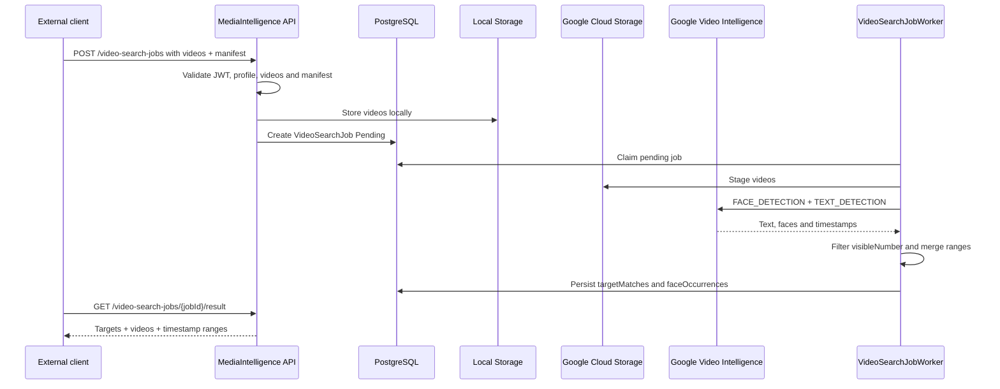

# Video Target Search

This page describes the event-video flow for finding visible targets across one or more videos.

The service does not identify people by name, national identifier, email or user account. It receives opaque `targetKey` values and visible numbers, detects video text/numbers, detects generic face occurrences and returns timestamp ranges.

## Google Scope

| Capability | Status |
| --- | --- |
| Multiple videos per job | Implemented |
| Opaque `targetKey` | Implemented |
| Search by `visibleNumber` | Implemented |
| Generic face occurrence detection | Implemented |
| Facial verification against reference image | Available through the separate [AWS facial flow](aws-rekognition-face-search.en.md) |
| Physical downloadable clips | Future |

## Main Endpoint

```http
POST /api/v1/video-search-jobs
Authorization: Bearer <token>
Content-Type: multipart/form-data
```

Fields:

| Field | Type | Description |
| --- | --- | --- |
| `clientKey` | string | Client that owns the job. |
| `profileKey` | string | Must be `event-video-target-search-v1`. |
| `manifestJson` | JSON string | Targets and detection options. |
| `videos[]` | files | One or more `.mp4`, `.mov` or `.avi` videos. |

Manifest example:

```json
{
  "detectFaces": true,
  "detectNumbers": true,
  "minConfidence": 0.7,
  "mergeGapSeconds": 2,
  "targets": [
    {
      "targetKey": "target-001",
      "visibleNumber": "123"
    }
  ]
}
```

The manifest does not accept personal data such as `name`, `email`, `rut`, `phone`, `userId` or `personId`.

## Result

```http
GET /api/v1/video-search-jobs/{jobId}/result
Authorization: Bearer <token>
```

`targetMatches` returns visible-number matches by target and video. `faceOccurrences` only means that faces are visible in the range; it does not associate faces with targets.

Job status:

```http
GET /api/v1/video-search-jobs/{jobId}
Authorization: Bearer <token>
```

Use this endpoint for polling until `status` is `Completed` or `Failed`.

## Flow



## Configuration

Create or choose a staging bucket for videos:

```powershell
gcloud services enable videointelligence.googleapis.com storage.googleapis.com --project <project-id>
gcloud storage buckets create gs://<gcs-staging-bucket> --project <project-id> --location <region> --uniform-bucket-level-access
```

The service account or ADC credential used by the API must be able to upload objects to the bucket and call Video Intelligence.

```text
GoogleVideoIntelligence__Enabled=true
GoogleVideoIntelligence__CredentialsPath=/run/secrets/google-application-default-credentials.json
GoogleVideoIntelligence__BucketName=<gcs-staging-bucket>
GoogleVideoIntelligence__AllowUserCredentials=true
GoogleVideoIntelligence__RemoteOperationTimeoutSeconds=7200
VideoAnalysis__MaxVideosPerJob=5
VideoAnalysis__MaxVideoSizeBytes=1073741824
VideoAnalysis__MaxDurationSeconds=3600
VideoAnalysis__MaxProcessingAttempts=3
VideoAnalysis__DefaultMinConfidence=0.7
VideoAnalysis__DefaultMergeGapSeconds=2
VideoAnalysis__FaceMatchingEnabled=false
Skills__EnableMockSkills=false
AnalysisProfiles__EnableMockProfiles=false
```

## Facial Recognition

Google detects generic faces; it does not compare identities with a reference.
The existing [AWS Rekognition flow](aws-rekognition-face-search.en.md) uses
`/api/v1/face-search-jobs` for reference-face search. It does not require enabling
`VideoAnalysis__FaceMatchingEnabled` or creating another Google worker.

## Installation And Authorized Use

Keep the GCS bucket private. The API identity needs object upload/read and video
analysis access. The retired setup example used `roles/videointelligence.editor`
and bucket `roles/storage.objectAdmin`; those are broad examples, not a claim of
least privilege. Use the [production identity guide](reference/production-cloud-credentials.md)
for scoped runtime access and [ADC setup](reference/local-tokens-and-google-secrets.md)
for local credentials. User ADC is a development option only.

`GoogleVideoIntelligence__RemoteOperationTimeoutSeconds=7200` bounds how long the
adapter waits for Google; a timeout becomes an issue, not proof of zero findings.
Tune it for the installation rather than treating the old example as a product SLA.
See [Getting Started](getting-started.en.md) for Docker and client tokens.
`GET /api/v1/providers/google-video-intelligence/status` reads local readiness;
`?checkRemote=true` is an operator/admin remote check and requires authorization.

For a separately authorized multipart submission, save the manifest above to
`manifest.json` (synthetic targets only in examples) and use a client allowed
for `event-video-target-search-v1`:

```powershell
curl.exe -X POST "http://localhost:8085/api/v1/video-search-jobs" `
  -H "Authorization: Bearer $clientToken" `
  -F "clientKey=<client-key>" `
  -F "profileKey=event-video-target-search-v1" `
  -F "manifestJson=<manifest.json" `
  -F "videos=@<local-video.mp4>"
```

Here the first `<` in `manifestJson=<...` is curl's form-file-content operator;
replace `manifest.json` with the actual local path. Productive inputs may instead
use `assetSelectorJson`; see [cloud references](cloud-asset-references-and-staging.en.md).
Poll the status route and then `/result`; `targetMatches` contains number ranges,
while `faceOccurrences` contains generic detections without identity association.
[Historical evidence](examples/video-result-evidence.en.md) is preserved separately;
no new cloud execution is required to demonstrate the saved product results.
