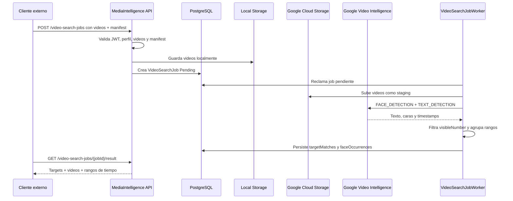

# Busqueda De Targets En Video

Esta pagina describe el flujo para encontrar targets visibles en uno o varios videos de evento.

El servicio no identifica personas por nombre, RUT, email ni usuario. Recibe `targetKey` opacos y numeros visibles, detecta texto/numeros en video, detecta ocurrencias genericas de caras y devuelve rangos de tiempo.

## Alcance De Fase 1

| Capacidad | Estado |
| --- | --- |
| Multiples videos por job | Implementado |
| Target opaco por `targetKey` | Implementado |
| Busqueda por `visibleNumber` | Implementado |
| Deteccion generica de caras | Implementado |
| Reconocimiento facial contra foto | Fase 2, apagado por defecto |
| Clips fisicos descargables | Futuro |

## Endpoint Principal

```http
POST /api/v1/video-search-jobs
Authorization: Bearer <token>
Content-Type: multipart/form-data
```

Campos:

| Campo | Tipo | Descripcion |
| --- | --- | --- |
| `clientKey` | string | Cliente que envia el job. |
| `profileKey` | string | Debe ser `event-video-target-search-v1`. |
| `manifestJson` | JSON string | Targets y opciones de deteccion. |
| `videos[]` | files | Uno o mas videos `.mp4`, `.mov` o `.avi`. |

Manifest ejemplo:

```json
{
  "detectFaces": true,
  "detectNumbers": true,
  "minConfidence": 0.7,
  "mergeGapSeconds": 2,
  "targets": [
    {
      "targetKey": "target-001",
      "visibleNumber": "123"
    },
    {
      "targetKey": "target-002",
      "visibleNumber": "456"
    }
  ]
}
```

El manifest no acepta datos personales como `name`, `email`, `rut`, `phone`, `userId` o `personId`.

## Resultado

```http
GET /api/v1/video-search-jobs/{jobId}/result
Authorization: Bearer <token>
```

Respuesta simplificada:

```json
{
  "jobId": "00000000-0000-0000-0000-000000000000",
  "clientKey": "generic",
  "status": "Completed",
  "targetMatches": [
    {
      "targetKey": "target-001",
      "visibleNumber": "123",
      "matches": [
        {
          "videoKey": "video-1",
          "videoFileName": "race-camera-1.mp4",
          "startTimecode": "01:23.000",
          "endTimecode": "01:54.000",
          "confidence": 0.87,
          "sourceProvider": "GoogleVideoIntelligence"
        }
      ]
    }
  ],
  "faceOccurrences": [
    {
      "videoKey": "video-1",
      "videoFileName": "race-camera-1.mp4",
      "startTimecode": "01:10.000",
      "endTimecode": "01:13.000",
      "confidence": 0.81,
      "sourceProvider": "GoogleVideoIntelligence"
    }
  ]
}
```

`faceOccurrences` indica que hay caras visibles en ese rango. No indica que una cara corresponda a un target.

Estado del job:

```http
GET /api/v1/video-search-jobs/{jobId}
Authorization: Bearer <token>
```

Usar este endpoint para polling hasta que `status` sea `Completed` o `Failed`.

## Flujo



## Configuracion

Crear o elegir un bucket de staging para los videos:

```powershell
gcloud services enable videointelligence.googleapis.com storage.googleapis.com --project <project-id>
gcloud storage buckets create gs://<gcs-staging-bucket> --project <project-id> --location <region>
```

El service account o credencial ADC usada por la API debe poder subir objetos al bucket y llamar Video Intelligence.

```text
GoogleVideoIntelligence__Enabled=true
GoogleVideoIntelligence__CredentialsPath=/run/secrets/google-application-default-credentials.json
GoogleVideoIntelligence__BucketName=<gcs-staging-bucket>
GoogleVideoIntelligence__AllowUserCredentials=true
GoogleVideoIntelligence__RemoteOperationTimeoutSeconds=7200
VideoAnalysis__MaxVideosPerJob=5
VideoAnalysis__MaxVideoSizeBytes=1073741824
VideoAnalysis__MaxDurationSeconds=3600
VideoAnalysis__DefaultMinConfidence=0.7
VideoAnalysis__DefaultMergeGapSeconds=2
VideoAnalysis__FaceMatchingEnabled=false
```

Status local/remoto:

```http
GET /api/v1/providers/google-video-intelligence/status
GET /api/v1/providers/google-video-intelligence/status?checkRemote=true
```

## Fase 2 Facial

La verificacion facial queda fuera de Fase 1. La ruta tecnica de producto esta en [Ruta MVP Video Real](video-mvp-real-route.md). Para implementarla despues:

1. Mantener `FaceMatchingEnabled=false` por defecto.
2. Recibir imagenes de referencia solo con consentimiento externo valido.
3. Crear un worker separado de verificacion facial.
4. Generar embeddings temporales.
5. Comparar contra caras detectadas por Google.
6. Devolver `matchType=FaceReference`.
7. No guardar nombres, RUT, emails ni identidad personal.
8. Auditar aceptacion, revocacion y borrado.
